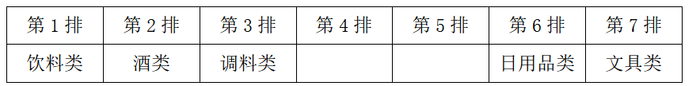

# 分析推理-位置排列（代入法）

考点：[[20-考点/判断推理/逻辑判断/分析推理-位置排列（代入法）|逻辑判断 / 分析推理-位置排列（代入法）]]

**问法模型**：题干问'以下哪项是可能的'→可能性选项优先用代入法，逐项代入全部约束验证，无矛盾者即为答案

## 推理链
1. 第1步：题干为7类商品排7排且饮料类固定第1排，条件（1）酒类在调料类之前、（2）文具类和调料类中间隔着3排（相距4个位置）、（3）粮油类在零食类之后中间隔着2排（相距3个位置）、（4）日用品类紧挨文具类前一排或后一排
2. 第2步：提问为'哪项是可能的'，采用代入法逐项验证，与全部条件无矛盾者当选
3. 第3步：代入A：零食在文具前一排，结合（4）得零食-文具-日用品先后相邻，可放第2、3、4排；由（2）调料类在第7排，由（3）粮油类在第5排，酒类放第6排，满足（1）酒（第6排）在调料（第7排）之前，全部条件无矛盾，可能为真
4. 第4步：代入B：粮油在调料前一排，由（3）零食在粮油前3个位置，即零食与调料也隔3排；于是零食与文具都必须与调料相距4个位置且同在其前侧，两位置重合，矛盾，排除
5. 第5步：代入C：日用品在文具前一排。若文具在调料前，因第1排被饮料占据且日用品须紧邻文具之前，文具只能第3排、调料第7排、日用品第2排，剩第4、5、6排无法满足（3）粮油与零食隔2排；若文具在调料后，则调料只能第3排、文具第7排、酒第2排、日用品第6排，剩第4、5排同样无法满足（3），排除
6. 第6步：代入D：酒在文具前一排，由（4）得酒-文具-日用品依次相邻；由（1）（2）文具只能在调料前且相距4个位置，推出文具第3排、调料第7排、酒第2排、日用品第4排，剩第5、6排无法满足（3），排除
7. 第7步：只有A项代入后与题干四个条件全部相容，故正确答案为A

**最快解法**：⚡ 代入法：直接代A项——零食第2排、文具第3排、日用品第4排、粮油第5排、酒第6排、调料第7排，四个条件逐一核对全部满足，立即锁定答案，无需枚举全排列

## 易错点
- ⚠ '中间隔着3排'须换算为两物相距4个位置（'隔着2排'=相距3个位置），直接把间隔排数当距离会排错位置
- ⚠ 忽略题干前提'饮料类固定第1排'，验证C、D时误把第1排当可用位置（如误以为文具可放第2排、日用品放第1排的方案可行）
- ⚠ B项验证时未察觉'零食与调料隔3排'与'文具与调料隔3排'在7排内不能同时成立（两者须与调料等距而位置重合）

## 母题抽象
> 🧩 当题干给出多个对象的前后顺序与间隔位置条件、且提问为'哪项可能/可能为真'时，用代入法逐项验证，与全部条件无冲突的选项即为答案；若问'必然/不可能'则改为找矛盾排除

**同类特征**：七类对象对应七个排、条件为前后顺序+间隔排数的组合、提问为'哪项是可能的'、某类对象位置固定（饮料类第1排）、含'紧挨''中间隔着…排'等位置约束词

## 相关题
（暂无）

---

### 题干
如果饮料类排在第1排，则以下哪项是可能的？

### 选项
- A. 零食类排在文具类前一排　✅
- B. 粮油类排在调料类前一排
- C. 日用品类排在文具类前一排
- D. 酒类排在文具类前一排

### 官方解析

第一步：分析题干条件。

（1）酒类排在调料类之前；

（2）文具类和调料类中间隔着3排；

（3）粮油类在零食类之后，中间隔着2排；

（4）日用品类紧挨在文具类前一排或者后一排。

第二步：根据题干条件进行推理。

若饮料类排在第1排，如下表：

提问为“可能”，所以考虑代入法。

代入A项，若零食类排在文具前一排，根据条件（4）可知，零食类、文具类和日用品类先后相邻，可以分别放在第2排、第3排和第4排；根据条件（2）可知，调料类在第7排；根据条件（3）可知，粮油类在第5排；此时酒类放在第6排，符合条件（1）；与题干所有条件均不矛盾，可能为真，当选。

代入B项，若粮油类排在调料类前一排，结合条件（3）可知，零食类和调料类中间隔着3排，这与条件（2）矛盾，排除；

代入C项，若日用品类排在文具类前一排，根据条件（2），文具类和调料类中间隔着3排，假设文具类在调料类前，一共只有7排，则文具类只能在第3排，调料类在第7排，日用品类在第2排，如图所示，现只剩下第4、5、6排空缺，与条件（3）矛盾，排除；

假设文具类在调料类后，根据条件（1），调料类只能在第3排，文具类在第7排，酒类在第2排，根据条件（4），日用品类在第6排，如图所示，现只剩下第4、5排空缺，与条件（3）矛盾，排除；

代入D项，若酒类排在文具类前一排，根据条件（4）可知，酒类、文具类和日用品类先后相邻；根据条件（1）、（2）可知，文具类只能在调料类前面，且为文具类×××调料类，进一步推出文具类在第3排，调料类在第7排，酒类在第2排，日用品类在第4排，如图所示，现只剩下第5、6排空缺，与条件（3）矛盾，排除。

故正确答案为A。

### 给定材料

某超市从前到后整齐排列着7排货架，放置着文具、零食、调料、日用品、酒、粮油和饮料7类商品，每类商品占据一排。已知：

（1）酒类排在调料类之前；

（2）文具类和调料类中间隔着3排；

（3）粮油类在零食类之后，中间隔着2排；

（4）日用品类紧挨在文具类前一排或者后一排。

