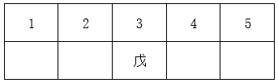

# 分析推理-排序组合（列表+假设法）

考点：[[20-考点/判断推理/逻辑判断/分析推理-排序组合（列表+假设法）|逻辑判断 / 分析推理-排序组合（列表+假设法）]]

**问法模型**：'根据上述信息，可以推出以下哪项'的组合排列题 → 采用先固定确定项、再分假设穷举并找所有情形共同结论的模型

## 推理链
1. 第1步：由条件（1）'戊是第3个被检查单位'，先固定戊=第3位
2. 第2步：由条件（2）（3）：第4位单位'既有批评也有表扬'，而'乙和丁得到的只有批评'，故第4位只能是甲或丙
3. 第3步：假设一（第4位是甲）：由条件（4）'检查甲单位是在检查丁单位之后'，丁只能排第1或第2位，戊（第3位）在丁之后
4. 第4步：假设二（第4位是丙）：甲、乙、丁分占第1、2、5位，由甲在丁之后可知丁不能是第5位（否则甲无处可排），丁只能在第1或第2位，戊（第3位）仍在丁之后
5. 第5步：两种假设下均必然得出'戊在丁之后'，即D成立
6. 第6步：排除其余选项：A中乙、丙在假设一可占第2、5位，顺序不定；B中假设二里甲可为第2位、在戊（第3位）之前，不必然；C中假设一丙可排第5位而在丁之后，不必然

**最快解法**：⚡ 列表法+假设法：先定戊=3，再用'只有批评的乙丁≠既有批评又有表扬的第4位'锁定第4位为甲或丙，两种假设下结合'甲在丁后'均推出丁只能在1或2位，戊=3必在丁后，直接选D

## 易错点
- ⚠ 忽略条件（2）（3）的隐含推理：只有批评的乙、丁不可能处于'既有批评也有表扬'的第4位
- ⚠ 只验证一种假设（如仅设第4位为甲）就匆忙下结论，未对两种假设都检验并找共同结论
- ⚠ 误选B：未注意到假设二（第4位为丙）中甲可排第2位、位于戊之前

## 母题抽象
> 🧩 当题干出现'若干对象按顺序排列+某位置属性限制+对象间相对先后条件'时，先固定确定项，再由限制条件排除不可能对象、分假设列举，最后取所有假设下均成立的结论作答

**同类特征**：周一至周五对应5个位置、戊是第3个、第4个既有批评也有表扬、乙和丁只有批评、甲在丁之后、可以推出以下哪项

## 相关题
- [[10-真题/判断推理/逻辑判断/1797328 翻译推理-逆否等价与'有的'命题换位连锁|1797328]]（山东 2016，相关度1）
- [[10-真题/判断推理/逻辑判断/4652519 分析推理-最大信息法+排除法（身份与住处匹配）|4652519]]（江苏 2022，相关度1）
- [[10-真题/判断推理/逻辑判断/4652546 翻译推理-递推串联（肯前必肯后）|4652546]]（江苏 2022，相关度1）

---

### 题干
上级检查组在某周的周一至周五检查了甲、乙、丙、丁、戊5个单位。已知：
（1）戊是第3个被检查单位；
（2）第4个被检查单位得到的既有批评也有表扬；
（3）乙和丁两个单位得到的只有批评；
（4）检查甲单位是在检查丁单位之后。
根据上述信息，可以推出以下哪项？

### 选项
- A. 检查乙单位是在检查丙单位之前
- B. 检查甲单位是在检查戊单位之后
- C. 检查丙单位是在检查丁单位之前
- D. 检查戊单位是在检查丁单位之后　✅

### 官方解析

本题为组合排列题。题干涉及排序，可优先考虑列表。

根据条件（1）可知：

根据条件（2）（3）可知：

4不是乙、丁，故4只能是甲、丙，即如下两种假设：

假设一：

根据条件（4）检查甲单位是在检查丁单位之后，可知：丁在1或2，此时戊在丁之后；

假设二：

根据条件（4）检查甲单位是在检查丁单位之后，可知：若满足甲在丁之后，则丁不在5，丁只能在1或2，此时戊在丁之后。

故正确答案为D。

### 给定材料
（无）
