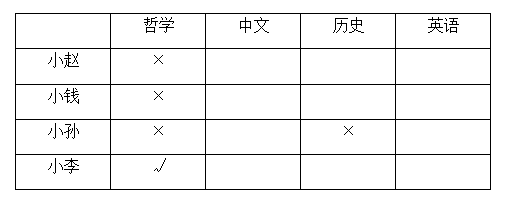
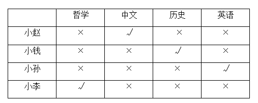

# 分析推理-最大信息法（列表排除匹配）

考点：[[20-考点/判断推理/逻辑判断/分析推理-最大信息法（列表排除匹配）|逻辑判断 / 分析推理-最大信息法（列表排除匹配）]]

**问法模型**：'据此，可以推出'→多人多属性匹配型分析推理，用交互条件做排除+最大信息法逐层锁定对应关系

## 推理链
1. 第1步：提取交互条件的隐含前提——对局/同行双方必是不同人，故由条件(1)'小孙和历史专业的下过围棋'得小孙≠历史专业
2. 第2步：由条件(3)'小钱和小孙曾和哲学专业的同学一起爬山'得小钱≠哲学、小孙≠哲学
3. 第3步：联立条件(2)'哲学专业的从没赢过'与条件(4)'小赵取胜'，若小赵是哲学则与'从没赢过'矛盾，故小赵≠哲学
4. 第4步：哲学专业排除小钱、小孙、小赵三人，唯一剩下小李，故小李=哲学
5. 第5步：由条件(2)哲学专业的只和中文专业的下过围棋，而条件(4)小李（哲学）与小赵下过围棋，搭桥得小赵=中文
6. 第6步：剩余历史、英语分配给小孙、小钱，由条件(1)小孙≠历史，故小孙=英语、小钱=历史
7. 第7步：对照选项，只有D'小李是学哲学的，小钱是学历史的'与推理结果完全一致

**最快解法**：⚡ 排除法+最大信息法：先收集全部否定信息（小孙≠历史、小钱≠哲学、小孙≠哲学、小赵≠哲学），锁定唯一确定项'小李=哲学'作为锚点；再用'哲学只和中文下过棋'与'小李小赵对局'搭桥得小赵=中文，最后按条件(1)分配剩余两人，直接锁定D

## 易错点
- ⚠ 误以为条件(1)中'各有输赢'意味着小孙可能就是历史专业者，忽略'小孙和历史专业的'对局表明二者必是不同人
- ⚠ 漏掉'从没赢过'与条件(4)'小赵取胜'的联合推理，导致无法排除小赵是哲学专业、卡在三人可能性上
- ⚠ 只验证D中'小李是哲学'就仓促选答案，未完整推出小钱=历史进行核对

## 母题抽象
> 🧩 当题干出现'多人+多专业（属性）+若干交互事实（谁和谁下棋/同行）'的特征时，先用交互双方必不同属性做排除，再用'只和某人交互+确定对局事实'搭桥锁定身份，列表推完四人后对照选项

**同类特征**：四人四专业匹配、下过围棋的交互条件、各有输赢、从没赢过、一起爬山、据此可以推出

## 相关题
- [[10-真题/判断推理/逻辑判断/2261881 翻译推理-必要条件翻译与逆否规则（递进串联）|2261881]]（湖北 2017，相关度1）
- [[10-真题/判断推理/逻辑判断/2263056 翻译推理-逆否规则（只有A才B翻译为B→A，否后必否前）|2263056]]（四川 2016，相关度1）
- [[10-真题/判断推理/逻辑判断/2452725 翻译推理-假言命题逆否等价（含确定信息代入）|2452725]]（江苏 2020，相关度1）
- [[10-真题/判断推理/逻辑判断/4630404 翻译推理-选言命题否一推一（含'至多-至少'约束翻译与假言连锁推理）|4630404]]（新疆 2021，相关度1）

---

### 题干
某校辩论队的小赵、小钱、小孙和小李分别是哲学、中文、历史和英语专业的，他们也都爱好下围棋。还知道如下情况：
（1）小孙和历史专业的下过围棋，并且各有输赢；
（2）哲学专业的只和中文专业的下过围棋，而且从没赢过；
（3）小钱和小孙二人曾和哲学专业的同学一起爬过山；
（4）某日小李、小赵下围棋，且小赵取胜。
据此，可以推出：

### 选项
- A. 小赵是学英语的，小钱是学历史的
- B. 小钱是学历史的，小孙是学中文的
- C. 小赵是学历史的，小孙是学英语的
- D. 小李是学哲学的，小钱是学历史的　✅

### 官方解析

第一步，分析题干条件。

（1）小孙和历史专业的下过围棋，并且各有输赢；

（2）哲学专业的只和中文专业的下过围棋，而且从没赢过；

（3）小钱和小孙二人曾和哲学专业的同学一起爬过山；

（4）某日小李、小赵下围棋，且小赵取胜。

第二步，根据题干条件进行推理，题干无确定信息，可以考虑最大信息法。由于对象和信息较多，为了使推理更加清晰，可以借助列表推理：

题干条件中小孙提到两次，根据条件（1）可知小孙不是历史专业，根据条件（3）可知小孙不是哲学专业；

题干条件中哲学提到两次，根据条件（3）可知小钱不是哲学专业，根据条件（2）和条件（4）可知小赵取胜，但哲学专业从没赢过，因此小赵不是哲学专业。

根据以上信息可知，小李为哲学专业，得到表格如下：

根据条件，已知小李为哲学专业，结合条件（2）和条件（4）可知，哲学专业的只和中文专业的下过围棋，而小李和小赵下过围棋，因此小赵是中文专业，进一步可知小孙是英语专业，最后推出小钱是历史专业，得到表格如下：

故正确答案为D。

### 给定材料
（无）
