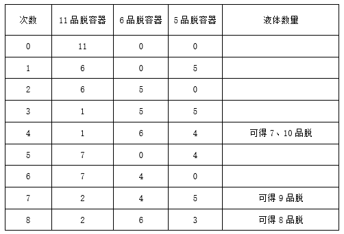

# 分析推理-数字条件推理（容器量取-倒水组合问题）

考点：[[20-考点/判断推理/逻辑判断/分析推理-数字条件推理（容器量取-倒水组合问题）|逻辑判断 / 分析推理-数字条件推理（容器量取/倒水组合问题）]]

**问法模型**：问'需要的液体数量可能是'且限定'两个容器都要利用到'→ 采用必要条件排除法：先排除可由单一容器直接得到的数值，再验证剩余数值能否组合量出

## 推理链
1. 第1步：提取条件——11品脱容器'装满了该液体'且'不满足他的需求'，另有刻度模糊的5品脱、6品脱容器，条件（3）'5品脱和6品脱的容器都要利用到'
2. 第2步：将条件（3）转化为排除规则——目标数量不能是仅用其中一个容器（或仅用已装满的11品脱容器）就能直接得到的数，即排除5（单用5品脱容器）、6（单用6品脱容器）、11（单用原11品脱容器，且题干明言11品脱'不满足他的需求'）
3. 第3步：逐项对照——A项含5、B项含6、D项含11，均与'两个容器都要利用到'矛盾，排除A、B、D
4. 第4步：验证C项可量取性——利用'倒满/倒空'操作与6-5=1品脱的差值：11倒满6、6倒满5后6中余1，将5倒回11得10；重复该操作每轮多量出1品脱，依次可在容器中量出9、8、7
5. 第5步：只有C项（7、8、9、10）的全部数值均需同时利用三个容器才能得到，故选C

**最快解法**：⚡ 排除法：抓住'5品脱和6品脱的容器都要利用到'这一必要条件，凡选项含5（A项）、含6（B项）、含11（D项，且11品脱已装满仍不满足需求）直接排除，唯一不含5、6、11的C项即为答案

## 易错点
- ⚠ 忽略'两个容器都要利用到'的必要条件限定，只判断数值能否倒出，误选含5或6的A、B项
- ⚠ 误以为容器'刻度模糊'就无法量取目标数量，忽视靠倒满/倒空操作及6-5=1品脱差值可逐步构造出各数量
- ⚠ 对每个数值逐一设计倒水步骤而浪费时间，未先用排除法一步锁定唯一选项

## 母题抽象
> 🧩 当题干出现'若干量具/容器必须全部利用才能得到目标量'的特征时，先排除可由单个量具直接得到的数值，再对剩余选项验证组合量取的可能性

**同类特征**：容器容积11、6、5品脱且刻度模糊、11品脱容器已装满且不满足需求、'两个容器都要利用到'的必要条件、问'可能是'的四数值组合选项、依靠倒满/倒空操作量取而非读刻度

## 相关题
（暂无）

---

### 题干
小张需要一定数量的特定液体。目前，小张有一个容积为11品脱、装满了该液体且刻度模糊的容器，不满足他的需求，于是他向好友小刚寻求帮助，小刚拿出了两个刻度模糊、容积分别为5品脱和6品脱的容器，说小张将这两个容器都利用到就可以得到想要的液体数量。
由此可以推出，小张需要的液体数量可能是：

### 选项
- A. 5品脱、7品脱、8品脱、10品脱
- B. 6品脱、7品脱、8品脱、9品脱
- C. 7品脱、8品脱、9品脱、10品脱　✅
- D. 8品脱、9品脱、10品脱、11品脱

### 官方解析

第一步：分析题干条件。

（1）有一个11品脱刻度模糊的容器，且此容器装满了特定溶液；

（2）有两个刻度模糊的容器分别为5品脱和6品脱；

（3）5品脱和6品脱容器都要利用到。

第二步：根据题干条件进行推理。

根据条件（3）可知，5品脱和6品脱的容器都要利用到，不能只使用其中一个，故小张需要的液体数量肯定不能是单独的5品脱、6品脱或11品脱，排除A、B、D三项；而C项中的液体数量都可以利用这三个容器得到，如下表所示：

故正确答案为C。

### 给定材料
（无）
