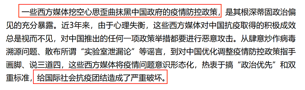

# 削弱论证-削弱论点（举例反例质疑推断，多选项削弱比直接性）

考点：[[20-考点/判断推理/逻辑判断/削弱论证-削弱论点（举例反例质疑推断，多选项削弱比直接性）|逻辑判断 / 削弱论证-削弱论点（举例反例质疑推断，多选项削弱比直接性）]]

**问法模型**：『以下哪项如果为真，最能质疑上述推断』且论点论据话题一致→优先削弱论点，找直接呈现'实际对立/不紧密'的实例反例，多项削弱时比直接性与针对性

## 推理链
1. 第1步：定位论点——'它（新冠肺炎疫情）会让世界各国变得更加紧密'
2. 第2步：定位论据——疫情是'全世界共同面临的重大问题'，各国'需要彼此汲取经验'（病毒性质、社会措施、医疗防护设备等）
3. 第3步：判断论证结构——论点论据均围绕'疫情与世界各国关系'，话题一致，优先考虑削弱论点而非切断论据
4. 第4步：排除A——A谈东亚应对好的原因是'有应对非典时合作的经验'，话题是应对效果归因，未触及'是否更紧密'，无法削弱
5. 第5步：排除B——B说'大家开始抱团取暖'，恰是解释疫情为何使各国更紧密，属补充论据的加强项
6. 第6步：对照C、D——C举实例：'中国就遭到少数西方媒体及政客恶意并令人惊讶的无端攻击'，直接呈现疫情下国家间的对立攻击，证明疫情未必使各国更紧密，削弱论点；D说国际文化交流'短期内很难恢复到疫情前水平'，从交流受阻角度也能削弱
7. 第7步：力度比较——C以具体实例直接揭示疫情期间国家间攻击与对立，直接否定'更加紧密'，比D的间接推断更直接，故选C

**最快解法**：⚡ 削弱论点优先法+找反例：先锁定论点'让世界各国更加紧密'，直接扫选项找'疫情下国家间不合作/对立'的实例——C项'中国遭无端攻击'即最直接反例；B是加强、A话题无关，D虽削弱但属间接，排除法秒选C

## 易错点
- ⚠ 误选D：D项'交流冲击难恢复'确有削弱力度，但属'交流受阻→推断不紧密'的间接削弱，C项实例直接呈现对立，直接性更强
- ⚠ 误选B：将'担忧恐惧、抱团取暖'误判为削弱，实际是对论点的解释加强
- ⚠ 纠结论据：忽视'论点论据话题一致时优先削弱论点'的原则，错误地去攻击'汲取经验'这一论据

## 母题抽象
> 🧩 当题干出现'共同问题→需要合作→（由此看来）会更紧密'式的归纳推断，问'最能质疑'时，用削弱论点法，优先找直接呈现'实际对立/反面实例'的选项；若多项均能削弱，选针对论点最直接、以具体实例说话的一项

**同类特征**：最能质疑上述推断、由此看来（引出论点的标志词）、论点论据话题一致、削弱论点-举反例、多选项削弱比较直接性

## 相关题
- [[10-真题/判断推理/逻辑判断/12536473 论证评价-加强论证（选非题，补充论据型）|12536473]]（四川 2024，相关度1）
- [[10-真题/判断推理/逻辑判断/13504381 加强论证-补充论据（反面-对照论据）|13504381]]（云南 2025，相关度1）
- [[10-真题/判断推理/逻辑判断/13504386 加强论证-补充论据（安全有效性论证）|13504386]]（云南 2025，相关度1）
- [[10-真题/判断推理/逻辑判断/13504459 论证加强-前提假设（必要条件-否定代入）|13504459]]（新疆 2025，相关度1）
- [[10-真题/判断推理/逻辑判断/13504503 削弱论证-削弱论点（否定功能实现的前提条件）|13504503]]（河北 2025，相关度1）

---

### 题干
新冠肺炎疫情已成为一种全球性现象，它迅速席卷各个国家，是全世界共同面临的重大问题。被波及的各国需要彼此汲取经验，其中包括关于病毒的性质、彻底消灭或遏制病毒所必需的社会措施以及抗疫所需的医疗和防护设备等等。由此看来它会让世界各国变得更加紧密。
以下哪项如果为真，最能质疑上述推断？

### 选项
- A. 东亚地区应对新冠肺炎疫情好于其他国家的原因之一是他们有应对“非典”时合作的经验
- B. 新冠肺炎疫情带来的威胁如此之大，引发了社会所有阶层的担忧和恐惧，大家开始抱团取暖
- C. 自从新冠肺炎疫情发生以来，中国就遭到少数西方媒体及政客恶意并令人惊讶的无端攻击　✅
- D. 新冠肺炎疫情给国际文化、经济等方面交流带来了巨大冲击，短期内很难恢复到疫情前水平

### 官方解析

第一步：找出论点和论据。

论点：它（新冠肺炎疫情）会让世界各国变得更加紧密。

论据：新冠肺炎疫情已成为一种全球性现象，它迅速席卷各个国家，是全世界共同面临的重大问题。被波及的各国需要彼此汲取经验，其中包括关于病毒的性质、彻底消灭或遏制病毒所必需的社会措施以及抗疫所需的医疗和防护设备等等。

本题的论点和论据都在讨论新冠肺炎疫情和世界各国变得更加紧密的关系，论点论据话题一致，优先考虑削弱论点。

A项：该项说的是东亚地区应对新冠肺炎疫情好于其他国家的原因，论点说的是新冠肺炎疫情会让世界各国变得更加紧密，话题不一致，无法削弱，排除；

B项：该项说的是新冠肺炎疫情带来的威胁引发担忧和恐惧，大家开始抱团取暖，解释了为什么新冠肺炎疫情会让世界各国变得更加紧密，补充论据，为加强项，无法削弱，排除；

C项：该项说的是自从新冠肺炎疫情发生以来，“中国”就遭到“少数西方媒体及政客”恶意的无端攻击，有的国家会被无端攻击，说明新冠肺炎疫情并不一定会让世界各国变得更加紧密，削弱论点，保留；

D项：该项说的是新冠肺炎疫情给国际文化、经济等方面交流带来了巨大冲击，短期内很难恢复到疫情前水平，因为交流难，新冠肺炎疫情并不一定会让世界各国变得更加紧密，削弱论点，保留。

本题CD项都有削弱的力度，但是C项更直接地通过实例揭示疫情期间国家间的攻击与对立，尤其是还用了中国举例；另外我们通过查询原文，如下所示，原文也是直接表达了“一些西方媒体抹黑中国给国际抗疫团结造成了破坏”，所以本题答案给到C项。

故正确答案为C。

### 给定材料
（无）

> [!warning] 疑点（官方解析可能有误，待人工复核）
> 官方解析自认C、D均有削弱力度，最终选择依据除'更直接'外还引用了'查询原文'的表述佐证，而'查询原文'并非考场可复现的判定依据；D项'交流巨大冲击短期难恢复'对论点'更紧密'的直接削弱力度与C较为接近，力度比较存在一定主观空间，但按官方答案仍以C为准
