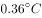

# 加强论证-补充论据（加强力度对比）

考点：[[20-考点/判断推理/逻辑判断/加强论证-补充论据（加强力度对比）|逻辑判断 / 加强论证-补充论据（加强力度对比）]]

**问法模型**：'以下哪项为真，最能证明上述观点'→加强型论证题：先核对论点与论据话题是否一致，再在话题一致项中比较补充论据的力度强弱

## 推理链
1. 第1步：提取论点——'全球变暖的步调并没有加速'；论据——最近50年温升速率均不超过（某值）/10年，且2011～2020年、2001～2010年相对于1850～1900年平均值的10年温升速率也不超过该值
2. 第2步：判断论证结构——论点和论据都在谈温度/温升速率，话题一致，按规则加强优先考虑补充论据
3. 第3步：排除C项——C说'不同区域受全球变暖影响存在差异'，讨论的是变暖后的影响分布，与'变暖是否加速'话题不一致，为无关项
4. 第4步：排除D项——D说二氧化碳浓度高于200万年来任何时候、海平面上升速度比过去300年任何世纪都快，说明变暖在加速，属削弱项
5. 第5步：分析A项——A补充1980～1999、1961～1990两个基准的平均值温度变化数据，可推出变暖步调未加速，能加强，但与题干论据同质，都是'基于既有历史数据的比较'
6. 第6步：分析B项——B补充新论据：多国强化降低GDP能源强度和二氧化碳强度，按当前控排力度，气温升幅加快可能性不大，从成因层面支持'步调不加速'
7. 第7步：力度对比——A与题干论据类似、属同质数据补充，B是新增的、更明确的原因性论据，B加强力度更强，故选B

**最快解法**：⚡ 

## 易错点
- ⚠ 误选A：认为A的数据与题干'温升速率'更贴合，忽略'最能证明'要求比较加强力度——与题干论据同质的补充弱于新增论据
- ⚠ 误选C：被'全球变暖'等表面词汇吸引，未识别其讨论的是'区域影响差异'而非'是否加速'，话题不一致
- ⚠ 误判D：把'海平面上升速度比过去300年任何世纪都快'当作中性事实陈述，未意识到它恰恰证明变暖在加速，方向相反属削弱

## 母题抽象
> 🧩 当加强题中论点与论据话题一致（都在说同一指标）时，用'补充论据'思路，优先选提供新增原因性/前瞻性论据的选项，排除话题漂移项和反向削弱项，并与题干论据同质的选项做力度对比

**同类特征**：最能证明/最能支持、论点论据话题一致、全球变暖的步调并没有加速、温升速率数据比较、需要比较A、B加强力度、补充论据优先

## 相关题
- [[10-真题/判断推理/逻辑判断/12101008 加强论证-补充论据（搭桥建立因果机制）|12101008]]（江苏 2025，相关度1）
- [[10-真题/判断推理/逻辑判断/12536473 论证评价-加强论证（选非题，补充论据型）|12536473]]（四川 2024，相关度1）
- [[10-真题/判断推理/逻辑判断/13504381 加强论证-补充论据（反面-对照论据）|13504381]]（云南 2025，相关度1）
- [[10-真题/判断推理/逻辑判断/13504386 加强论证-补充论据（安全有效性论证）|13504386]]（云南 2025，相关度1）
- [[10-真题/判断推理/逻辑判断/13504459 论证加强-前提假设（必要条件-否定代入）|13504459]]（新疆 2025，相关度1）

---

### 题干
全球变暖带来的气候变化日益显著，成为影响人类发展前景的决定性因素之一。从观测和古气候重建的资料来看，人类活动对地球气候系统的影响已经非常深刻。数据显示，最近50年来的温升速率都不超过/10年。即便从最近的20年来看，2011～2020年相对于1850～1900年平均值的温度变化是，2001～2010年相对于1850～1900年平均值的温度变化是，10年的温升速率不超过。根据上述数据来看，全球变暖的步调并没有加速。
以下哪项为真，最能证明上述观点？

### 选项
- A. 
最近20年相对于1980～1999年平均值的温度变化是，相对于1961～1990年平均值的温度变化是

- B. 
目前多国出台政策强化降低GDP能源强度和二氧化碳强度的力度和幅度，按照现在人类控制排放的力度，全球气温升幅加快的可能性不大
　✅
- C. 
不同区域受到全球气候变暖带来的影响存在差异，比如1951～2019年中国的增温速度高于同期全球平均水平

- D. 
当前大气中的二氧化碳浓度高于200万年以来的任何时候，1900年以来的全球平均海平面上升速度比过去300年中任何一个世纪都快

### 官方解析
第一步：找出论点和论据。
论点：全球变暖的步调并没有加速。
论据：最近50年来的温升速率都不超过/10年。即便从最近的20年来看，2011～2020年相对于1850～1900年平均值的温度变化是，2001～2010年相对于1850～1900年平均值的温度变化是，10年的温升速率不超过。
本题论点说的是全球没有加速变暖，论据说的是全球过去50年的温升速率都不超过/10年，论点和论据都在说温度，话题一致，加强优先考虑补充论据。
第二步：逐一分析选项。
A项：该项说的是最近20年对于1980～1999以及1961～1990年的平均值温度变化，1980～1999的平均值温度变化为，1961～1990的平均值温度变化为，说明1980～1999比1961～1990的温度要低，进而补充论据说明全球变暖的步调没有加速，可以加强，保留；
B项：该项说的是目前多国已经出台了政策，按照现在人类控制排放的力度，全球气温升幅加快的可能性不大，那全球温升速率加快的可能性也就不会大，进而全球变暖的步调也就不会加速，补充论据，可以加强，保留；
C项：该项说的是不同区域受到全球变暖带来的影响存在差异，强调的是全球变暖以后不同区域受到的影响，但题干在讨论全球变暖有没有加速，二者话题不一致，为无关项，无法加强，排除；
D项：该项说的是当前大气中的二氧化碳浓度比过去高，全球平均海平面上升速度比过去300年中任何一个世纪都快，说明全球变暖在加速，有削弱力度，无法加强，排除。
对比A、B两项，A补充的论据和题干论据类似，都是基于之前的数据得到的论点，B项是补充新的论据，B项比A项更明确。
故正确答案为B。

### 给定材料
（无）
