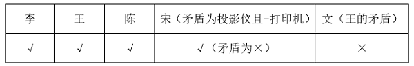
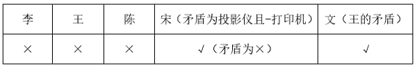
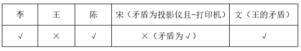
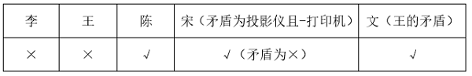

# 真假推理-穷举假设法（复合命题真值判定，选非题）

考点：[[20-考点/判断推理/逻辑判断/真假推理-穷举假设法（复合命题真值判定，选非题）|逻辑判断 / 真假推理-穷举假设法（复合命题真值判定，选非题）]]

**问法模型**：问法'可知办公室最终的采购不可能……'（选非型）→ 采购结果未定、各人意见真假无法直接判定时，对全部采购组合穷举假设，统计每种组合下'意见不冲突'的人数，找出不可能出现的数值。

## 推理链
1. 第1步：符号化五人意见——李=必买投影仪；王=打印机且投影仪；陈=打印机或投影仪；宋=投影仪→打印机；文='至多买一样'=并非（打印机且投影仪）。
2. 第2步：识别结构关系——王（都买）与文（至多买一样）为矛盾关系，任何采购结果下必一真一假，故'不冲突人数'中二人恒占且仅占1个。
3. 第3步：题干无法直接确定采购结果，采购共4种组合（两样都买／只买打印机／只买投影仪／两样都不买），用假设法逐一验证。
4. 第4步：假设两样都买——李真、王真、陈真、宋真（前件真后件真）、文假→4人不冲突，A项可能，排除A。
5. 第5步：假设只买打印机——李假、王假、陈真、宋真（前件假为真）、文真→3人不冲突；假设只买投影仪——李真、王假、陈真、宋假、文真→3人不冲突，B项可能，排除B。
6. 第6步：假设两样都不买——李假、王假、陈假、宋真（前件'买投影仪'为假，条件命题为真）、文真（零件≤'至多一样'）→2人不冲突，C项可能，排除C。
7. 第7步：四种组合下'不冲突人数'只能取4、3、3、2，取不到1，选非题故答案为D。

**最快解法**：⚡ 矛盾定性+反证速判：①王与文矛盾，任何结果下必恰有1人不冲突；②反证'仅1人不冲突'（D项）：则李、陈、宋须全部冲突；李冲突⇒没买投影仪⇒宋'若买投影仪则买打印机'前件假、命题为真不冲突，矛盾——故'与其中1人不冲突'不可能，直接锁定D。再用穷举验证A/B/C均可能：都买→4人、只买一样→3人、都不买→2人。

## 易错点
- ⚠ 误判宋的条件命题真假：'若买投影仪则买打印机'在'没买投影仪'时前件假、命题为真（空真），易误判为冲突。
- ⚠ 误解'至多买一样'：两样都不买也满足'至多一样'，易误以为必须买一样；同理李的意见是'无条件必买投影仪'而非条件句。
- ⚠ 漏看选非问法'不可能'，或穷举时漏掉'两样都不买'这一组合，导致误判C项不可能而错选。

## 母题抽象
> 🧩 当题干出现多人对同一待定事实各作复合断言（含联言、选言、条件、矛盾对）且问'哪种结果不可能'时，先符号化各断言并锁定矛盾对，再穷举全部可能结果、统计'断言为真（不冲突）'的人数，逐一排除可能的选项，剩余项即答案。

**同类特征**：多人（5人）对同一采购方案各表意见、意见混合联言、选言、条件命题且存在矛盾对（王vs文）、问法为'不可能'（选非题）、事实结果未定，需假设法穷举、采购组合有限：2项采购共4种情况、条件命题'若…则…'的真值（空真）是判定关键

## 相关题
（暂无）

---

### 题干
某处室共有李、王、陈、宋、文5人，办公室就该处室是否购买打印机和投影仪征询5人意见。5人表示如下：
李：不管买不买打印机，都要买投影仪；
王：两样都买；
陈：两样至少买一样；
宋：若买投影仪，则一定也买打印机；
文：两样至多买一样。
办公室经过综合考虑，最终完成了采购工作。
根据以上信息，可知办公室最终的采购不可能        。

### 选项
- A. 与其中4人的意见不冲突
- B. 与其中3人的意见不冲突
- C. 与其中2人的意见不冲突
- D. 与其中1人的意见不冲突　✅

### 官方解析

第一步：分析题干条件。

李：投影仪；

王：投影仪 且 打印机；

陈：投影仪 或 打印机；

宋：投影仪打印机；

文：投影仪 或 打印机。

第二步：根据题干条件进行推理。

问题为“不可能”，且根据题干条件无法判断满足了几个人的意见，优先考虑假设法。

采购情况共分为4种，分别是投影仪 且 打印机，投影仪 且 打印机，投影仪 且 打印机，打印机 且 投影仪。分情况代入判断5个人意见的真假，其中王与文为矛盾关系，必有一真必有一假，可同步判断；宋的意见“投影仪打印机”为条件关系，无法直接判断，可先判断其矛盾“投影仪 且 打印机”的真假，再判断宋的意见的真假。

第一种情况：投影仪 且 打印机，具体情况如下表所示，此时购买情况与其中4人的意见不冲突，故A项可能成立，排除A项；

第二种情况：投影仪 且 打印机，具体情况如下表所示，此时购买情况与其中2人的意见不冲突，故C项可能成立，排除C项；

第三种情况：投影仪 且 打印机，具体情况如下表所示，此时购买情况与其中3人的意见不冲突，故B项可能成立，排除B项；

第四种情况：打印机 且 投影仪，具体情况如下表所示，此时购买情况与其中3人的意见不冲突，与第三种情况相同，可排除B项。

综合上述四种情况可知，A、B、C三项都是可能的，只有D项不可能。

本题为选非题，故正确答案为D。

### 给定材料
（无）

> [!warning] 疑点（官方解析可能有误，待人工复核）
> 官方解析文本因否定符号丢失，四种采购情况均显示为'投影仪且打印机'；按计数（4、2、3、3）及'与第三种情况相同'的表述，实际应为'两样都买→4人／两样都不买→2人／只买其一→3人'。经核验四种情况的'不冲突人数'为4、3、3、2，与解析数值一致，结论'仅D不可能'正确，不影响答案。

<!-- CODEX-ANSWER-REVIEW:BEGIN -->
### 本次独立复核

**复核状态：** `resolved`（答案与解析已核定）

**计分答案：** D（可计分）

**复核解析：**

穷举打印机(P)、投影仪(T)四种采购状态并核对五人意见：T与P都买，李、王、陈、宋赞同，共4人；都不买，仅宋(条件句空真)和文赞同，共2人；只买投影仪，李、陈、文赞同，共3人；只买打印机，陈、宋、文赞同，共3人。可实现的“不冲突人数”为2、3、4，不可能为1，故选D。旧解释把两种“只买其一”的人数写错，误答B。

**相关信息：**

把条件句与析取句逐种代入；“不管买不买打印机，都买投影仪”在两种含投影仪的情况为真。

**题源依据：** [固定版本原题](https://github.com/Mentat-Uran/kaogongzhentizhengliu/blob/84ab93d4b64b61d897bece8a1c0a5bab06b4feb2/10-%E7%9C%9F%E9%A2%98/%E5%88%A4%E6%96%AD%E6%8E%A8%E7%90%86/%E9%80%BB%E8%BE%91%E5%88%A4%E6%96%AD/5423772%20%E7%9C%9F%E5%81%87%E6%8E%A8%E7%90%86-%E7%A9%B7%E4%B8%BE%E5%81%87%E8%AE%BE%E6%B3%95%EF%BC%88%E5%A4%8D%E5%90%88%E5%91%BD%E9%A2%98%E7%9C%9F%E5%80%BC%E5%88%A4%E5%AE%9A%EF%BC%8C%E9%80%89%E9%9D%9E%E9%A2%98%EF%BC%89.md)；固定内容 commit `84ab93d4b64b61d897bece8a1c0a5bab06b4feb2`，Markdown blob `1fa20856a1cfd2cdc372e67353d5e2b0b952d25c`。
<!-- CODEX-ANSWER-REVIEW:END -->
