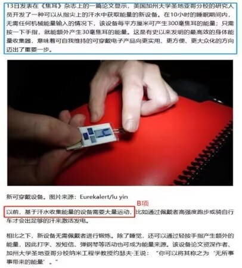

# 加强论证-补充论据（隐含比较型，补比较基线择优）

考点：[[20-考点/判断推理/逻辑判断/加强论证-补充论据（隐含比较型，补比较基线择优）|逻辑判断 / 加强论证-补充论据（隐含比较型，补比较基线择优）]]

**问法模型**：问'哪项最能支持论述'→ 先拆论点论据，发现论点含'更实用、更方便'的隐含比较，优先选能补上'与此前设备对比'的选项

## 推理链
1. 第1步：提取论点——新设备的出现意味着'可自我维持的可穿戴电子产品'向'更实用、更方便、更大众化'迈出重要一步，'更'字隐含与此前设备的比较关系
2. 第2步：提取论据——'10小时的睡眠期间内，无需任何机械能量输入'每平方厘米产生300毫焦耳，'按一下手指'额外产生30毫焦耳，只陈述新设备现状，未提供比较对象
3. 第3步：论证分析——论据与论点话题一致（都是新设备发电），加强优先补充论据，且最好补上'以前设备如何'这条比较基线
4. 第4步：A项说电能'储存在小电容器中并释放到其他设备'，未涉及与此前设备的比较，与论点比较关系话题不一致，排除
5. 第5步：B项指出'此前基于汗水收集能量的设备需要佩戴者大量运动出足够的汗来激活发电'，与论据'睡眠期间无需任何机械能量输入即可发电'形成今昔对比，直接支撑'更实用、更方便'，保留
6. 第6步：C项说手指汗量是其他部位的'100到1000倍'，但未说明汗能否转化为能量使设备更便携，未触及与旧设备的比较，为不明确项，排除
7. 第7步：D项举受试者'10小时睡眠收集近400毫焦耳'为例，补充论据证明设备确能发电，但仍是当前设备情况，未回应论点中的比较关系
8. 第8步：对比B、D——论点存在'现在与以前设备'的比较关系，B补充此前设备情况，D仅举当前例子，择优选B

**最快解法**：⚡ 抓'更'字比较法+排除法：论点'更实用、更方便、更大众化'隐含与以前设备的对比→加强项需补'此前设备'基线；快速扫描选项，只有B含'此前'并与论据'睡眠无需机械输入'构成今昔反差，直接锁定B（D只是当前设备的例子，力度弱于B）

## 易错点
- ⚠ 忽略论点'更实用、更方便'中隐含的与此前设备的比较关系，误选D（D仅举例证明当前设备能发电，未涉及'更'的比较基线）
- ⚠ 误选C：手指汗量100-1000倍看似加强来源优势，但未建立'汗→发电→更方便'链条且无今昔对比，属不明确项
- ⚠ 误选A：电能可储存释放看似'实用'，但只是设备功能描述，与论点的比较关系话题不一致，属无关项

## 母题抽象
> 🧩 当论点出现'更/相比此前/迈出重要一步'等隐含比较特征时，用'补比较基线'法加强，优先选含'此前/以前/传统'表述且与论据形成今昔反差的选项，而非仅陈述当前情况的举例项

**同类特征**：论点含'更实用、更方便、更大众化'隐含比较、论据只描述新设备现状无对比对象、无需机械能量输入即可发电、睡眠期间从指尖汗水获取能量、问法为'最能支持'、需在两个补充论据选项间比较择优

## 相关题
- [[10-真题/判断推理/逻辑判断/10204620 加强论证-只有论点补充论据（因果解释型支持）|10204620]]（黑龙江 2024，相关度1）
- [[10-真题/判断推理/逻辑判断/12101003 加强论证-无据加强（补充论据+强度比较）|12101003]]（江苏 2025，相关度1）
- [[10-真题/判断推理/逻辑判断/12881965 论证加强-搭桥（补足论据与论点的话题断裂）|12881965]]（广东 2025，相关度1）
- [[10-真题/判断推理/逻辑判断/15137631 加强论证-补充论据（排除他因-主体话题一致性）|15137631]]（湖北 2024，相关度1）
- [[10-真题/判断推理/逻辑判断/19526265 加强论证-补充论据（因果搭桥）|19526265]]（国考 2026，相关度1）

---

### 题干
研究人员开发了一种可以从指尖上的汗水中获取能量的新设备。在10小时的睡眠期间内，无需任何机械能量输入的情况下，该设备每平方厘米可产生300毫焦耳的能量；只需按一下手指，就能额外产生30毫焦耳的能量。这意味着可自我维持的可穿戴电子产品向更实用、更方便、更大众化的方向迈出了重要一步。
以下哪项如果为真，最能支持上述论述？

### 选项
- A. 新设备产生的电能可被储存在小电容器中，并在需要时释放到其他设备
- B. 此前基于汗水收集能量的设备需要佩戴者大量运动出足够的汗来激活发电　✅
- C. 手指是身体24小时的“汗水工厂”，产生的汗量是其他部位的100到1000倍
- D. 一名受试者在10小时睡眠中收集了近400毫焦耳的能量，这足以为一块电子表提供24小时电力

### 官方解析

第一步：找出论点和论据。

论点：可自我维持的可穿戴电子产品向更实用、更方便、更大众化的方向迈出了重要一步。

论据：在10小时的睡眠期间内，无需任何机械能量输入的情况下，该设备每平方厘米可产生300毫焦耳的能量；只需按一下手指，就能额外产生30毫焦耳的能量。

论据讨论的是睡眠期间可通过手指让新设备产生能量，论点说的是新设备的出现意味着可自我维持的可穿戴电子产品变得更实用、更方便、更大众化了，论据和论点的话题一致，加强优先考虑补充论据。

第二步：逐一分析选项。

A项：选项指出新设备产生的电能可以被储存并能释放到其他设备，但论点说的是新设备的出现意味着可自我维持的可穿戴电子产品变得更实用、更方便、更大众化了，话题不一致，为无关项，无法加强，排除；

B项：选项指出此前的设备需要大量出汗激活发电，而现有论据表明现在的设备只需要指尖上的少量汗水即可激活，说明可穿戴电子产品确实向更实用、更方便、更大众化的方向发展了，补充论据，可以加强，保留；

C项：选项指出手指产生的汗量比其他部位高，但是没有提及手指产生的汗是否能转化成能量，进而让这个设备更便携，为不明确项，无法加强，排除；

D项：选项举了一名受试者的例子证明该新设备确实可以在人们睡眠期间产生能量，补充论据，可以加强，保留。

对比B、D两项，本题论点中存在现在和以前设备之间的比较关系，B项补充了此前设备的情况，D项虽然举了一个例子但仍然在表述当前设备的情况，因此择优选择B项。注：B选项属于原文中的论述原话，用于说明可穿戴电子产品确实向更实用、更方便、更大众化的方向发展了，如下图所示。

 故正确答案为B。

### 给定材料
（无）
