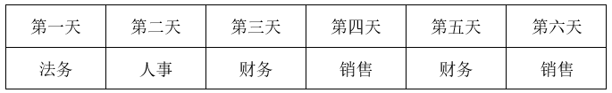

# 分析推理-排班匹配（代入排除法）

考点：[[20-考点/判断推理/逻辑判断/分析推理-排班匹配（代入排除法）|逻辑判断 / 分析推理-排班匹配（代入排除法）]]

**问法模型**：问法为'第一天、第六天可安排的值班人员可能分别来自'（求'可能'项）→ 将各选项代入首尾两天，用全部排班条件逐项检验相容性，排除矛盾项、留下能自洽安排者

## 推理链
1. 第1步：从题干提取设定与四条要求：6天每天1人值班、6个部门各推荐2人（每部门至多出2人）、（1）法务不排在第二天和第四天、（2）后勤安排在法务前一天、（3）研发安排在后勤前一天、（4）第三天和第五天安排财务
2. 第2步：因提问为'可能'，采用代入法：把每个选项当作第一天、第六天的值班部门，沿'研发→后勤→法务'的相邻先后关系逐日连锁推演，看与（1）～（4）是否冲突
3. 第3步：代入A项'第一天后勤、第六天法务'：由条件（2），第一天为后勤则第二天为法务，与条件（1）法务不在第二天冲突，排除
4. 第4步：代入B项'第一天法务、第六天销售'：因第三、五天已是财务，由条件（2）（3）知第二天和第四天不能是后勤（其次日应为法务）、不能是研发（其次日应为后勤），再由条件（1）二、四天不能是法务，故二、四天可排人事或销售，如'法务、人事、财务、销售、财务、销售'即完全自洽，当选
5. 第5步：代入C项'第一天财务、第六天销售'：第一天与第三、五天共需3名财务值班，超过'6个部门各推荐2人'中财务部至多2人的上限，排除
6. 第6步：代入D项'第一天研发、第六天人事'：由条件（3）得第二天为后勤，再由条件（2）得第三天为法务，与条件（4）'第三天安排财务'直接冲突，排除
7. 第7步：仅B项与全部条件相容，故正确答案为B

**最快解法**：⚡ 代入排除法＋'研发→后勤→法务'连锁推演：先看C项，第一、三、五天均为财务即超'每部门2人'上限秒排；再对A、D沿'前一天部门决定后一天部门'推得第二天为法务/第三天为法务，与'法务不在第二天''第三天是财务'矛盾排除；B项只需确认第二、四天可放人事或销售即当选

## 易错点
- ⚠ 把条件（1）方向读反，误解为'法务就排在第二、四天'，会误认为A项可行
- ⚠ 漏用'6个部门各推荐2人'的隐藏上限：C项需3名财务即超员，这一点最易被忽略
- ⚠ 连锁关系方向搞反：是'后勤的次日为法务、研发的次日为后勤'，而非法务/后勤的前一天必须有人值班；且只从12人中选6人，部门可以整个不出场

## 母题抽象
> 🧩 当题干给出'某部门排在另一部门前一天/某天不能排某部门/某两天已固定'类排班约束且问'可能'时，用代入排除法：将选项代入首尾位置，沿相邻先后关系逐日连锁推演，与已定日期或禁止日期冲突即排除，能给出一个自洽安排者当选

**同类特征**：6天假期每天1人值班、6个部门各推荐2人（每部门至多2人）、法务不排在第二天、第四天、后勤值班在法务前一天、研发值班在后勤前一天、第三天第五天安排财务

## 相关题
- [[10-真题/判断推理/逻辑判断/5445808 分析推理-日程排班约束推理（相邻位置联动+必然性结论·选非题）|5445808]]（国考 2023，相关度1）

---

### 题干
如果在第三天、第五天分别安排两个财务部门的人值班，则第一天、第六天可安排的值班人员可能分别来自：

### 选项
- A. 后勤部门和法务部门
- B. 法务部门和销售部门　✅
- C. 财务部门和销售部门
- D. 研发部门和人事部门

### 官方解析

第一步：分析题干条件。

6天假期每天需安排一人值班，6个部门各推荐2人，从12人中选择6人，每人值班一天。安排要求如下：

（1）法务部第二、四天；

（2）后勤值班后勤安排在法务前一天；

（3）研发值班研发安排在后勤前一天；

（4）在第三天、第五天分别安排两个财务部门的人值班。

第二步：根据题干条件进行推理。

提问方式为“可能”，优先使用代入法。

代入A项：如果第一天、第六天安排的值班人员分别来自后勤部门和法务部门，根据条件（2）后勤值班后勤安排在法务前一天，可知第二天为法务，不满足条件（1），排除；

代入B项：如果第一天、第六天安排的值班人员分别来自法务部门和销售部门，根据条件（4）在第三天、第五天分别安排财务，根据条件（2）后勤值班后勤安排在法务前一天，可知第二天和第四天不能安排后勤，根据条件（1），可知第二天和第四天不能安排法务，根据条件（3）研发值班研发安排在后勤前一天，可知第二天和第四天不能安排研发，所以第二天和第四天可以安排人事或者销售，可进行如下安排，满足题干条件，当选；

代入C项：如果第一天、第六天安排的值班人员分别来自财务部门和销售部门，此时第一天、第三天和第五天安排的值班人员均来自财务部门，不符合题干条件“6个部门各推荐2人”，不满足题干条件，排除；

代入D项：如果第一天、第六天安排的值班人员分别来自研发部门和人事部门，根据条件（3）研发值班研发安排在后勤前一天，可知第二天的值班人员来自后勤部门，根据条件（2）后勤值班后勤安排在法务前一天，可知第三天的值班人员来自法务部门，此时不符合条件（4）“第三天安排财务部门的人值班”，不满足题干条件，排除。

故正确答案为B。

### 给定材料

6天休假期间，单位需要每天安排一人值班。财务、研发、人事、后勤、法务和销售6个部门各推荐了2人，值班人员从这12人中选择，每人至多值班一天。安排要求：

（1）第二天和第四天不安排法务部门的人值班；

（2）若安排后勤部门的人值班，则只能安排在法务部门的人值班的前一天；

（3）若安排研发部门的人值班，则只能安排在后勤部门的人值班的前一天。

> [!warning] 疑点（官方解析可能有误，待人工复核）
> 题干转录的条件（1）写作'法务部第二、四天'，但官方解析实际按'第二天和第四天不能安排法务'使用（A项因'第二天为法务'被判违反条件（1），B项中二、四天被排除法务）；若按'法务排在第二、四天'理解，A、B两项的解析推理均不成立。疑为题干原条件是'法务部门的人不能安排在第二天和第四天值班'，官方答案B在该口径下推理自洽，无需改判。
