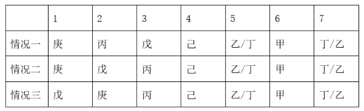

# 分析推理-排序定位（隐含下界+先于关系压缩位置）

考点：[[20-考点/判断推理/逻辑判断/分析推理-排序定位（隐含下界+先于关系压缩位置）|逻辑判断 / 分析推理-排序定位（隐含下界+先于关系压缩位置）]]

**问法模型**：问'哪两人不可能相邻'→先确定各元素的位置区间/唯一位置，再逐一验证各选项组合是否存在可行的相邻排列，选出始终不相邻的一对

## 推理链
1. 第1步：从条件(2)'在己之前进行面试的人中恰好有两名硕士'与条件(1)'不存在相邻两人都是硕士'提取隐含前提：若己之前只有2人，则这两人都是硕士且相邻，违反(1)，故己之前至少有3人，己排在第4位或更后
2. 第2步：结合条件(2)'己的面试先于乙和丁'和条件(3)'甲是第6个'，甲、乙、丁共3人都排在己之后；若己排第5位，其后仅剩2个位置无法容纳3人，矛盾，故己恰为第4位
3. 第3步：锁定己=第4位后，第5、6、7位由甲(第6)、乙、丁填充，第1、2、3位只能由丙、戊、庚填充
4. 第4步：结合条件(4)'庚的面试在丙之前'，丙只能占第2或第3位（丙不可能越过己到后三位），故庚只能排第1或第2位，永远进不了第3位
5. 第5步：庚最靠后也在第2位，与第4位的己之间必隔1人（第3位是戊或丙），故己和庚在任何排列中都不相邻
6. 第6步：验证其余选项均可行：戊(3)与己(4)相邻（A可行）；戊(2)与丙(3)相邻（B可行）；乙(5)与己(4)相邻（C可行）；故不可能相邻的只有己和庚，选D

**最快解法**：⚡ 定位法+极值分析：由'己前恰好2硕士+不得相邻硕士'推出己前≥3人，再由'己后必有甲乙丁3人'取等号定死己=第4位；随后用'庚在丙前'把庚压到第1或第2位，直接看出己(第4)与庚(≤第2)必隔位，秒选D

## 易错点
- ⚠ 忽略隐含人数下界：没有把'恰好两名硕士'与'相邻不都是硕士'结合推出'己前至少3人'，导致己的位置无法锁定
- ⚠ 遗漏'甲、乙、丁均在己之后'的占位约束，误允许己排到第5位或更后
- ⚠ 只验证1-3位的一种排列就下结论，未穷举'庚戊丙/庚丙戊/戊庚丙'三种情况，从而漏看庚永远到不了第3位

## 母题抽象
> 🧩 当题干出现'某元素之前恰好n个某类元素+相邻限制'的特征时，先用隐含人数下界锁定该元素的位置下界，再用'其后必须跟随的固定人数'取等号定死位置，最后用先于关系压缩剩余元素的可占位置并验证目标组合的相邻可能性

**同类特征**：排序题-位置锁定、相邻限制(不相邻同类)、之前恰好N个某类元素、固定锚点(甲第6个)、先于关系(己先于乙丁/庚先于丙)、问不可能相邻

## 相关题
（暂无）

---

### 题干
有7名到大美公司应聘的人员：甲、乙、丙、丁、戊、己和庚，他们被安排在同一天的不同时段进行面试。每个人进行面试的时段各不相同，而且每人只进行一次面试。所有应聘人员不是硕士，就是博士。还知道如下条件：
（1）不存在面试顺序相邻两人都是硕士的情况；
（2）己的面试先于乙和丁；在己之前进行面试的人中恰好有两名硕士；
（3）甲是第6个进行面试的；
（4）庚的面试在丙之前进行。
据此可以得出，以下哪两人的面试不可能相邻？

### 选项
- A. 戊和己
- B. 戊和丙
- C. 己和乙
- D. 己和庚　✅

### 官方解析

第一步：分析题干条件。

（1）不存在面试顺序相邻两人都是硕士的情况；

（2）己的面试先于乙和丁；在己之前进行面试的人中恰好有两名硕士；

（3）甲是第6个进行面试的；

（4）庚的面试在丙之前进行。

第二步：根据题干条件进行推理。

由于条件（2）中的己和其他人的联系较多，优先从条件（2）入手进行推理。根据条件（1）和条件（2）在己之前进行面试的人中恰好有两名硕士可知，己之前应至少有三人进行面试，结合条件（3）和条件（2）己的面试先于乙和丁可知，甲、乙、丁均在己之后面试，故己是第4个进行面试的。此时剩余的丙、戊和庚均应在己之前进行面试，再结合条件（4）可得三者的面试顺序如下表所示：

综上，己和庚始终无法相邻。

本题为选非题，故正确答案为D。

### 给定材料
（无）
