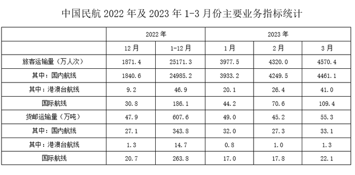

# 现期值与基期月均的倍数计算（上年月均=上年累计÷12）

考点：[[20-考点/资料分析/倍数/现期值与基期月均的倍数计算（上年月均=上年累计÷12）|倍数 / 现期值与基期月均的倍数计算（上年月均=上年累计÷12）]]
材料：[[15-材料/资料分析/5901926 以2023年一季度我国民航-公路-铁|5901926 以2023年一季度我国民航-公路-铁]]

**问法模型**：题干问'2023年3月（当月值）约是上年月均水平的多少倍'→ 用 2023年3月值 ÷（2022年1-12月累计÷12）的现期倍数模型

## 推理链
1. 第1步：定位表格旅客运输量（万人次）总计行，取2023年3月列=4570.4万人次（当月值，非累计）
2. 第2步：上年月均需用2022年1-12月累计列=25171.3万人次÷12，而非2022年12月当月值1871.4
3. 第3步：计算上年月均=25171.3÷12≈2097.6万人次
4. 第4步：所求倍数=4570.4÷2097.6≈2.18
5. 第5步：与选项对照，2.18≈2.2，对应C，排除A(1.4)、B(1.8)、D(2.6)

**最快解法**：⚡ 截位直除/等效变形：倍数=4570.4÷(25171.3/12)=4570.4×12÷25171.3≈54845÷25171≈2.18≈2.2，直接锁定C；或粗算月均≈2100，4570.4÷2100≈2.2

## 易错点
- ⚠ 基期取错列：误用2022年12月当月值1871.4作基期，得4570.4÷1871.4≈2.44，会误选D(2.6)附近；正确须用1-12月累计÷12
- ⚠ 取数错材料：误用文字段民航'1.29亿人次'（2023年一季度累计、单位亿人次），与3月当月值口径时间、单位均不符
- ⚠ 当月/累计混淆：4570.4是2023年3月当月值，不是1-3月累计，误当累计会算错倍数

## 母题抽象
> 🧩 当题干出现'现期某月值是上年月均（水平）的多少倍'时，用 现期值×12÷上年全年累计（即现期值÷(上年累计÷12)）截位直除，对照选项验证

**同类特征**：'上年月均水平'、现期当月值 vs 上年全年累计、倍数计算、表格跨列取数（2023年3月列+2022年1-12月列）、单位统一为万人次

## 相关题
- [[10-真题/资料分析/增长/2031184 增长量倍数计算（两主体增长量作比）|2031184]]（北京 2017，相关度1）
- [[10-真题/资料分析/增长/10886504 增长量计算及增长量倍数（两个增长量作商）|10886504]]（山东 2025，相关度1）

---

### 题干
2023年3月，我国民航旅客运输量约是上年月均水平的多少倍？

### 选项
- A. 1.4
- B. 1.8
- C. 2.2　✅
- D. 2.6

### 官方解析

根据题干“2023年3月······约是上年月均水平的多少倍”，可判定本题为现期倍数问题。定位表格材料可得：2023年3月和2022年1-12月，我国民航旅客运输量分别为4570.4万人次、25171.3万人次。则所求倍数倍。

故正确答案为C。

### 给定材料

        2023年一季度，我国民航、公路、铁路、水路旅客运输量分别为1.29亿人次、9.79亿人次、7.53亿人次和0.51亿人次，同比分别增长68.9%，1.0%，66.0%和93.3%。

