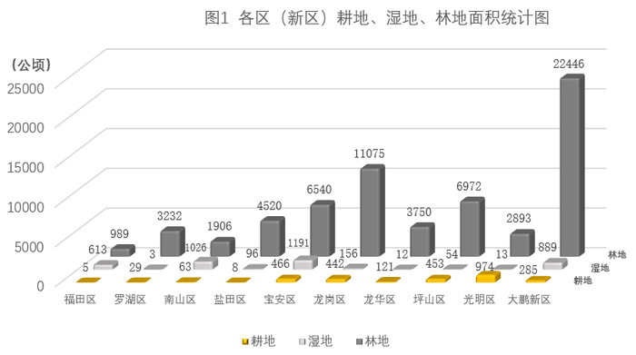

# 两并列总量之比（比值计算，湿地：耕地，非部分占整体）

考点：[[20-考点/资料分析/倍数/两并列总量之比（比值计算，湿地：耕地，非部分占整体）|倍数 / 两并列总量之比（比值计算，湿地：耕地，非部分占整体）]]
材料：[[15-材料/资料分析/4478979 深圳市10个区（新区）的耕地、湿地、|4478979 深圳市10个区（新区）的耕地、湿地、]]

**问法模型**：题干为'全市A与B之比接近于'+选项给整数比 → 将十区两类数据分别加总后作商，截位约分成整数比与选项对照

## 推理链
1. 第1步：定位图1，提取十区湿地面积：613、3、1026、96、1191、156、12、54、13、889公顷；耕地面积：5、29、63、8、466、442、121、453、974、285公顷
2. 第2步：全市湿地面积=613+3+1026+96+1191+156+12+54+13+889=4053公顷；全市耕地面积=5+29+63+8+466+442+121+453+974+285=2846公顷
3. 第3步：湿地：耕地=4053:2846，分子分母各截前两位得40/28，约分恰为10/7≈1.43（精确值4053÷2846≈1.424）
4. 第4步：与选项对照：8:5=1.6、8:7≈1.14、10:5=2.0、10:7≈1.43，1.424与10:7最接近，故选D

**最快解法**：⚡ 截位直除+整数比匹配：两类各自加总得4053与2846后，分子分母各截前两位（4053→40、2846→28），40/28约分恰好=10/7，一步锁定D，无需精算小数

## 易错点
- ⚠ 分子分母颠倒：题干是湿地：耕地（4053为分子），若倒算成2846/4053≈0.70会与选项对不上而乱套
- ⚠ 十区加总漏项/看串：图1为三维柱状图，小值柱（福田耕地5、罗湖湿地3、龙华湿地12、盐田耕地8）几乎贴地，极易漏加或串区串系列
- ⚠ 不化简选项比值：不把8:5、8:7、10:5、10:7先化成1.6、1.14、2.0、1.43对照，凭直觉误选分子更大的8:5

## 母题抽象
> 🧩 当题干出现'全市A与B之比接近于'且选项为整数比时，先分列加总两类总量，再对分子分母同时截位约分（如4053/2846→40/28=10/7）直接匹配选项

**同类特征**：之比接近于、全市口径需十区加总、选项为整数比（如10:7）、两个并列指标作比（非部分占整体比重）、无年份存量面积数据、湿地面积与耕地面积

## 相关题
（暂无）

---

### 题干
深圳市湿地面积与耕地面积之比接近于（    ）。

### 选项
- A. 8：5
- B. 8：7
- C. 10：5
- D. 10：7　✅

### 官方解析
根据题干“深圳市······与······之比接近于”，可判定本题为比值计算问题。定位图1可得深圳市各区（新区）湿地面积与耕地面积。深圳市湿地面积为613+3+1026+96+1191+156+12+54+13+889=4053公顷，耕地面积为5+29+63+8+466+442+121+453+974+285=2846公顷，深圳市湿地面积与耕地面积之比，与D项最接近。
故正确答案为D。

### 给定材料

