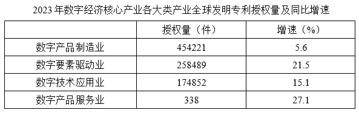

# 现期倍数（增速不变假设下的外推倍数）

考点：[[20-考点/资料分析/倍数/现期倍数（增速不变假设下的外推倍数）|倍数 / 现期倍数（增速不变假设下的外推倍数）]]
材料：[[15-材料/资料分析/3794764 2016-2023年数字经济核心产业|3794764 2016-2023年数字经济核心产业]]

**问法模型**：题干出现'如保持2023年同比增速不变，则2024年A是B的多少倍'→ 用外推公式：倍数 = A现期×(1+a) ÷ [B现期×(1+b)]，即现期量分别乘各自(1+增速)后再作比

## 推理链
1. 第1步：从图2提取数据——2023年数字产品制造业授权量454221件、同比增速5.6%；数字要素驱动业授权量258489件、同比增速21.5%
2. 第2步：增速不变意味着2024年仍按各自增速增长，用公式 现期量=基期量×(1+增长率) 外推：2024年量=2023年量×(1+增速)
3. 第3步：数字产品制造业2024年≈454221×1.056≈479657件；数字要素驱动业2024年≈258489×1.215≈314064件
4. 第4步：所求倍数≈479657÷314064≈1.53
5. 第5步：与选项对照，1.53与B项1.5最接近，故选B

**最快解法**：⚡ 比值拆分法（先比基数、再乘增速系数）：454221/258489截位直除≈1.76；增速系数1.056/1.215≈0.87（分子增速小、系数小于1）；1.76×0.87≈1.53，锁定B，无需精确展开两个乘法

## 易错点
- ⚠ 忘乘增速系数：直接用现期量之比454221/258489≈1.76作答，会误选更接近1.9的C项
- ⚠ 增速配对错误：把21.5%错配给制造业、5.6%错配给要素驱动业，得约1.76×1.15≈2.0，会误选C（1.9）或D（2.4）
- ⚠ 单位量级陷阱：图2单位为'件'、图1为'万件'，本题虽同用图2口径，但跨图复用数据时必须先统一单位，否则结果差1万倍

## 母题抽象
> 🧩 当题干出现'保持增速不变，求下一年A是B的几倍'特征时，用现期倍数外推模型：先算现期基数之比，再乘(1+a)/(1+b)校正增速差，最后与选项对照取最接近值

**同类特征**：保持同比增速不变、2024年（外推年份）、多少倍、约、两个二级产业对比、数据来自图2统计表

## 相关题
- [[10-真题/资料分析/增长/15419182 由同比增速求增长量并作倍数比较（增长量作比）|15419182]]（湖北 2025，相关度1）
- [[10-真题/资料分析/增长/2144597 增长量计算及增长量倍数比较（增量=现期×r-(1+r)）|2144597]]（选调 2018，相关度1）
- [[10-真题/资料分析/倍数/1752646 基期倍数（亏损额基期还原+倍数计算）|1752646]]（北京 2016，相关度1）
- [[10-真题/资料分析/倍数/2578811 基期倍数（图形逐月加总＋文字段增速还原基期）|2578811]]（四川 2020，相关度1）
- [[10-真题/资料分析/平均数/15419186 平均数增长率（两期平均数比较，现期平均每支设立规模 vs 上年同期）|15419186]]（湖北 2025，相关度1）

---

### 题干
如保持2023年同比增速不变，则2024年数字产品制造业全球发明专利授权量约是数字要素驱动业全球发明专利授权量的多少倍?

### 选项
- A. 1.2
- B. 1.5　✅
- C. 1.9
- D. 2.4

### 官方解析
根据题干“如保持2023年同比增速不变，则2024年······是······的多少倍”，结合材料时间为2023年，可判定本题为现期倍数问题。定位统计表可得：2023年数字产品制造业全球发明专利授权量为454221件，同比增速为5.6%；数字要素驱动业全球发明专利授权量为258489件，同比增速为21.5%。根据公式：现期量=基期量×（1+增长率），则题干所求倍，与B项最接近。
故正确答案为B。

### 给定材料

