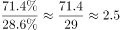

# 同一总体占比之比求倍数

考点：[[20-考点/资料分析/倍数/同一总体占比之比求倍数|倍数 / 同一总体占比之比求倍数]]
材料：[[15-材料/资料分析/182186 2015年6月某市统计局对应届毕业生|182186 2015年6月某市统计局对应届毕业生]]

**问法模型**：问'没有创业打算的人数约是有创业打算的几倍'但只给创业占比28.6% → 同一总体下人数之比等于占比之比，先求不创业占比71.4%再相除，无需反推总人数

## 推理链
1. 第1步：从文字材料提取：打算创业593名，占受访者的28.6%；全体受访者只分为'打算创业'与'不打算创业'两类
2. 第2步：同一总体中两类占比之和为100%，故没有创业打算的占比=100%−28.6%=71.4%
3. 第3步：同一总体下人数之比=占比之比，倍数=71.4%÷28.6%≈2.496≈2.5倍（速验：28.6%×2.5=71.5%≈71.4%）
4. 第4步：与选项对照，2.5倍对应C；若误算'多几倍'得(71.4−28.6)%÷28.6%≈1.5倍会错选A

**最快解法**：⚡ 占比直除+倍数反推验证：100%−28.6%=71.4%，71.4÷28.6≈2.5选C；更快一步用选项反推——28.6%×2.5=71.5%恰好等于不创业占比，秒锁C

## 易错点
- ⚠ '是几倍'与'多几倍'混淆：多出的部分42.8%÷28.6%≈1.5倍，误选A
- ⚠ 误把593名当总人数当分母，或先反推总样本≈2073名再求不创业人数，绕远且中间四舍五入易出错（本题只需占比）
- ⚠ 忘记用100%−28.6%得71.4%，拿28.6%与其他数字（如7.0个百分点、34.5%）乱配计算

## 母题抽象
> 🧩 当题干问'总体中A部分是B部分的几倍'且材料只给同一总体的两类占比时，用占比之比直接求倍数（占比和必为100%），不还原绝对人数；验证：B占比×选项倍数≈A占比

**同类特征**：没有创业打算的…是有创业打算的…的几倍、本次调查中、同一总体两部分人数之比、只给部分占比28.6%、约是…倍

## 相关题
（暂无）

---

### 题干
本次调查中，没有创业打算的毕业生人数约是有创业打算的毕业生人数的：

### 选项
- A. 1.5倍
- B. 1.9倍
- C. 2.5倍　✅
- D. 2.8倍

### 官方解析

根据题目求二者的倍数关系可判定此题为倍数计算问题。定位文字材料第一段，本次调查中，有创业打算的毕业生人数占比28.6，则没有创业打算的毕业生人数占比71.4，。

故正确答案为C。

### 给定材料

        2015年6月某市统计局对应届毕业生的抽样调查显示：有593名受访者打算创业，占28.6%。其中，大专生打算创业的比重比平均水平高7.0个百分点，本科生打算创业的比重比平均水平低3.9个百分点，31.4%的研究生打算创业，有34.5%的受访男生打算创业，比女生高11.2个百分点。

        在没有创业打算的受访者应届毕业生中，因缺乏启动资金，缺乏社会经验，缺乏创业方向等原因不打算创业的情况见图1，有创业打算的受访应届毕业生能承担的创业资金额度情况见图2.

