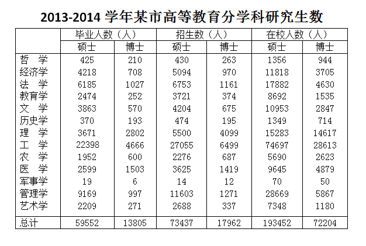

# 硕博招生比与毕业比两比值作差比较

考点：[[20-考点/资料分析/倍数/硕博招生比与毕业比两比值作差比较|倍数 / 硕博招生比与毕业比两比值作差比较]]
材料：[[15-材料/资料分析/182578 2013-2014学年某市高等教育分|182578 2013-2014学年某市高等教育分]]

**问法模型**：题干问'招生人数比例与毕业人数比例相差最大的学科'→对选项四学科分别算'招生硕士÷招生博士'与'毕业硕士÷毕业博士'两个比值，作差取绝对值后比大小。

## 推理链
1. 第1步：从表格定位四个选项学科的招生、毕业数据：哲学招生430/263、毕业425/210；文学招生4204/675、毕业3863/570；军事学招生14/12、毕业19/6；艺术学招生2688/337、毕业2209/271。
2. 第2步：确定规则：硕博比=硕士人数÷博士人数（两列比值方向必须统一），差值=|招生硕博比−毕业硕博比|。
3. 第3步：代入计算——哲学|430/263−425/210|≈|1.64−2.02|=0.39；文学|4204/675−3863/570|≈|6.23−6.78|=0.55；军事学|14/12−19/6|≈|1.17−3.17|=2.0；艺术学|2688/337−2209/271|≈|7.98−8.15|=0.17。
4. 第4步：比较差值：军事学2.0＞文学0.55＞哲学0.39＞艺术学0.17，军事学相差最大，对应选项C。

**最快解法**：⚡ 定性观察+极端值锁定：军事学博士由毕业6人变招生12人（翻倍），硕士却由毕业19人变招生14人（不升反降），硕博比必从约3.2骤降至约1.2，落差一眼可见；其余三学科硕博比基本稳定（哲学约1.6→2.0、文学约6.2→6.8、艺术学均约8倍），无需精算即可锁定C。

## 易错点
- ⚠ 比值方向搞反：招生与毕业两比值须统一用'硕士÷博士'（或统一'博士÷硕士'），若一边用硕/博、另一边用博/硕，差值判断会颠倒。
- ⚠ 军事学数值极小（毕业仅19人/6人），考生易因数字太小而直觉排除，但个位数级分母恰是产生极端比值、拉开差值的来源。
- ⚠ 平均数/比重口径误用：本题是'硕士与博士两列之比'，不是占研究生总数的比重，无须加总硕博，也不要拿'总计'行做分母。

## 母题抽象
> 🧩 当题干出现'……比例与其……比例相差最大（最小）的……是'时，只对选项所列对象分别计算两个比值并作差取绝对值比较，数值量级极小或极端的对象往往就是答案。

**同类特征**：比例相差最大、招生人数比例、毕业人数比例、硕士生与博士生之比、限定四个选项学科、比值作差比较

## 相关题
（暂无）

---

### 题干
硕士生与博士生招生人数比例与其毕业人数比例相差最大的学科是：

### 选项
- A. 哲学
- B. 文学
- C. 军事学　✅
- D. 艺术学

### 官方解析
根据题干中“硕士生与博士生招生人数比例与其毕业人数比例相差最大的学科”，可判定本题为比值比较问题。定位表格，哲学硕博招生人数、毕业人数基本持平；文学硕博招生人数比例为，毕业生人数比例为；军事学硕博招生人数比例为，毕业生人数比例为；艺术学硕博招生比例为，毕业生人数比例为，观察可得，差距最大的学科为军事学。
故正确答案为C。

### 给定材料

根据所绘资料，回答106~110题。

