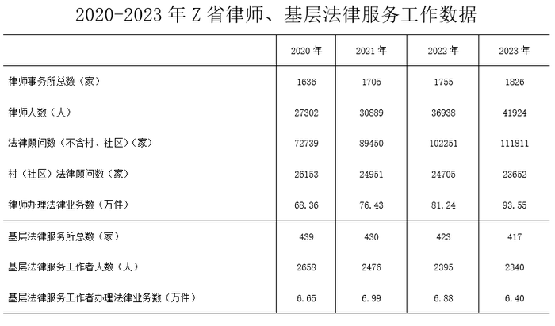

# 现期倍数（分项口径合并后跨年作比）

考点：[[20-考点/资料分析/倍数/现期倍数（分项口径合并后跨年作比）|倍数 / 现期倍数（分项口径合并后跨年作比）]]
材料：[[15-材料/资料分析/3617387 2020—2023年Z省律师行业与基|3617387 2020—2023年Z省律师行业与基]]

**问法模型**：题干出现'2023年……含村、社区在内……约是2020年的多少倍'的现期倍数问法，且'含村、社区在内'提示口径合并 → 先将两行法律顾问数同列相加，再作 A2023/A2020 的倍数计算

## 推理链
1. 第1步：定位统计表两行——'法律顾问数（不含村、社区）'2023年111811家、2020年72739家；'村（社区）法律顾问数'2023年23652家、2020年26153家
2. 第2步：题干要求'含村、社区在内'，须同列相加合并口径：2023年=111811+23652=135463家；2020年=72739+26153=98892家
3. 第3步：代入现期倍数公式：135463÷98892≈1.37
4. 第4步：与选项对照：1.37与B（1.4）最接近，与C（1.6）相差约0.23，故选B

**最快解法**：⚡ 加总后截位直除：分子135463、分母98892，截为135.5/98.9≈1.37；或用选项反推——98892×1.4≈13.85万＞13.55万，×1.2≈11.87万＜13.55万，排除A、C后确认B；亦可插值：98892×1.3=128560＜135463＜98892×1.4=138449，且135463距1.4端更近

## 易错点
- ⚠ 口径陷阱：只取'不含村、社区'单行作比（111811÷72739≈1.54，选项中最接近1.6），漏加村（社区）行会误选C
- ⚠ 串行/串列陷阱：两行法律顾问数走向相反（不含村社区逐年递增72739→111811，村社区逐年递减26153→23652），且与相邻指标数值同量级，查表易取错行或取错年份列
- ⚠ 年份对位陷阱：分子必须用2023列、分母用2020列，若误用2021/2022列数据（如分母取89450+24951=114401，倍数≈1.18）会误选A

## 母题抽象
> 🧩 当题干出现'含……在内的合计口径指标是某年的多少倍'时，先把现期与基期各自的分项两行同列加总，再作 (A1+A2)/(B1+B2) 的截位直除，切勿只用单行数据作比

**同类特征**：现期倍数、含村、社区在内（口径合并提示）、两行同列相加后再作比、跨年（2023 vs 2020）作比、约是多少倍、单表跨行取数

## 相关题
- [[10-真题/资料分析/倍数/2616169 现期倍数计算|2616169]]（海南 2020，相关度2）
- [[10-真题/资料分析/倍数/4637200 现期倍数计算（部分不合格量与其余部分不合格量之比）|4637200]]（国考 2022，相关度2）
- [[10-真题/资料分析/倍数/2444699 现期倍数（部分÷比重反推总量后再作商）|2444699]]（四川 2019，相关度2）
- [[10-真题/资料分析/倍数/2578797 现期倍数计算（基期值+增长量还原现期值后求倍数）|2578797]]（四川 2020，相关度2）
- [[10-真题/资料分析/倍数/2742293 同比增量倍数（需先做同比增速比较定位年份）|2742293]]（北京 2021，相关度2）

---

### 题干
2023年，Z省含村、社区在内的法律顾问数约是2020年的多少倍？

### 选项
- A. 1.2
- B. 1.4　✅
- C. 1.6
- D. 1.8

### 官方解析

根据题干“2023年······约是······多少倍”，可判定本题为现期倍数问题。定位统计表可得：2023年Z省（不含村、社区）法律顾问数为111811家，村(社区)法律顾问数为23652家；2020年Z省（不含村、社区）法律顾问数为72739家，村（社区）法律顾问数为26153家。则题干所求倍。

故正确答案为B。

### 给定材料

> [!warning] 疑点（官方解析可能有误，待人工复核）
> 官方解析末句'则题干所求倍'语句残缺、未给出完整算式与数值，但按表计算135463÷98892≈1.37与答案B（1.4）一致，不构成实质错误
