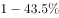
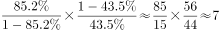

# 现期平均数倍数（每家机构平均接待观众之比，含'其他=总量−已知'两次减法）

考点：[[20-考点/资料分析/倍数/现期平均数倍数（每家机构平均接待观众之比，含'其他=总量−已知'两次减法）|倍数 / 现期平均数倍数（每家机构平均接待观众之比，含'其他=总量−已知'两次减法）]]
材料：[[15-材料/资料分析/185154 我国文物机构（含博物馆）2008～2|185154 我国文物机构（含博物馆）2008～2]]

**问法模型**：题干问'平均每家博物馆接待观众约是其他文物机构的多少倍'→采用'（博物馆观众÷博物馆数）÷（其他观众÷其他机构数）'的现期平均数相除模型，其中'其他'两组数据均需用总量减去博物馆数据做减法得出

## 推理链
1. 第1步：从表格取2014年文物机构总数8418个、接待观众总量84256万人次；从文段取2014年博物馆3658个、博物馆接待观众71774万人次
2. 第2步：求'其他文物机构'两组数据（两次减法）：机构数=8418−3658=4760个，观众人次=84256−71774=12482万人次
3. 第3步：计算两组平均数：平均每家博物馆接待=71774÷3658≈19.6万人次/家；平均每家其他机构接待=12482÷4760≈2.6万人次/家
4. 第4步：代入倍数公式：19.6÷2.6≈7.5倍（一步式为71774×4760÷(3658×12482)）
5. 第5步：与选项对照：A.2、B.4.5、C.7.5、D.11，计算结果≈7.5与C项最接近，故选C

**最快解法**：⚡ 截位直除+两组平均数口算：先做两次减法得其他机构4760个、其他观众12482万人次，再71774÷3658≈19.6、12482÷4760≈2.6，19.6÷2.6≈7.5，直接锁定C；亦可将一步式分子分母先约分（4760/3658≈1.3、71774/12482≈5.75，5.75×1.3≈7.5）

## 易错点
- ⚠ 漏做两次减法：直接用博物馆观众71774÷博物馆数3658与总观众84256÷总机构8418相除，或把'其他机构'错当成全部文物机构，是本题经典错解
- ⚠ 口径混淆：'文物机构'≠'博物馆'，博物馆仅占机构数的3658/8418≈43%，却占观众的71774/84256≈85%，两组数据取数错位会导致倍数算偏
- ⚠ 跨源取数遗漏：博物馆数3658、博物馆观众71774只在文段，机构总数8418、观众总量84256只在表格，任取一处都拼不齐数据；另注意观众单位为万人次、机构单位为个，须先'观众÷机构数'求平均再相除，不能直接用人次除以其他指标

## 母题抽象
> 🧩 当题干出现'平均每家A是其他（或全部）B的多少倍'特征时，用'总量指标÷单位个数'分别求两组平均数再相除；若比较对象是'其他'，必须先用总量减去已知组做两次减法，最后验证商与最接近的选项

**同类特征**：平均每家…是…多少倍、博物馆与其他文物机构对比、现期倍数（2014年）、两次减法求'其他'、观众人次÷机构个数、跨文段与表格拼数

## 相关题
（暂无）

---

### 题干
2014年，平均每家博物馆接待观众人次数约是其他文物机构的多少倍？

### 选项
- A. 2
- B. 4.5
- C. 7.5　✅
- D. 11

### 官方解析

       由题干“2014年，…是…多少倍”材料所给时间为2014年，可判定本题是现期倍数问题。根据题意可列式为，定位文字材料第一二段，2014年末，我国共有博物馆3658个，占文物机构总数的，则其他文物机构占总数的比重为；其中博物馆接待观众71774万人次，占文物机构接待观众总数的，则其他文物机构接待观众人次占总数的比重为。代入式子计算：，C项与之最接近。

故正确答案为C。

### 给定材料

        截至2014年末，我国共有博物馆3658个，占文物机构总数的。全国文物机构拥有文物藏品4063.58万件，比上年末增加222.77万件。其中，博物馆文物藏品2929.97万件，文物商店文物藏品770.00万件。文物藏品中，一级文物9.82万件，二级文物68.82万件，三级文物340.51万件。

        2014年全国文物机构共安排基本陈列9996个，比上年增长；举办临时展览11174个，增长；接待观众84256万人次，增长，其中博物馆接待观众71774万人次，占文物机构接待观众总人次的。

