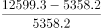
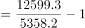
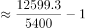

# 现期倍数（'多几倍'=是几倍−1）

考点：[[20-考点/资料分析/倍数/现期倍数（'多几倍'=是几倍−1）|倍数 / 现期倍数（'多几倍'=是几倍−1）]]
材料：[[15-材料/资料分析/186568 2014—2015年全国医院病人门诊|186568 2014—2015年全国医院病人门诊]]

**问法模型**：题干'A比B多'+选项给倍数 → 求(A−B)/B = A/B − 1的现期倍数模型，注意'多几倍'需在'是几倍'基础上减1

## 推理链
1. 第1步：定位表格2015年列，三级医院人均住院费用12599.3元，二级医院人均住院费用5358.2元（'三级医院''二级医院'列即公立三级/二级医院口径）
2. 第2步：'比…多几倍'公式 = (A−B)/B = A/B − 1，即增长倍数而非倍数本身
3. 第3步：代入计算：(12599.3−5358.2)/5358.2 = 7241.1/5358.2 ≈ 1.35；或先算12599.3/5358.2≈2.35，再减1得1.35
4. 第4步：1.35与选项1.1/1.4/1.7/2.0对照，最接近1.4倍，故选B

**最快解法**：⚡ 截位直除：差额7241.1÷5358.2≈72.4÷53.6≈1.35，与1.4最接近；也可直除12599.3÷5358.2≈2.35后减1

## 易错点
- ⚠ '多几倍'与'是几倍'混淆：直接算12599.3/5358.2≈2.35是'是几倍'，忘记减1会错选接近2.0的D项
- ⚠ 列口径串列：三级医院、二级医院是公立医院下的分组列，勿误取'公立医院'列8833.0或全口径'医院'列8268.1
- ⚠ 行与年份定位错误：须取'人均住院费用'行的2015年数据，勿串到'日均住院费用''次均门诊费用'行或误取2014年列（5114.6）

## 母题抽象
> 🧩 当题干出现'A比B多'+倍数选项特征时，用'多几倍=是几倍−1'模型，即(A−B)/B，验证结果与选项最接近者；若选项同时含'是几倍'数值则为典型陷阱设计

**同类特征**：比…多（几倍）、选项均为倍数、现期（2015年）数据直读、人均住院费用、三级医院与二级医院跨列比较、不需用涨幅行数据

## 相关题
（暂无）

---

### 题干
2015年全国公立三级医院人均住院费用比公立二级医院多：

### 选项
- A. 1.1倍
- B. 1.4倍　✅
- C. 1.7倍
- D. 2.0倍

### 官方解析

由题干“2015年······比······多”结合选项给出倍数，可知本题为现期倍数问题。定位表格，2015年全国公立三级医院和公立二级医院人均住院费分别为12599.3、5358.2元，故2015年全国公立三级医院人均住院费用比公立二级医院多：倍，与B项最接近。

故正确答案为B。

### 给定材料

注：①费用均值按当年价格计算；②次均门诊费用指门诊病人次均医药费用，人均住院费用指出院病人住院期间人均医药费用，日均住院费用指出院病人住院期间日均医药费用。

