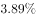
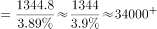
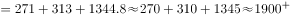
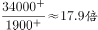

# 现期倍数计算（比重反推整体后求倍数）

考点：[[20-考点/资料分析/倍数/现期倍数计算（比重反推整体后求倍数）|倍数 / 现期倍数计算（比重反推整体后求倍数）]]
材料：[[15-材料/资料分析/186646 2010—2014年我国天然气供应情|186646 2010—2014年我国天然气供应情]]

**问法模型**：题干为'全球总产量约是我国供应量的多少倍'，全球总量未直接给出 → 先用'我国产量÷全球占比'反推整体，再除以供应量合计求倍数

## 推理链
1. 第1步：定位图2，2014年我国天然气产量1344.8亿立方米，占全球总产量比重3.89%（虚线折线，右轴%）
2. 第2步：整体=部分÷占比，全球天然气总产量=1344.8÷3.89%≈34571亿立方米
3. 第3步：定位图1，2014年供应量合计=国产气1344.8+管输进口313+LNG进口271=1928.8亿立方米
4. 第4步：倍数=34571÷1928.8≈17.9倍
5. 第5步：与选项对照，17.9最接近18，故选B

**最快解法**：⚡ 两步合并截位直除：倍数=(1344.8÷1928.8)÷3.89%，1344.8/1928.8≈0.7，0.7÷3.89%≈18倍，无需算出全球总量，30秒可解

## 易错点
- ⚠ 口径陷阱（最核心）：图2'产量'=国产气1344.8，而题干'供应量'=1344.8+313+271=1928.8；若误把产量1344.8当供应量，得34571÷1344.8≈25.7倍，会误选C(27)
- ⚠ 双轴折线混淆：右轴实线是同比增速7.69%、虚线才是全球占比3.89%；若误用7.69%反推，得约9倍，易偏向A(10)
- ⚠ 不能跳过反推：全球总产量材料未直接给出，必须用'1344.8÷3.89%'反推，且该占比的分母口径是国产气产量而非供应量

## 母题抽象
> 🧩 当题干问'A是B的几倍'且A只以'占整体比重'形式给出时，用'部分÷占比'反推整体再除以B，速算时可合并为'(部分÷B)÷占比'一步直除；先核对'部分'与'B'的口径是否一致（产量vs供应量）

**同类特征**：全球…约是…的多少倍、现期倍数、占全球总产量比重、比重反推整体、供应量=国产气+两类进口、跨图拼数据

## 相关题
- [[10-真题/资料分析/倍数/10204451 现期倍数计算（部分与部分之和的倍数）|10204451]]（广东 2024，相关度1）
- [[10-真题/资料分析/倍数/10297461 现期倍数计算（含'二季度=上半年-一季度'时段拆分推算）|10297461]]（四川 2025，相关度1）
- [[10-真题/资料分析/倍数/1797608 现期倍数计算+加总排序定位|1797608]]（山东 2016，相关度1）
- [[10-真题/资料分析/倍数/2024182 现期倍数（两分项净增量之比）|2024182]]（重庆 2016，相关度1）
- [[10-真题/资料分析/倍数/2042820 现期倍数计算（同一子总体内占比相除）|2042820]]（江苏 2017，相关度1）

---

### 题干
2014年，全球天然气总产量约是我国各类天然气供应量的（  ）倍。

### 选项
- A. 10
- B. 18　✅
- C. 27
- D. 30

### 官方解析

题干所求为“2014年，全球天然气总产量是我国供应量的多少倍”，可判定本题为现期倍数计算问题。定位图二，2014年我国天然气产量为1344.8亿立方米，占全球总产量的比重为，则全球天然气总产量。定位图一，2014年我国各类天然气供应量亿立方米。2014年，全球天然气总产量约是我国各类天然气供应量的，与B项接近。 

故正确答案为B。

### 给定材料

        我国供气来源多元化，主要包括国产气和进口气两部分。国产气主要有常规天然气、页岩气和煤层气等，进口气主要有进口LNG和进口管输气。近年来，我国天然气供应量稳步增加，国产气、进口管输气、进口LNG都呈上涨趋势。国产气从2010年的989.7亿立方米增至2014年的1344.8亿立方米，增长了355.1亿立方米。进口管输气从2010年的35.5亿立方米增至2014年的313亿立方米，增长了7.82倍。

> [!warning] 疑点（官方解析可能有误，待人工复核）
> 官方解析中'占全球总产量的比重为'及'全球天然气总产量'两处算式数字因排版缺失（应为3.89%与1344.8÷3.89%≈34571），但按图2数据计算结果≈17.9倍与B项一致，不影响答案

<!-- CODEX-ANSWER-REVIEW:BEGIN -->
### 本次独立复核

**复核状态：** `resolved`（答案与解析已核定）

**计分答案：** B（可计分）

**复核解析：**

2014年我国天然气产量1344.8亿立方米，占全球3.89%，故全球总产量约1344.8÷0.0389≈34571亿立方米。我国各类供应量=1344.8+271+313=1928.8亿立方米。全球/我国供应≈34571÷1928.8≈17.92，最接近18倍，选B。

**相关信息：**

产量的全球占比只用于反推全球产量；本国供应量由国产气、管输进口气、LNG三项相加。

**题源依据：** [固定版本原题](https://github.com/Mentat-Uran/kaogongzhentizhengliu/blob/84ab93d4b64b61d897bece8a1c0a5bab06b4feb2/10-%E7%9C%9F%E9%A2%98/%E8%B5%84%E6%96%99%E5%88%86%E6%9E%90/%E5%80%8D%E6%95%B0/2045758%20%E7%8E%B0%E6%9C%9F%E5%80%8D%E6%95%B0%E8%AE%A1%E7%AE%97%EF%BC%88%E6%AF%94%E9%87%8D%E5%8F%8D%E6%8E%A8%E6%95%B4%E4%BD%93%E5%90%8E%E6%B1%82%E5%80%8D%E6%95%B0%EF%BC%89.md)；固定内容 commit `84ab93d4b64b61d897bece8a1c0a5bab06b4feb2`，Markdown blob `ebb4aa016b5f8d6dd86a95cddf78391c0befd248`。
<!-- CODEX-ANSWER-REVIEW:END -->
