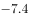
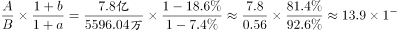

# 基期倍数计算（含亿-万单位换算）

考点：[[20-考点/资料分析/倍数/基期倍数计算（含亿-万单位换算）|倍数 / 基期倍数计算（含亿/万单位换算）]]
材料：[[15-材料/资料分析/186748 2016年某省邮政通信业务发展情况：|186748 2016年某省邮政通信业务发展情况：]]

**问法模型**：题干问'2015年报纸订销完成量约是杂志的多少倍'，基期年份+倍数→基期倍数模型：基期倍数=(现期A/(1+gA))÷(现期B/(1+gB))=现期倍数×(1+gB)/(1+gA)，且必须先把报纸7.8亿件换算为78000万件统一单位。

## 推理链
1. 第1步：从统计表提取2016年数据：报纸订销完成量7.8亿件、增速-7.4%；杂志订销完成量5596.04万件、增速-18.6%。
2. 第2步：统一单位，7.8亿件=78000万件，与杂志的'万件'口径对齐。
3. 第3步：套用基期倍数公式：2015年倍数=[78000/(1-7.4%)]÷[5596.04/(1-18.6%)]=78000/5596.04×(0.814/0.926)。
4. 第4步：先算现期倍数78000/5596.04≈13.94，再看增速修正系数0.814/0.926≈0.879。
5. 第5步：代入计算13.94×0.879≈12.25（或直除：报纸2015年≈78000/0.926≈84233万件，杂志2015年≈5596.04/0.814≈6875万件，84233/6875≈12.25）。
6. 第6步：与选项对照：12.25≈12.3，对应A项；另可用方向排除——报纸降幅(-7.4%)小于杂志降幅(-18.6%)，杂志基期相对更大，故基期倍数必小于现期倍数13.9，四个选项中仅A(12.3)<13.9，直接锁定A。

**最快解法**：⚡ 基期倍数公式+方向排除：先截位直除算现期倍数78000/5596.04≈13.9，再比较增速——报纸降幅7.4%小于杂志降幅18.6%，基期倍数应小于13.9，选项中仅A符合，无需精算；若精算则13.9×0.814/0.926≈12.3。

## 易错点
- ⚠ 单位陷阱：报纸单位为'亿件'、杂志为'万件'，不换算直接相除得约0.0014量级，必须先做7.8亿件=78000万件的换算。
- ⚠ 增速符号陷阱：两项增速均为负值，基期=现期/(1+g)时分母为(1-7.4%)和(1-18.6%)，若误将负增长当正增长代入(1+|g|)会算出错误基期值。
- ⚠ 倍数方向误判：易凭直觉认为'报纸降幅小所以基期倍数比现期大'而错选B(13.9)或更大项；实际杂志降幅更大、2015年杂志相对更多，基期倍数(12.3)小于现期倍数(13.9)。

## 母题抽象
> 🧩 当题干出现'基期年份A是B的多少倍'且表格给出两项现期量与增速时，用基期倍数公式=现期倍数×(1+gB)/(1+gA)；先用现期倍数（此处约13.9）做方向排除缩小选项，再精算验证；若两项单位不一（亿/万混用），换算是第一步且不可省。

**同类特征**：2015年（基期年份设问）、报纸、杂志、订销完成量、多少倍、表格单位亿件/万件混用

## 相关题
- [[10-真题/资料分析/增长/15419182 由同比增速求增长量并作倍数比较（增长量作比）|15419182]]（湖北 2025，相关度1）
- [[10-真题/资料分析/增长/2144597 增长量计算及增长量倍数比较（增量=现期×r-(1+r)）|2144597]]（选调 2018，相关度1）
- [[10-真题/资料分析/倍数/1752646 基期倍数（亏损额基期还原+倍数计算）|1752646]]（北京 2016，相关度1）
- [[10-真题/资料分析/倍数/2578811 基期倍数（图形逐月加总＋文字段增速还原基期）|2578811]]（四川 2020，相关度1）
- [[10-真题/资料分析/倍数/13504276 现期倍数（增速不变假设下的外推倍数）|13504276]]（河南 2025，相关度1）

---

### 题干
2015年该省报纸的订销完成量约是杂志的多少倍？

### 选项
- A. 12.3　✅
- B. 13.9
- C. 15.1
- D. 16.7

### 官方解析

由题干“2015年，······是······的多少倍”，结合材料为2016年，可判定该题为基期倍数问题。定位表格材料“报纸的订销完成量7.8亿件，增速；杂志的订销完成量5596.04万件，增速”，代入基期倍数公式，只有A项小于13.9。

故正确答案为A。

### 给定材料

        2016年，某省完成邮政通信业务总量6886.15亿元，同比增长，增幅比上年提高27.4个百分点。其中，完成邮政业务总量1879.99亿元，增长，增幅提高11.0个百分点；完成通信业务总量5006.16亿元，增长，增幅提高33.2个百分点。

        2016年，该省完成快递业务量76.72亿件，同比增长，占全国快递业务量的比重达到，比排名第二的Z省多16.80亿件。

        2016年，该省电话用户数为1.69亿，其中固定电话用户数为2609.7万，移动电话用户数为14349万，分别比上年减少197.4万户和203.1万户。移动电话中4G用户数为9085.30万，占移动电话用户的比重由上年的提升至。固定电话本地通话时长、长途通话时长以及移动电话通话时长同比分别减少、和，移动短信、彩信业务量分别减少和。

        2016年，该省固定互联网宽带用户数为2850.60万，宽带接入流量同比增长，其中8M及以上和20M及以上宽带接入用户占比分别为和，分别比上年提升26.2个和40.4个百分点，固定宽带用户均资费同比下降。该省移动互联网用户数达1.15亿，移动互联网接入流量同比增长，移动流量资费水平同比下降，通信资费总体水平同比下降。

