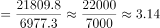
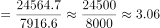
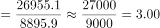
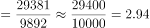
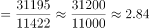
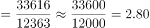
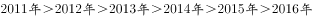

# 比值（城乡收入比）逐年计算与趋势判断

考点：[[20-考点/资料分析/倍数/比值（城乡收入比）逐年计算与趋势判断|倍数 / 比值（城乡收入比）逐年计算与趋势判断]]
材料：[[15-材料/资料分析/186960 2016年中国脱贫攻坚成效综述，配以|186960 2016年中国脱贫攻坚成效综述，配以]]

**问法模型**：题干问'2011-2016年比值的变化趋势' → 逐年计算城镇收入÷农村收入（或比较城乡各自增速大小），得比值序列后看单调性定趋势

## 推理链
1. 第1步：从图1提取六组数据，城镇（元）：21809.8、24564.7、26955.1、29381、31195、33616；农村（元）：6977.3、7916.6、8895.9、9892、11422、12363
2. 第2步：比值=城镇收入÷农村收入，需逐年计算六个比值再比较大小
3. 第3步：截位相除得2011年21809.8/6977.3≈3.13，2012年24564.7/7916.6≈3.10，2013年26955.1/8895.9≈3.03，2014年29381/9892≈2.97，2015年31195/11422≈2.73，2016年33616/12363≈2.72
4. 第4步：比值序列3.13→3.10→3.03→2.97→2.73→2.72，每一年都比前一年小，呈单调递减
5. 第5步：与选项对照，'逐年递减'为B，排除波浪形（A）、递增（C）、直线形（D）

**最快解法**：⚡ 截位直除＋增速比较口算：各年农村增速均高于城镇增速（如2015年农村(11422-9892)/9892≈15.5%＞城镇(31195-29381)/29381≈6.2%，2016年农村941/11422≈8.2%＞城镇2421/31195≈7.8%），分子分母同向增长且分母（农村）增速持续更大，故比值必然逐年下降，直接选B；稳妥起见可逐年截位相除得3.13、3.10、3.03、2.97、2.73、2.72验证

## 易错点
- ⚠ 分子分母顺序：城镇为分子、农村为分母，若倒置成农村÷城镇（约0.32→0.37），会误判为逐年递增而错选C
- ⚠ 把'比值变化趋势'误当'增长率变化趋势'：本题是逐年相除的比值大小比较，不是对增速作差或比较增长量
- ⚠ 图1小数抄数易错位：21809.8、8895.9等带小数年份与29381、31195、33616等整数年份混抄，导致个别年份比值算错而误判为'波浪形'

## 母题抽象
> 🧩 当题干出现'A、B两指标比值/倍数的变化趋势'时，逐年计算A÷B得比值序列验证单调性；速判技巧是若分母增速逐年大于分子增速，则比值必逐年下降（反之递增），再用首尾两年截位相除验证

**同类特征**：2011-2016年、城乡人均可支配收入比值、变化趋势、双柱图两列数据、城镇÷农村、逐年比较

## 相关题
- [[10-真题/资料分析/增长/15833691 环比增速计算与折线趋势匹配（累计值连环相减化当期值）|15833691]]（黑龙江 2026，相关度1）
- [[10-真题/资料分析/其他/2050538 简单计算之直接读数比较计数|2050538]]（吉林 2017，相关度1）
- [[10-真题/资料分析/增长/12882030 累计转当期+环比增长率计算与趋势匹配|12882030]]（内蒙古 2025，相关度1）
- [[10-真题/资料分析/增长/15833698 环比增速计算与折线趋势图匹配|15833698]]（黑龙江 2026，相关度1）
- [[10-真题/资料分析/增长/2051184 增长量比较（同比增长量趋势折线图判断）|2051184]]（黑龙江 2017，相关度1）

---

### 题干
2011-2016年城乡居民人均可支配收入的比值变化趋势为：

### 选项
- A. 波浪形变化
- B. 逐年递减　✅
- C. 逐年递增
- D. 直线形变化

### 官方解析

由题干“2011-2016年······比值变化趋势为”，比值变化趋势其实也就是比值大小变化情况，可判定该题是比值比较问题。定位数据图一中数据，可得2011-2016年城乡居民人均可支配收入的比值分别为：2011年；2012年；2013年；2014年；2015年；2016年，所以2011-2016年城乡居民人均可支配收入的比值，呈逐年递减趋势。

故正确答案为B。

### 给定材料

        2016年是中国脱贫攻坚首战之年，全年超过1000万人告别贫困；中央和省级财政扶贫资金首次超过1000亿元；各类金融机构累计发放扶贫小额贷款2772亿元；产业扶贫为脱贫不断“换血”，其中2016年旅游扶贫覆盖到2.26万个贫困村，据不完全统计，河南、甘肃、河北等地2016年贫困地区农民人均可支配收入增长速度普遍高于当地农民人均可支配收入增速。其中，河南省贫困地区人均可支配收入可达9734.9元，处于中部地区领先水平；福建贫困地区人均可支配收入增长高达，高于全国农民人均可支配收入增长的平均水平。

