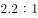
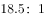

# 同基数两类人数之比（分母为'不足'型模糊值的放缩定界）

考点：[[20-考点/资料分析/倍数/同基数两类人数之比（分母为'不足'型模糊值的放缩定界）|倍数 / 同基数两类人数之比（分母为'不足'型模糊值的放缩定界）]]
材料：[[15-材料/资料分析/187066 某年度某机构关于中国宠物主人消费行为|187066 某年度某机构关于中国宠物主人消费行为]]

**问法模型**：题干问'同一调查（基数10680）中两类选择者人数之比'→同基数下人数之比=两占比之比（基数10680约去），再利用分母'不足X%'做放缩，判定比值大于某界值

## 推理链
1. 第1步：题干要求'选择综合电商平台和选择购物类O2O服务的消费者人数之比'，两指标共用同一基数10680份有效问卷：综合电商平台占比为精确百分数（记a%），O2O服务有选择意向者'不足'某上限值（记b%，b%为约数界限；所给文本中两处数值均空格缺省，须以完整原卷数值为准）
2. 第2步：同基数比值模型：人数之比=(10680×a%)÷(10680×b′)=a%÷b′，其中b′为O2O真实占比，基数10680在分子分母中直接约去
3. 第3步：放缩定界：由'O2O选择意向不足b%'可知真实分母b′<b%，分母变小则分数值变大，故真实比值>a%÷b%（即大于以O2O上限b%代入所得的比值）
4. 第4步：对照选项：比值应'大于'a%÷b%这一界限值，与'大于'型且界值匹配的D项一致，故正确答案为D

**最快解法**：⚡ 放缩法（分母'不足'型）：同基数10680约去，人数之比=综合电商占比÷O2O占比；因O2O占比'不足'上限b%，分母取上限b%时比值最小，故真实比值必大于'综合电商占比÷b%'，无需精确数值即可直接锁定'大于'界值的D项

## 易错点
- ⚠ 把'不足X%'当精确占比代入硬算精确比值——'不足/不到'只是上限约数，本题只能判定比值大于某界值的范围结论，算不出也不需要精确数
- ⚠ 忽视同基数约简：误以为必须先算出两类人数再相比，实际占比之比即可，10680直接约去；同时勿与可多选的'人次'口径混淆，本题两处均为单一占比，无重复计数
- ⚠ 材料文本中所有关键百分数均为空格缺省，切勿凭常识或做题经验补数（如凭印象填综合电商占比或O2O上限），比较界值必须以完整原卷数值为准

## 母题抽象
> 🧩 当题干问'同一总量下两分量之比'且分母一侧为'不足/不到X'型模糊值时，先同基数约去得占比之比，再令分母取上限X放缩——真实分母<X⇒真实比值>分子/X，直接锁定'大于X'型选项

**同类特征**：同一基数下两类消费者'人数之比'、分子占比为精确值、分母为'不足'型模糊值、选项为'小于/大于'某界值，是比值定界而非求精确值、基数10680在分子分母中可约去、利用分母变小、分数值变大的放缩逻辑

## 相关题
（暂无）

---

### 题干
问卷中，选择综合电商平台和选择购物类O2O服务的消费者人数之比为：

### 选项
- A. 
小于

- B. 
大于

- C. 
小于

- D. 
大于
　✅

### 官方解析

由题干“……和……人数之比”，可知本题为比值计算问题。定位文字材料“的被访问者选择综合电商平台……对购物类O2O服务有选择意向的不足”，则两者之比为：，分母不足，分母变小，分数值变大，故两者之比大于。

故正确答案为D。

### 给定材料

        某年度某机构关于中国宠物主人消费行为及倾向调查回收的10680份有效问卷显示：女性养宠者占，宠物主人为“80-90后”占。将宠物定义为“孩子”“亲人”“朋友”和“宠物”的分别为、、和。的人月开销在100元以内，的人开销在101至500元之间，而花费在501至1000元之间的达到，月消费1000元以上的人群达到。在购买物品方面，购买宠物食物的人数达到有效问卷总人数的，其次为药品、保健品，以及日用品、玩具、服饰五项，均接近。宠物主人外出时，四成“委托亲朋照顾”，三成“一起带走”，委托寄养还不到。在训练方面，的宠物处于自主训练或放任生长的状态，但近一半人希望爱宠得到专业训练。在购买渠道方面，的被访问者选择综合电商平台，选择线下综合商店或专卖店者为，选择宠物类垂直电商平台的占，但其复购率更高。值得注意的是，目前宠物主人对购物类O2O服务有选择意向的不足。

