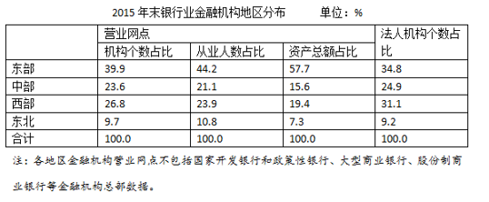

# 倍数计算（'比…多几倍'口径，占比相除约去总量）

考点：[[20-考点/资料分析/倍数/倍数计算（'比…多几倍'口径，占比相除约去总量）|倍数 / 倍数计算（'比…多几倍'口径，占比相除约去总量）]]
材料：[[15-材料/资料分析/187100 中国人民银行《2015年中国区域金融|187100 中国人民银行《2015年中国区域金融]]

**问法模型**：题干'A比B多多少倍'→先算'是几倍'（同一总量下占比相除44.2%÷10.8%≈4.1），再减1，即多约3倍

## 推理链
1. 第1步：题干求2015年末东部从业人数比东北地区'多多少倍'；从业人数=占比×全国总量379.0万人，两地共用同一总量
2. 第2步：定位表格'从业人数占比'列：东部44.2%，东北地区对应表中'西北'行，占比10.8%（行名口径不一致须确认对应）
3. 第3步：因总量相同可约去，多几倍=(44.2%−10.8%)÷10.8%=33.4÷10.8≈3.09倍（或先算是几倍44.2÷10.8≈4.09，再减1）
4. 第4步：与选项对照，3.09最接近整数3，故选C

**最快解法**：⚡ 占比相除（比值模型，总量379.0万自动约掉，无需换算绝对量）+倍数口径修正：33.4/10.8，直除首位得3.09≈3，秒选C；心算版：44.2/10.8≈4.1，'多'=是−1≈3

## 易错点
- ⚠ '多多少倍'≠'是几倍'：直接用44.2÷10.8≈4.1作答会误选D（4），必须再减1（多x倍=是x+1倍）
- ⚠ 行名陷阱：题干说'东北地区'而表格行名为'西北'，须确认该行数据10.8%；若错找或错定位到西部行（23.9）会算成(44.2−23.9)/23.9≈0.85而误选A
- ⚠ 模型误用：本题是占比相除的比值模型，无需'占比×379.0万人'换算绝对量，先算167.5万与40.9万再相除虽结论相同但浪费时间

## 母题抽象
> 🧩 当题干出现'A比B多多少倍'且A、B为同一总量下的占比（或总量可约去）时，直接占比相除得'是几倍'，再减1得'多几倍'，对照最接近的整数选项

**同类特征**：比……多多少倍、从业人数（占比列）、同一全国总量379.0万人、地区间两两比较、2015年末、总量可约去、占比直接相除

## 相关题
- [[10-真题/资料分析/增长/2172271 基期量计算（时点值差法：基期时点值=现期时点值-期间新增量）|2172271]]（江苏 2018，相关度1）
- [[10-真题/资料分析/倍数/4663217 现期倍数计算（'多多少倍'型，(A-B)-B）|4663217]]（山东 2022，相关度1）
- [[10-真题/资料分析/比重/2051590 现期比重部分量求差（占比差×全国总量）|2051590]]（陕西 2017，相关度1）
- [[10-真题/资料分析/平均数/2051604 现期平均数大小比较（资产总额占比÷网点个数占比，全国总量约掉）|2051604]]（陕西 2017，相关度1）

---

### 题干
2015年末，我国东部地区银行业金融机构从业人数比东北地区的多多少倍？

### 选项
- A. 1
- B. 2
- C. 3　✅
- D. 4

### 官方解析
由题干“2015年末……多……倍”，可知本题为一般增长率问题。定位表格第三列可知，2015年末，东部地区银行业金融机构从业人数占比为，东北地区银行业金融机构从业人数占比为，则东部地区从业人数比东北地区多倍。
故正确答案为C。

### 给定材料

        中国人民银行发布的《2015年中国区域金融运营报告》披露：2015年末，全国各地区银行业金融机构网点共计22.1万个，从业人员379.0万人，资产总额174.2万亿元，同比分别增长、、。分地区看，中部、西部和东北地区银行业金融机构发展加快，从业人员和资产规模占全国的比例同比均有所提高，东部地区这两项指标同比分别下降1.0个百分点和0.7个百分点。

