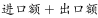
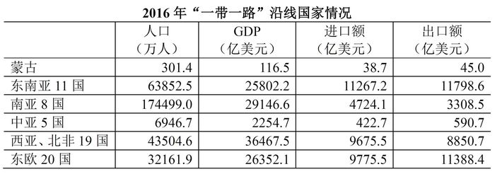

# 现期倍数（人均GDP两步作商）

考点：[[20-考点/资料分析/倍数/现期倍数（人均GDP两步作商）|倍数 / 现期倍数（人均GDP两步作商）]]
材料：[[15-材料/资料分析/191536 2016年'一带一路'沿线64国的经|191536 2016年'一带一路'沿线64国的经]]

**问法模型**：题干'A区域的人均GDP约是B区域的多少倍'→ 先各自做'GDP÷人口'得人均值，再对两个平均数作商的现期倍数模型

## 推理链
1. 第1步：由题干'2016年……是……的多少倍'且材料仅有2016年现期数据、无增速，判定为现期倍数问题；定位统计表：东欧20国人口32161.9万人、GDP 26352.1亿美元，中亚5国人口6946.7万人、GDP 2254.7亿美元
2. 第2步：人均GDP=GDP÷人口；且单位上'亿美元÷万人=万美元/人'，两区域口径一致，倍数=(东欧GDP÷东欧人口)÷(中亚GDP÷中亚人口)=(26352.1×6946.7)÷(2254.7×32161.9)
3. 第3步：东欧人均GDP=26352.1÷32161.9≈0.82万美元/人，中亚人均GDP=2254.7÷6946.7≈0.32万美元/人
4. 第4步：倍数≈0.82÷0.32≈2.5（拆式验证：26352.1÷2254.7≈11.7，32161.9÷6946.7≈4.63，11.7÷4.63≈2.53）
5. 第5步：与选项对照，2.5与A项最接近，故选A

**最快解法**：⚡ 截位直除+倍数拆式：将式子整理为(东欧GDP÷中亚GDP)÷(东欧人口÷中亚人口)=11.7÷4.63≈2.5，两步三位截位直除即可锁定A；切勿只算分子11.7而误选D

## 易错点
- ⚠ 量级/单位陷阱：亿美元÷万人恰好=万美元/人，两区域同口径直接作商，勿再错误乘除10000
- ⚠ 选项陷阱：D项11.7恰是'东欧GDP÷中亚GDP'的总量之比（26352.1÷2254.7≈11.7），忘记除以人口之比就会误选D
- ⚠ 取数错配：须同一行内取本区域的人口与GDP（东欧32161.9万人配26352.1亿美元，中亚6946.7万人配2254.7亿美元），勿跨行混用或误用进口额/出口额代替GDP

## 母题抽象
> 🧩 当题干出现'A的人均X是B的多少倍'且表格分区域列出总量与人口时，用'(A总量×B人口)÷(B总量×A人口)'交叉约减作商，并用总量之比明显偏大（如11.7）来反向验证须再除人口之比

**同类特征**：东欧20国的人均GDP、是中亚5国的多少倍、现期倍数（无增速、无基期）、GDP÷人口两步作商、亿美元与万人单位相除、选项含总量之比干扰值

## 相关题
（暂无）

---

### 题干
2016年“一带一路”沿线国家中，东欧20国的人均GDP约是中亚5国的多少倍？

### 选项
- A. 2.5　✅
- B. 3.6
- C. 5.3
- D. 11.7

### 官方解析
由题干“2016年······是······的多少倍”，材料已知时间为2016年，可判定此题为现期倍数问题。定位统计表：“东欧20国的人口为32161.9万人，GDP为26352.1亿美元，中亚5国的人口为6946.7万人，GDP为2254.7亿美元”，可得，东欧20国的，中亚5国的，故2016年“一带一路”沿线国家中，东欧20国的人均GDP约是中亚5国的倍，与A项最为接近。
故正确答案为A。

### 给定材料

<b>根据以下资料，回答下列5题。</b>

        2016年“一带一路”沿线64个国家GDP之和约为12.0万亿美元，占全球GDP的；人口总数约为32.1亿人，占全球总人口的；对外贸易总额（）约为71885.6亿美元，占全球贸易总额的。

