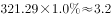
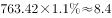
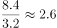

# 现期倍数计算（文字基数×表格比重的拼接型）

考点：[[20-考点/资料分析/倍数/现期倍数计算（文字基数×表格比重的拼接型）|倍数 / 现期倍数计算（文字基数×表格比重的拼接型）]]
材料：[[15-材料/资料分析/194389 2016年江苏农业生产经营人员127|194389 2016年江苏农业生产经营人员127]]

**问法模型**：题干'A地区某构成人员是B地区的几倍'→两地人数均须'文字段基数×表格比重'求得，再作商求倍数，即(基数A×比重A)÷(基数B×比重B)

## 推理链
1. 第1步：从文字材料提取两地基数——苏北农业生产经营人员763.42万人、苏中321.29万人
2. 第2步：从表格'受教育程度—大专及以上'行提取两地比重——苏北1.1%、苏中1.0%
3. 第3步：代入'人数=基数×比重'：苏北=763.42×1.1%≈8.40万人，苏中=321.29×1.0%≈3.21万人
4. 第4步：作商求倍数：8.40÷3.21≈2.61倍
5. 第5步：与选项对照，最接近C项2.6倍，故选C

**最快解法**：⚡ 截位直除+比重比合并：倍数=(763.42/321.29)×(1.1/1.0)≈2.38×1.1≈2.61，直接锁定C；更粗速算：763.42×1.1≈840，321.29×1.0≈321，840/321≈2.6

## 易错点
- ⚠ 比重与基数配错：误用全省总量1270.87万或全省比重1.2%作基数/比重，地区指标必须配地区基数
- ⚠ 把表中百分数直接当人数作比得1.1/1.0=1.1倍，忽略文字段基数差异（苏北基数约为苏中的2.4倍）
- ⚠ 分子分母颠倒：问'苏北是苏中的几倍'应为苏北÷苏中≈2.6，反除约0.38无对应选项易慌乱

## 母题抽象
> 🧩 当题干出现'A地区某类构成人员是B地区的几倍'特征时，用'各地基数×各地比重再作商'模型，可合并为(基数A×比重A)/(基数B×比重B)一步截位直除，验证结果与选项量级吻合

**同类特征**：现期倍数、大专及以上文化程度、苏北是苏中的、地区人数×地区比重、文字+表格拼接、万人基数×小百分比

## 相关题
- [[10-真题/资料分析/倍数/10204451 现期倍数计算（部分与部分之和的倍数）|10204451]]（广东 2024，相关度1）
- [[10-真题/资料分析/倍数/10297461 现期倍数计算（含'二季度=上半年-一季度'时段拆分推算）|10297461]]（四川 2025，相关度1）
- [[10-真题/资料分析/倍数/1797608 现期倍数计算+加总排序定位|1797608]]（山东 2016，相关度1）
- [[10-真题/资料分析/倍数/2024182 现期倍数（两分项净增量之比）|2024182]]（重庆 2016，相关度1）
- [[10-真题/资料分析/倍数/2042820 现期倍数计算（同一子总体内占比相除）|2042820]]（江苏 2017，相关度1）

---

### 题干
2016年苏北地区的大专及以上文化程度农业生产经营人员是苏中地区的：

### 选项
- A. 1.9倍
- B. 2.2倍
- C. 2.6倍　✅
- D. 3.1倍

### 官方解析

根据题干“2016年…是…”结合选项为倍数，判定本题为现期倍数问题。定位文字材料“2016年，苏中地区农业生产经营人员为321.29万人，苏北地区为763.42万人”；定位表格，苏中地区的大专及以上农业生产经营人员占，苏北地区的大专及以上农业生产经营人员占。根据公式：，则苏中地区的大专及以上农业生产经营人员为万人，苏北地区为万人，后者是前者的倍，与C项最接近。

故正确答案为C。

### 给定材料

二、根据以下资料回答116-120题。

        2016年江苏农业生产经营人员1270.87万人。其中女性645.40万人，苏南、苏中、苏北地区分别有186.16万人、321.29万人、763.42万人；年龄35岁及以下的有127万人。36-54岁的有524.90万人、55岁及以上的有618.87万人。

