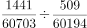
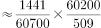

# 两期增长率之比（现期倍数计算，基期值来自柱状图）

考点：[[20-考点/资料分析/倍数/两期增长率之比（现期倍数计算，基期值来自柱状图）|倍数 / 两期增长率之比（现期倍数计算，基期值来自柱状图）]]
材料：[[15-材料/资料分析/194405 2017年我国粮食及主要农作物（小麦|194405 2017年我国粮食及主要农作物（小麦]]

**问法模型**：题干'A年增长率约是B年的多少倍'→先用（当年-上年）/上年分别求两年增长率，再相除求倍数

## 推理链
1. 第1步：从柱状图读取三年当期产量：2013年60194万吨、2014年60703万吨、2015年62144万吨（单位万吨）
2. 第2步：增长率公式：增长率=（现期-基期）/基期，2015年的基期是2014年，2014年的基期是2013年
3. 第3步：2015年增长率=（62144-60703）/60703=1441/60703≈2.37%
4. 第4步：2014年增长率=（60703-60194）/60194=509/60194≈0.85%
5. 第5步：倍数=2.37%/0.85%≈2.8倍（等价于1441/509×60194/60703≈2.83×0.99≈2.8）
6. 第6步：与选项对照：2.8与A项3最接近，其余5、7、9均远大于计算值，故选A

**最快解法**：⚡ 增量之比速估+截位直除：两年基数60703与60194几乎相同（差约0.8%），倍数≈增量之比1441/509≈2.8，直接锁定最近的3（A）；严谨做法为1441/60703÷(509/60194)≈2.8

## 易错点
- ⚠ 基期取错：2015年增长率的基期是2014年（60703），2014年增长率的基期是2013年（60194），勿误用2016年61625或把'增长率'算成环比增量
- ⚠ 单位与量级误读：柱状图纵轴为万吨（6亿吨量级），勿把60194读成其他单位；纵轴起点为59000而非0，柱高比例不等于数量比例，必须用标注数值计算
- ⚠ 倍数与增长率混淆：题目问'几倍'而非增长率本身，算出的2.37%、0.85%只是中间量；同时图示2016年较2015年下降，勿凭'连年增长'直觉取数

## 母题抽象
> 🧩 当题干出现'A年增长率约是B年的多少倍'且材料为各年当期值柱状图时，用（当年-上年）/上年分别求两期增长率再相除；若两期基数接近（差<1%），可直接用增量之比速估并选最近选项

**同类特征**：约是…的（ ）倍、相较于上一年、增长率、2015年与2014年对比、柱状图读数（万吨）

## 相关题
- [[10-真题/资料分析/增长/2434297 一般增长率计算与折线图匹配（增长率走势比较）|2434297]]（新疆 2019，相关度1）
- [[10-真题/资料分析/增长/5509531 逐年增长率计算与变动趋势比较（趋势图匹配）|5509531]]（甘肃 2023，相关度1）
- [[10-真题/资料分析/增长/2188118 两期总额之一般增长率计算（多组条形求和后作比）|2188118]]（选调 2018，相关度1）
- [[10-真题/资料分析/增长/13319364 跨期一般增长率（基期为图中最左年份，非相邻年份）|13319364]]（江苏 2025，相关度1）

---

### 题干
相较于上一年，2015年全国粮食产量的增长率约是2014年的（  ）倍。

### 选项
- A. 3　✅
- B. 5
- C. 7
- D. 9

### 官方解析

由题干“…约是…的多少倍”，可判定本题为现期倍数计算问题。定位柱形图可得“2015年全国粮食产量为62144万吨、2014年为60703万吨、2013年为60194万吨”，代入公式：，则2015年全国粮食产量同比增长率；2014年同比增长率。因此，相较于上一年，2015年全国粮食产量的增长率约是2014年的倍，与A项最接近。

故正确答案为A。

### 给定材料

        我国2017年粮食种植面积为11222万公顷，比上年减少81万公顷。其中，小麦种植面积2399万公顷，减少20万公顷；稻谷种植面积3018万公顷，减少0.2万公顷；玉米种植面积3545万公顷，减少132万公顷。棉花种植面积323万公顷，减少12万公顷。油料种植面积1420万公顷，增加7万公顷。糖料种植面积168万公顷，减少1万公顷。

        2017年粮食产量61791万吨，比上年增加166万吨，增产。其中，夏粮产量14031万吨，增产；早稻产量3174万吨，减产；秋粮产量44585万吨，增产。全年谷物产量56455万吨，比上年减产。其中，稻谷产量20856万吨，增产；小麦产量12977万吨，增产；玉米产量21589万吨，减产。全年棉花产量549万吨，比上年增产。油料产量3732万吨，增产。糖料产量12556万吨，增产。茶叶产量255万吨，增产。

