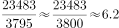
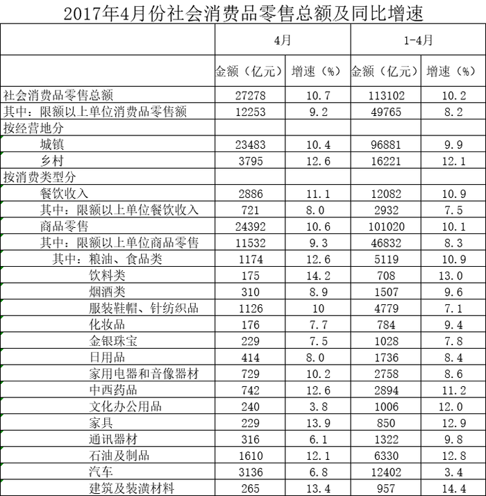

# 现期倍数计算

考点：[[20-考点/资料分析/倍数/现期倍数计算|倍数 / 现期倍数计算]]
材料：[[15-材料/资料分析/195086 2017年4月当月及1~4月累计全国|195086 2017年4月当月及1~4月累计全国]]

**问法模型**：题干为'现期时间+A是B的多少倍'→ 直接用现期值相除 A÷B，无需基期转换

## 推理链
1. 第1步：题干限定'2017年4月份'，判定用表格'4月'列（金额亿元），绝不能用'1~4月'累计列
2. 第2步：定位'按经营地分'层下两行：城镇23483亿元、乡村3795亿元
3. 第3步：现期倍数=城镇÷乡村=23483÷3795
4. 第4步：估算：3795×6=22770，23483−22770=713，713÷3795≈0.19，故结果≈6.19倍
5. 第5步：与选项对照，6.19≈6.2，锁定D；反向验证3795×6.2≈23529，与23483误差不足50，确认无误

**最快解法**：⚡ 截位直除（首位商法）：23483÷3795，首位商6，余713再商约0.19→≈6.2倍直选D；或用选项反乘最快验证：3795×6.2≈23529≈23483，秒锁D

## 易错点
- ⚠ 双列错位陷阱：误用'1~4月'列（96881÷16221≈5.97）会错选C（5.9倍），这是本表最大陷阱
- ⚠ 倍数方向搞反：若算成乡村÷城镇≈0.16，量级上易被A（1.2倍）类选项干扰；'城镇是乡村的几倍'分子必须为城镇
- ⚠ 表格层级陷阱：城镇/乡村在'按经营地分'层下，勿与'按消费类型分'的餐饮、商品零售行混淆，也不可用其中项（限额以上）数据

## 母题抽象
> 🧩 当题干出现'现期时间+A是B的多少倍'时，直接定位现期两值相除A÷B，用首位商估算或选项反乘验证；并列表格务必先锁定'当月列/累计列'再取行，列错位即全错

**同类特征**：2017年4月份（当月口径）、城镇……是……乡村……多少倍、现期倍数、按经营地分、双列并排表格（4月/1~4月）

## 相关题
- [[10-真题/资料分析/倍数/2616169 现期倍数计算|2616169]]（海南 2020，相关度3）
- [[10-真题/资料分析/倍数/2051002 现期倍数计算|2051002]]（江西 2017，相关度3）
- [[10-真题/资料分析/倍数/2616148 现期倍数计算|2616148]]（海南 2020，相关度2）
- [[10-真题/资料分析/倍数/2047712 现期倍数计算|2047712]]（广东 2017，相关度2）
- [[10-真题/资料分析/倍数/4637143 现期倍数计算|4637143]]（国考 2022，相关度2）

---

### 题干
2017年4月份，城镇消费品零售额约是乡村消费品零售额的多少倍？

### 选项
- A. 1.2倍
- B. 5.2倍
- C. 5.9倍
- D. 6.2倍　✅

### 官方解析

根据题干“2017年4月份······是······的多少倍”，可判定本题为现期倍数问题。定位表格材料可知：“2017年4月份，城镇消费品零售额23483亿元，乡村消费品零售额3795亿元。”故城镇消费品零售额约是乡村消费品零售额的倍数为。

故正确答案为D。

### 给定材料

        2017年1～4月份，全国社会消费品网上零售额19180亿元，同比增长。其中，实物商品网上零售额14617亿元，增长。在实物商品网上零售额中，吃、穿和用类商品零售额分别增长，和。

