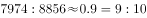

# 两总量之比（比值计算与化简）

考点：[[20-考点/资料分析/倍数/两总量之比（比值计算与化简）|倍数 / 两总量之比（比值计算与化简）]]
材料：[[15-材料/资料分析/238899 2018年我国双向非金融类直接投资：|238899 2018年我国双向非金融类直接投资：]]

**问法模型**：'A与B之比约为'的问法 → 统一币种/单位口径后直接作比A:B，截位直除化简为最简整数比对照选项。

## 推理链
1. 第1步：题干求2018年'我国对外直接投资额'与'外商在华直接投资额'之比，从文字段提取两总量：对外非金融类直接投资7974亿元、外商在华投资金额8856亿元（折1350亿美元）
2. 第2步：两量均为2018年当年值且同为人民币亿元计价，口径一致可直接作比；若用美元口径则取表2总计1213亿美元与折算后1350亿美元
3. 第3步：代入计算：7974:8856≈0.90:1（截位直除：7974/8856≈80/89≈0.9），化简得约9:10
4. 第4步：美元口径交叉验证：1213/1350≈0.90，同样约9:10，两种币种口径结论一致
5. 第5步：与选项对照：A为10:9（约1.11）、B为9:10（0.9）、C为9:8（1.125）、D为8:9（约0.889），0.90与B最接近，故选B

**最快解法**：⚡ 截位直除：7974/8856≈8000/8900≈0.9，即9:10，直接锁定B；亦可用材料折算关系1213/1350≈0.9做美元口径二次验证。

## 易错点
- ⚠ 币种混排陷阱：表2对外投资为1213亿美元、表1外商在华为8856亿元，若不统一币种直接用1213:8856作比必错，必须用7974:8856（亿元口径）或1213:1350（亿美元口径）
- ⚠ 比值方向颠倒：题干是'对外:在华'，对外（7974亿元）<在华（8856亿元），比值小于1对应9:10；分子分母写反会误选A（10:9）
- ⚠ 总量张冠李戴：勿将'一带一路'对华投资424亿元、对外投资156亿美元或表内某行业数值误当总量代入，也不可用分项相加（分项之和小于总计）冒充总量

## 母题抽象
> 🧩 当题干出现'两个总量之比约为'且两表单位/币种不一致时，先用材料给出的折算关系（如8856亿元=1350亿美元）统一口径，再截位直除化成最简整数比对照选项。

**同类特征**：两总量之比约为、我国对外直接投资额、外商在华直接投资额、非金融领域、2018年、比值型选项（如9：10）

## 相关题
- [[10-真题/资料分析/增长/2374708 同比增长率比较（增幅最大）|2374708]]（广东 2019，相关度1）
- [[10-真题/资料分析/其他/2374716 表格直接读数比较（最大值识别）|2374716]]（广东 2019，相关度1）
- [[10-真题/资料分析/增长/2374835 增长量计算（现期值-基期值）|2374835]]（广东 2019，相关度1）
- [[10-真题/资料分析/比重/2374836 比重（比例）两期差值计算——百分点口径|2374836]]（广东 2019，相关度1）
- [[10-真题/资料分析/其他/2394011 进出口顺差计算（顺差=出口-进口，简单作差）|2394011]]（青海 2019，相关度1）

---

### 题干
2018年，在非金融领域，我国对外直接投资额和外商在华直接投资额之比约为：

### 选项
- A. 10：9
- B. 9：10　✅
- C. 9：8
- D. 8：9

### 官方解析

根据题干“2018年······之比”，结合材料给出2018年数据，可判定本题为比值计算问题。定位文字材料第二段可知：2018年我国对外非金融类直接投资7974亿元，定位文字材料第一段可知：外商在华投资金额为8856亿元，两者之比约为。

故正确答案为B。

### 给定材料

        自改革开放以来，外商在华投资势头良好。今年两会期间，《中华人民共和国外商投资法（草案）》成为重要议题。2018年，外商直接在华投资（非金融类）新设立企业60533家。外商直接在华投资金额8856亿元，折1350亿美元。其中“一带一路”沿线国家对华直接投资新设立企业4479家，对华直接投资424亿元。全年高技术制造业实际使用外资（非金融类）898亿元，增长。

        2018年，我国对外非金融类直接投资7974亿元，同比下降，其中对“一带一路”沿线国家非金融类直接投资156亿美元，同比增长。

