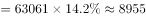
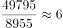

# 现期倍数计算（跨图表拼接：占比×总量换算后作商）

考点：[[20-考点/资料分析/倍数/现期倍数计算（跨图表拼接：占比×总量换算后作商）|倍数 / 现期倍数计算（跨图表拼接：占比×总量换算后作商）]]
材料：[[15-材料/资料分析/239412 2014-2018年我国软件行业收入|239412 2014-2018年我国软件行业收入]]

**问法模型**：题干问'占比最高的地区是占比最低子行业的约几倍'→现期倍数模型：先在两个维度中各自锁定目标（同一总盘下收入最大即占比最大、占比最小者），再用'子行业收入=合计×占比'跨图拼接后作商

## 推理链
1. 第1步：表1给出2018年四地区收入为东部49795、中部3163、西部7189、东北2914亿元，四地区共享同一总盘（合计63061亿元），总体相同时部分量最大者占比最大，故占比最高的地区为东部，收入49795亿元
2. 第2步：图2给出2018年三大子行业占比：信息技术服务55.10%、软件产品30.70%、嵌入式产品14.20%，占比最低的子行业为嵌入式产品（14.20%，黑色条）
3. 第3步：图2只给占比不给绝对值，需跨图拼接换算：2018年嵌入式产品收入=63061×14.20%≈8955亿元
4. 第4步：代入现期倍数公式：49795÷8955≈5.56倍
5. 第5步：与选项4/6/8/10倍对照，5.56倍最接近6倍，故选B

**最快解法**：⚡ 占比作商法+百化分：同一总盘下'地区收入÷子行业收入'可直接化为'两个占比相商'，即(49795/63061)÷14.2%≈79%÷14.2%≈5.6倍；或把14.2%百化分为约1/7，嵌入式收入≈63061÷7≈9000亿元，49795÷9000≈5.5倍，选项中距6倍最近，秒选B，全程无需精算8955

## 易错点
- ⚠ 跨图拼接陷阱：图2只给占比，嵌入式产品收入必须乘以表1合计63061（得约8955亿元），直接把14.20%当亿元用或漏乘总量是本题最大坑
- ⚠ 图例顺序陷阱：三条形从上到下为信息技术服务/软件产品/嵌入式产品，嵌入式是最下方黑色条14.20%，若误取中间白色条软件产品30.70%，会算得49795÷(63061×30.7%)≈2.6倍而误选A
- ⚠ '占比最高地区'判定陷阱：同一总盘下部分量大即占比大，直接锁定收入最大的东部49795；勿把表1'合计'行63061误当地区参与，或受兄弟题干扰错选西部

## 母题抽象
> 🧩 当题干出现'同一总盘下A维度占比最高（最低）的部分是B维度占比最低（最高）的子项的几倍'特征时，用'部分量=总量×占比'跨图拼接后作商；由于两个量除以同一总量，可直接用'A占比÷B占比'替代大数相除快速验证

**同类特征**：占比最高的地区、占比最低的子行业、同年（现期）倍数、约（）倍、表1+图2跨图表拼接、地区与子行业共享同一合计总盘

## 相关题
（暂无）

---

### 题干
2018年软件行业总收入中占比最高的地区的总收入是同年软件行业总收入中占比最低的子行业的总收入的约（  ）

### 选项
- A. 4倍
- B. 6倍　✅
- C. 8倍
- D. 10倍

### 官方解析

根据题干“2018年……的总收入是……的总收入”，结合选项为倍数，可判定本题为现期倍数问题。定位表格，根据总体相同时部分量最大的比重最大，可知占比最高的地区为东部地区，总收入为49795亿元。定位统计图可知，2018年总收入占比最低的子行业为嵌入式产品，占比为，且根据表格可知2018年总收入为63061亿元，故2018年嵌入式产品总收入亿元。则现期倍数倍。

故正确答案为B。

### 给定材料

 根据以下资料，回答下列问题 

