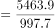

# 现期倍数计算（先定位最大值年份再跨行求倍数）

考点：[[20-考点/资料分析/倍数/现期倍数计算（先定位最大值年份再跨行求倍数）|倍数 / 现期倍数计算（先定位最大值年份再跨行求倍数）]]
材料：[[15-材料/资料分析/239972 2013~2017年我国环境污染治理|239972 2013~2017年我国环境污染治理]]

**问法模型**：题干为'某指标最高的年份，其A是B的多少倍'→先在指定行找最大值锁定年份，再用该年份同列的A÷B做现期倍数直除

## 推理链
1. 第1步：定位'当年完成环保验收项目环保投资'行：2013年2964.5、2014年3113.9、2015年3085.8、2016年2988.8、2017年2771.7亿元，最高为2014年3113.9亿元
2. 第2步：题干'其'指2014年，同列（2014年）取两行数据：城镇环境基础设施建设投资5463.9亿元，工业污染源治理投资997.7亿元
3. 第3步：现期倍数=5463.9÷997.7≈5.48（997.7×5.5≈5487，与5463.9接近，商略小于5.5）
4. 第4步：与选项对照，5.48≈5.5，对应A，排除B(6.1)、C(6.4)、D(6.6)

**最快解法**：⚡ 截位直除：先扫描'当年完成环保验收项目环保投资'行锁定2014年（3113.9最大），再算5463.9÷997.7，首位商5、次位约4~8，得≈5.48，直接选A（5.5）；更快的验证：997.7×5.5≈5487＞5463.9＞997.7×5.4≈5388，故倍数在5.4~5.5之间，唯一接近A

## 易错点
- ⚠ 定位行标陷阱：'最高年份'是'当年完成环保验收项目环保投资'行的2014年（3113.9亿元），不是投资总额最高年（2017年9539.0），也不是城镇投资最高年（2017年6085.7），行标看错则整题取数全错
- ⚠ 跨行取数陷阱：确定2014年后，城镇投资(5463.9)与工业污染源治理投资(997.7)必须同取2014年列；若顺手用2017年数据(6085.7÷681.5≈8.9)会远离所有选项
- ⚠ 分子分母颠倒：是'城镇投资÷工业污染源治理投资'（大÷小），颠倒得997.7÷5463.9≈0.18；另注意'其中'五个分项（燃气、集中供热、排水、园林绿化、市容环境卫生）只是城镇投资的分项，与本题两行无关，勿混入

## 母题抽象
> 🧩 当题干出现'某指标最高的年份，其A是B的多少倍'时，先在指定行扫出最大值锁定年份，再同列取A、B两行数据做现期倍数（A÷B）截位直除，用选项反乘验证区间

**同类特征**：'最高的年份'（先定位最大值）、'是……的多少倍'（现期倍数）、'其'字指代（年份需与取数列一致）、跨行取数（一行定年份、另两行拼数据）、无'增长/比上年'字样（不需要基期换算）

## 相关题
（暂无）

---

### 题干

20132017年，当年完成环保验收项目环保投资最高的年份其城镇环境基础设施建设投资额约是工业污染源治理投资额的多少倍？

### 选项
- A. 5.5　✅
- B. 6.1
- C. 6.4
- D. 6.6

### 官方解析

根据题干“20132017年，当年完成···是······多少倍”可判定本题为现期倍数问题。定位统计表倒数第二行可知，20132017年完成环保验收项目投资最高的年份是2014年为3113.9亿元。定位表格2014年城镇环境基础设施建设投资额为5463.9亿元，工业污染源治理投资额为997.7亿元，根据倍数计算问题公式。

故正确答案为A。

### 给定材料

根据所给资料，回答下列问题。

