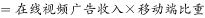
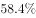
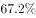
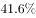
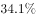
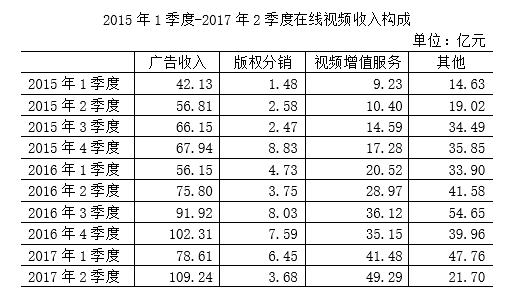

# 现期倍数关系转化为比重阈值判断（移动端=非移动端2倍以上 ⟺ 移动端占比-2-3≈66.7%）

考点：[[20-考点/资料分析/倍数/现期倍数关系转化为比重阈值判断（移动端=非移动端2倍以上 ⟺ 移动端占比-2-3≈66.7%）|倍数 / 现期倍数关系转化为比重阈值判断（移动端=非移动端2倍以上 ⟺ 移动端占比>2/3≈66.7%）]]
材料：[[15-材料/资料分析/239973 2015年1季度—2017年2季度在|239973 2015年1季度—2017年2季度在]]

**问法模型**：'A是B的2倍以上的季度有几个'→ 因同一季度移动端+非移动端=广告收入总额，将倍数条件转换为移动端占比>2/(2+1)=2/3≈66.7%，只需在折线图上逐点比对，无需计算任何绝对额

## 推理链
1. 第1步：题干限定时间为2015～2016年，即只看折线图15Q1～16Q4共8个季度，2017年两个季度（71.4%、70.0%）不在范围内
2. 第2步：设移动端占比为p，移动端收入=广告收入×p，非移动端=广告收入×(1−p)，同一季度广告收入总额相同；'移动端>2×非移动端'即 p>2(1−p)，解得 p>2/3≈66.7%
3. 第3步：定位折线图读数：15Q1=32.8、15Q2=40.9、15Q3=44.1、15Q4=56.3、16Q1=58.4、16Q2=60.8、16Q3=67.4、16Q4=65.9（单位%）
4. 第4步：逐点与66.7%比对：仅16Q3的67.4%>66.7%达标；最接近的16Q4为65.9%，差约0.8个百分点未达标，其余均远低于阈值
5. 第5步：满足条件的季度仅2016年3季度1个，对照选项得A

**最快解法**：⚡ 阈值判断法：把'2倍以上'秒转为'占比>2/3≈66.7%'，直接在折线图上数大于66.7%的点；先圈定时间范围15Q1～16Q4，可见仅16Q3（67.4）一个点达标，秒选A，全程不需查表格、不计算金额

## 易错点
- ⚠ 时间范围陷阱：忽略题干'2015～2016年'的限定，把17Q1（71.4%）、17Q2（70.0%）也计入，会数出3个季度误选C
- ⚠ 临界点误判：误把16Q4的65.9%当作达标（离66.7%仅差0.8个百分点），或凭占比'总体上行'的趋势直觉认为16Q3之后都达标，得出2个及以上的错误结论
- ⚠ 阈值转换错误：把'是…的2倍以上'误当作占比>50%判断（那样15Q4起全部达标）；正确阈值为2/3≈66.7%而非1/2，也不必用表格广告收入×占比分别算移动端与非移动端绝对额再比较，那样既费时又易错

## 母题抽象
> 🧩 当题干出现'A是B的n倍以上的量有几个'特征时，先用时间范围筛掉区间外数据，再把倍数条件转为占比阈值 A/(A+B)>n/(n+1)（n=2时即2/3≈66.7%），直接在比重图上逐点比对计数，无需算绝对额

**同类特征**：是……的2倍以上、有几个（计数类问法）、移动端广告收入与非移动端（同季总额相同）、限定2015～2016年（时间截断）、依赖折线图比重数据、临界值2/3≈66.7%判断

## 相关题
- [[10-真题/资料分析/增长/2725323 增长率比较（多指标三年增速筛选计数）|2725323]]（四川 2020，相关度1）

---

### 题干
2015～2016年，在线视频移动端广告收入是非移动端的2倍以上的季度有几个？

### 选项
- A. 1　✅
- B. 2
- C. 3
- D. 4

### 官方解析

根据题干“···2倍以上”，判定本题为现期倍数问题，根据移动端广告收入，非移动端广告收入，同一季度在线视频广告收入相同，因此只需判断移动端广告收入比重是否大于即可。定位折线图， 2015年1季度、2015年2季度、2015年3季度、2015年4季度、2016年1季度、2016年2季度、2016年3季度、2016年4季度，移动端广告收入比重分别为：，，，，，，，；非移动端广告收入比重分别为：，，，，，，，；

因此在线视频移动端广告收入是非移动端的2倍以上的季度只有2016年的3季度。

故正确答案为A。

### 给定材料

根据所给资料，回答下列问题。

注：“15Q1”表示2015年1季度数据，其余类推

