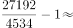

# 现期倍数之'多几倍'计算

考点：[[20-考点/资料分析/倍数/现期倍数之'多几倍'计算|倍数 / 现期倍数之'多几倍'计算]]
材料：[[15-材料/资料分析/240009 2019年一季度全国社会消费品零售总|240009 2019年一季度全国社会消费品零售总]]

**问法模型**：'A比B多几倍'→用(A-B)/B（即A/B-1）计算，区别于'是几倍'的A/B

## 推理链
1. 第1步：题干问'2019年3月'，需取'3月份'当月列数据（勿取1-3月累计），城镇消费品零售额27192亿元，乡村4534亿元
2. 第2步：'多几倍'公式为(城镇-乡村)/乡村=城镇/乡村-1
3. 第3步：代入(27192-4534)/4534=22658/4534≈5.0（或27192/4534≈6.0，再减1）
4. 第4步：与选项对照，5.0对应C项，D项6.0为'是几倍'的干扰项

**最快解法**：⚡ 截位直除：27192/4534，首商可得5.99≈6.0，'多几倍'再减1得5.0，直接锁定C；亦可直接算22658/4534首位上5

## 易错点
- ⚠ '多几倍'与'是几倍'混淆：27192/4534≈6.0是'是几倍'，对应D项陷阱；'多几倍'须减1得5.0
- ⚠ 读数串列：误用1-3月份累计值83402与14388，而题干明确问3月当月，应取27192与4534
- ⚠ 折线图增速8.5%/9.4%为同比增速，与本题倍数计算无关，勿混入

## 母题抽象
> 🧩 当题干出现'A比B多几倍'特征时，用A/B-1（或(A-B)/B）计算，并警惕选项中放置'A/B'原值的陷阱

**同类特征**：多几倍、2019年3月、城镇消费品零售额、乡村消费品零售额、两数对比求倍数

## 相关题
- [[10-真题/资料分析/增长/2050272 现期量计算（按同比增速外推一期）|2050272]]（湖南 2017，相关度1）
- [[10-真题/资料分析/比重/2377004 基期比重计算|2377004]]（选调 2019，相关度1）
- [[10-真题/资料分析/增长/2049864 增长量计算（已知现期量与同比增速）|2049864]]（湖南 2017，相关度1）
- [[10-真题/资料分析/增长/2051540 现期值计算（按同比增速外推下一期）|2051540]]（天津 2017，相关度1）

---

### 题干
2019年3月，城镇消费品零售额比乡村消费品零售额多几倍？

### 选项
- A. 3.8
- B. 4.8
- C. 5.0　✅
- D. 6.0

### 官方解析

根据题干所求“2019年3月···多几倍”，可判定本题为现期倍数问题，定位文字材料第二段， 3月份城镇消费品零售额27192亿元，乡村消费品零售额4534亿元，故城镇消费品零售额比乡村消费品零售额多的倍数为：，答案与C项最接近。

故正确答案为C。

### 给定材料

根据以下资料，回答下列问题。

        2019年一季度，社会消费品零售总额97790亿元，同比名义增长（扣除价格因素实际增长，以下除特殊说明外均为名义增长）。其中，3月份社会消费品零售总额31726亿元，同比增长。

        按经营单位所在地分，一季度城镇消费品零售额83402亿元，同比增长；乡村消费品零售额14388亿元，增长。其中，3月份城镇消费品零售额27192亿元，同比增长；乡村消费品零售额4534亿元，增长。

        按消费类型分，一季度餐饮收入10644亿元，同比增长；商品零售87146亿元，增长。其中，3月份餐饮收入3393亿元，同比增长；商品零售28333亿元，增长。

        按零售业态分，一季度限额以上零售业单位中的超市、百货店、专业店零售额同比分别增长、、，专卖店同比下降。

        一季度，全国网上零售额22379亿元，同比增长。其中，实物商品网上零售额17772亿元，增长，占社会消费品零售总额的比重为；在实物商品网上零售额中，吃、穿和用类商品分别增长、和。

