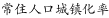
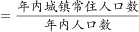
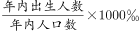
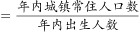

# 现期倍数计算（城镇化率÷人口出生率，两率相除含%与‰量纲换算）

考点：[[20-考点/资料分析/倍数/现期倍数计算（城镇化率÷人口出生率，两率相除含%与‰量纲换算）|倍数 / 现期倍数计算（城镇化率÷人口出生率，两率相除含%与‰量纲换算）]]
材料：[[15-材料/资料分析/240291 2018年我国国民经济和社会发展主要|240291 2018年我国国民经济和社会发展主要]]

**问法模型**：题干'A率约为B率的多少倍'且两率分母相同（同为总人口）→ 现期倍数模型，公共分母约分后直接分子相除，但须先统一%与‰的量纲（相差10倍）。

## 推理链
1. 第1步：从材料第一段提取条件：2018年城镇常住人口83137万人、全年出生人口1523万人、总人口139538万人。
2. 第2步：所用规则：城镇化率=城镇人口÷总人口（单位%），出生率=出生人口÷总人口（单位‰），两率相除求倍数前必须统一量纲，‰化%需÷10。
3. 第3步：代入计算：城镇化率≈83137÷139538≈59.6%，出生率≈1523÷139538≈10.9‰=1.09%，倍数≈59.6%÷1.09%≈54.6；因分母相同可直接约分为83137÷1523≈54.6，两法一致。
4. 第4步：与选项对照：54.6最接近55倍，若未换算量纲得约5.5倍对应干扰项A，故选C。

**最快解法**：⚡ 约分消分母（公式法）+截位直除：两率分母同为总人口139538万人，直接约掉，所求=83137/1523，截位直除83100/1520≈54.7≈55倍，秒选C；全程无需做两次除法，也无需动用被留白的增速数据。

## 易错点
- ⚠ %与‰量纲陷阱：若把城镇化率59.6%与出生率10.9‰不统一量纲直接相除，得约5.5倍而误选A，选项A即为此陷阱值，B/D为量级扰动项。
- ⚠ 两率分母必须同为同一时点总人口139538万人（2018年现期人口），勿误用2017年倒推人口139008万人或只用城镇人口当分母。
- ⚠ 口径混淆：'城镇常住人口83137万人'（第1段人口口径）≠'城镇消费品零售额325637亿元'（第3段消费口径），本题只能用人口数据。

## 母题抽象
> 🧩 当题干出现'两个率（率÷率）相除求倍数'且两率分母相同时，先核对两率单位量纲是否一致（%对‰差10倍），再约分消去公共分母转化为分子相除，用截位直除验证结果落在选项的量级档位（个位档还是十位档）。

**同类特征**：'城镇化率约为当年人口出生率的'——两率相除求倍数、两率分母相同（同为总人口），可约分消分母、%与‰单位量纲相差10倍的隐含换算、现期倍数（2018年当年数据，无需基期换算）、选项呈5.5/5.9与55/59两档量级分布，暗示10倍陷阱、取数集中在纯文字材料第一段人口数据，与留白增速无关

## 相关题
（暂无）

---

### 题干
2018年我国常住人口城镇化率约为当年人口出生率的（    ）。

### 选项
- A. 5.5倍
- B. 5.9倍
- C. 55倍　✅
- D. 59倍

### 官方解析

根据题干“2018年···为···”，结合选项求倍数，且材料时间为2018年，可判定本题为现期倍数问题。根据注释可知，，。则因此2018年常住人口城镇化率是当年人口出生率的倍数。定位文字材料第一段可知，2018年我国城镇常住人口83137万人，全年出生人口1523万人，故所求。

故正确答案为C。

### 给定材料

        2018年我国国内生产总值900309亿元，比上年增长，全国居民人均可支配收入28228元，比上年增长，全国居民恩格尔系数为。2018年我国总人口139538万人，比上年增加530万人，其中城镇常住人口83137万人，全年出生人口1523万人，死亡人口993万人。

        2018年我国货物进出口总额305050亿元，比上年增长。其中，出口164177亿元，增长；进口140873亿元，增长。货物进出口顺差23304亿元，比上年减少5217亿元。对“一带一路”沿线国家进出口总额83657亿元，比上年增长。其中，出口46478亿元，增长；进口37179亿元，增长。

        2018年社会消费品零售总额380987亿元，比上年增长。全年实物商品网上零售额70198亿元，比上年增长。按经营地统计，城镇消费品零售额325637亿元，增长；乡村消费品零售额55350亿元，增长。按消费类型统计，商品零售额338271亿元，增长；餐饮收入额42716亿元，增长。

注释：

> [!warning] 疑点（官方解析可能有误，待人工复核）
> 官方解析引用'根据注释可知'的城镇化率、出生率具体数值在本版材料中为留白（注释栏为空），但结论可用83137÷1523≈54.6≈55倍独立验证，与答案C一致，无实质矛盾。

<!-- CODEX-ANSWER-REVIEW:BEGIN -->
### 本次独立复核

**复核状态：** `resolved`（答案与解析已核定）

**计分答案：** C（可计分）

**复核解析：**

2018城镇化率=83137/139538≈59.58%；出生率=1523/139538×1000≈10.91‰。两率相除须将百分比换成千分率口径：59.58%/1.091%=54.6，最接近55倍，选C。

**相关信息：**

百分数与千分数相除需统一比例单位；人口分母相同可直接化简为城镇人口/出生人数。

**题源依据：** [固定版本原题](https://github.com/Mentat-Uran/kaogongzhentizhengliu/blob/84ab93d4b64b61d897bece8a1c0a5bab06b4feb2/10-%E7%9C%9F%E9%A2%98/%E8%B5%84%E6%96%99%E5%88%86%E6%9E%90/%E5%80%8D%E6%95%B0/2393999%20%E7%8E%B0%E6%9C%9F%E5%80%8D%E6%95%B0%E8%AE%A1%E7%AE%97%EF%BC%88%E5%9F%8E%E9%95%87%E5%8C%96%E7%8E%87%C3%B7%E4%BA%BA%E5%8F%A3%E5%87%BA%E7%94%9F%E7%8E%87%EF%BC%8C%E4%B8%A4%E7%8E%87%E7%9B%B8%E9%99%A4%E5%90%AB%25%E4%B8%8E%E2%80%B0%E9%87%8F%E7%BA%B2%E6%8D%A2%E7%AE%97%EF%BC%89.md)；固定内容 commit `84ab93d4b64b61d897bece8a1c0a5bab06b4feb2`，Markdown blob `de4b0481b7bee439076b87f0b353d5f7af418df6`。
<!-- CODEX-ANSWER-REVIEW:END -->
