# 基期倍数计算（同段共基总额的基期倍数比较）

考点：[[20-考点/资料分析/倍数/基期倍数计算（同段共基总额的基期倍数比较）|倍数 / 基期倍数计算（同段共基总额的基期倍数比较）]]
材料：[[15-材料/资料分析/242945 2018年全国网络零售规模与结构：全|242945 2018年全国网络零售规模与结构：全]]

**问法模型**：题干时间（2017年）早于材料时间（2018年）且问'A约是B的几倍'→ 基期倍数模型：现期倍数×(1+B增速)/(1+A增速)，因两品类共用总额2305亿元，可直接化简为占比之比再乘增速商。

## 推理链
1. 第1步：由第4段提取：2018年全国农产品网络零售额2305亿元，同段给出休闲食品的占比（设a%）与同比增速（设a′%）、滋补食品的占比（设b%）与同比增速（设b′%）（原卷具体数值在本传文本中留空，以原卷为准）。
2. 第2步：规则：两品类现期额分别为2305×a%与2305×b%，求2017年倍数即基期倍数=(2305×a%)÷(1+a′%) ÷ [2305×b%÷(1+b′%)]，总额2305亿元可整体约去。
3. 第3步：化简公式：所求倍数=(a/b)×(1+b′%)/(1+a′%)，即'占比之比×(1+滋补食品增速)/(1+休闲食品增速)'。
4. 第4步：代入原卷占比与增速数值，商约等于2.0。
5. 第5步：与选项对照：1.7/2/2.3/2.6中，2.0与B项'2倍'最接近，故选B。

**最快解法**：⚡ 基期倍数公式法+约分速算：两品类现期额共用总额2305亿元，直接约去，只算'休闲占比÷滋补占比'再乘'(1+滋补增速)/(1+休闲增速)'；先用占比之比锁定量级（2倍附近），再用增速商微调方向，无需分别算出两个基期额。

## 易错点
- ⚠ 时间混淆：题干问2017年、材料给2018年，若直接用2018年占比相除得现期倍数而不乘(1+b′%)/(1+a′%)修正，会错报量级
- ⚠ 增速商方向放反：分子应为(1+滋补食品增速)、分母为(1+休闲食品增速)，颠倒会把结果拉向错误选项
- ⚠ 干扰信息与公式嵌套：本题只需第4段的2305亿元及同段占比与增速，全国90100亿元、农村13700亿元及'比全国网络零售额增速高9.9个百分点'均与本问无关，勿混入计算；每品类基期额须按'2305×占比÷(1+增速)'嵌套，勿把占比当增速用

## 母题抽象
> 🧩 当题干出现'基期年份+A是B的几倍'且A、B同处一段共用同一总额时，用基期倍数公式（现期倍数×(1+B增速)/(1+A增速)，总额可约去），验证时先算现期倍数定档、再看增速商调整方向，选最接近项。

**同类特征**：2017年（基期时间词）、休闲食品、滋补食品、约是……的（几倍）、同段共基总额2305亿元、选项为倍数档位（1.7/2/2.3/2.6）

## 相关题
- [[10-真题/资料分析/倍数/3522356 现期倍数（部分和-其余和的倍数计算）|3522356]]（云南 2021，相关度1）

---

### 题干
2017年全国农产品网络零售品类中，休闲食品零售额约是滋补食品的：

### 选项
- A. 1.7倍
- B. 2倍　✅
- C. 2.3倍
- D. 2.6倍

### 官方解析

由题干“2017年······是······”，选项为倍数，结合材料时间为2018年，判定本题为基期倍数问题。定位文字材料第三段可得“2018年全国农产品网络零售额达2305亿元”。休闲食品占比为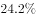，同比增速为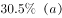；滋补食品占比为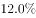，同比增速为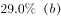。根据公式：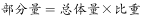，可得2018年休闲食品零售额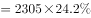；滋补食品零售额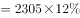。根据基期公式：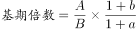，可得所求倍数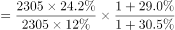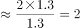倍。

故正确答案为B。

### 给定材料

        2018年全国网络零售额90100亿元，同比增长。其中，实物商品网上零售额为70200亿元，同比增长；非实物商品网上零售额19900亿元，同比增长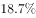。

        2018年全国农村网络零售额为13700亿元。其中，农村实物商品网络零售额为10900亿元，同比增长；农村非实物商品网络零售额2800亿元，同比增长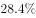。分品类看，农村实物商品零售额前三位的品类分别为服装鞋帽针织品、日用品、粮油食品及饮料烟酒，分别占农村实物商品零售额的、和，同比增速分别为、和。

        2018年全国农产品网络零售额达2305亿元，比全国网络零售额同比增速高9.9个百分点。其中，休闲食品、茶叶、滋补食品零售额排名前三，占比分别为、和，同比增速分别为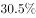、和。

