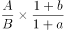
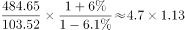
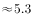

# 基期倍数计算（区间型选项定档）

考点：[[20-考点/资料分析/倍数/基期倍数计算（区间型选项定档）|倍数 / 基期倍数计算（区间型选项定档）]]
材料：[[15-材料/资料分析/244994 2018年A省财政收支（公共财政预算|244994 2018年A省财政收支（公共财政预算]]

**问法模型**：题干以基期年份'2017年…是…（多少倍）'设问而材料给2018年末现期值 → 采用基期倍数模型 [现期分子/(1+分子增速)]÷[现期分母/(1+分母增速)]，先算现期倍数再按增速修正定档

## 推理链
1. 第1步：题干问'2017年'的倍数关系，材料给的是2018年末时点余额，时间错位，判定为基期倍数计算题。
2. 第2步：锁定'农行A省分行'单一银行口径（不得混用A省辖区口径），取2018年末单位贷款484.65亿元（下降）、个人贷款103.52亿元（增长），两个增速数值在给定文本中缺失空白。
3. 第3步：套用基期倍数公式：基期倍数=[484.65/(1+r单位)]÷[103.52/(1+r个人)]=(484.65/103.52)×(1+r个人)/(1+r单位)。
4. 第4步：截位直除现期倍数484.65÷103.52≈4.68，暂落4～5倍档位。
5. 第5步：增速方向修正——单位贷款'下降'（r<0）使基期值高于484.65亿元，个人贷款'增长'（r>0）使基期值低于103.52亿元，两重修正均抬高倍数；按官方解析代入原增速运算，结果落在5～6倍区间。
6. 第6步：与选项对照，C项'5～6倍'在范围内，故选C。

**最快解法**：⚡ 截位直除+增速方向修正：现期倍数484.65/103.52≈4.68（4～5档），再由'单位贷款下降、个人贷款增长'的一降一增结构判断基期倍数必高于4.68，结合官方解析代入增速得5～6倍，直接锁定C，避免精算分子分母两个基期值

## 易错点
- ⚠ 直接用2018年现期值相除得4.68而误选B（4～5倍），漏做基期还原——题干问的是2017年基期倍数
- ⚠ 跨段混用口径：误取A省辖区的单位贷款2202.74亿元与个人贷款311.99亿元（≈7.1倍，会错选D档），必须锁定'农行A省分行'层级
- ⚠ 负增速处理错误：'下降'的增速为负值，基期=现期/(1+r)时分母小于1、基期大于现期，若忽略负号或误用现期×(1+r)，会把基期值方向算反

## 母题抽象
> 🧩 当题干出现'基期年份+A是B的多少倍'且材料给出两个现期值与各自'增/降'增速时，用基期倍数公式[A/(1+rA)]÷[B/(1+rB)]：先截位直除现期倍数定档，再按分子分母增速的方向（降升分子、分母分式翻转）与大小修正档位，对照区间选项验证

**同类特征**：'2017年'基期设问、'是…的（ ）倍'区间型倍数选项、农行A省分行（单一银行口径，区别于辖区口径）、单位贷款与个人贷款两级主体、现期'一增一降'的增速结构、需基期还原而非现期倍数

## 相关题
（暂无）

---

### 题干
2017年，农行A省单位贷款额是个人贷款额的（    ）。

### 选项
- A. 3～4倍
- B. 4～5倍
- C. 5～6倍　✅
- D. 6～7倍

### 官方解析

由题干“2017年······是······多少倍”，结合材料时间为2018年，可判定此题为基期倍数计算问题。定位文字材料第三段“2018年，农行A省个人贷款103.52亿元，增长；单位贷款484.65亿元，下降”。根据基期倍数公式，代入数据可得倍，在C项范围内。

故正确答案为C。

### 给定材料

        2018年，A省公共财政预算收入1180.07亿元，比上年增长。其中，一般公共预算收入103.82亿元，比上年下降。全年A省实际完成地方税收收入104亿元，中央财政返还68.60亿元，增长。A省一般公共预算支出从2012年的603.2亿元增加到2018年的958.41亿元，2018年同比增长。

        2018年末，A省辖区各项存款余额3051.06亿元，同比增长。其中，个人存款1491.89亿元，增长；单位存款1531.38亿元，下降；代理财政性存款25.38亿元，增长17.9倍。A省辖区各项贷款余额2574.10亿元，同比增长。其中，个人贷款311.99亿元，下降；单位贷款2202.74亿元，增长；含票据融资59.38亿元，增长。

        2018年，农行A省分行年末各项本外币存款余额1300.85亿元，同比增长，比上年同期下降7个百分点。其中，个人存款645.62亿元，增长；单位存款653.96亿元，下降；同业存款1.26亿元，下降。年末各项贷款余额662.92亿元，同比增长，比上年同期下降19个百分点。其中，个人贷款103.52亿元，增长；单位贷款484.65亿元，下降；贸易融资57.59亿元，增长；贴现及转贴现净值17.16亿元，增长155.0倍。

> [!warning] 疑点（官方解析可能有误，待人工复核）
> 材料文本中农行A省单位贷款降幅、个人贷款增速的具体数值均为空白，官方解析'代入数据可得 倍'处也缺失具体计算式与倍数，故无法从给定文本复算精确倍数，5～6倍的落点只能依据官方解析结论与'单位降、个人增'的方向修正（现期倍数4.68必被抬高）来锁定；另官方解析称数据在'第三段'，与本文本中农行贷款段（第五段）的段落编号不一致，属段落定位口径的小差异，不影响取数。
