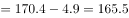
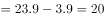
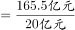
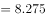
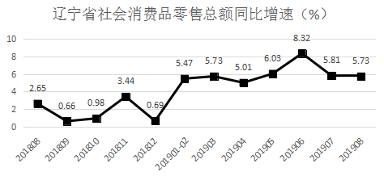
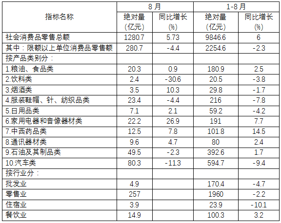

# 现期倍数（'累计−当月'拆分后求月均倍数）

考点：[[20-考点/资料分析/倍数/现期倍数（'累计−当月'拆分后求月均倍数）|倍数 / 现期倍数（'累计−当月'拆分后求月均倍数）]]
材料：[[15-材料/资料分析/246299 2019年1-8月（重点8月当月）辽|246299 2019年1-8月（重点8月当月）辽]]

**问法模型**：题干问'2019年1-7月平均每月A是B的几倍'→ 先用'1-8月累计−8月当月'拆出1-7月值，各除以7个月得月均，再相除求现期倍数

## 推理链
1. 第1步：定位表格'按行业分'：批发业8月零售额4.9亿元、1-8月累计170.4亿元；住宿业8月零售额3.9亿元、1-8月累计23.9亿元
2. 第2步：材料未直接给1-7月数据，用'累计−当月'拆分：1-7月=1-8月−8月
3. 第3步：批发业1-7月=170.4−4.9=165.5亿元；住宿业1-7月=23.9−3.9=20.0亿元
4. 第4步：1-7月共7个月，月均分别为165.5÷7和20.0÷7
5. 第5步：倍数=(165.5÷7)÷(20.0÷7)，分子分母同除7可直接约去，即165.5÷20=8.275
6. 第6步：8.275≈8.28，对照选项选C（7.12、7.69、9.01均不符）

**最快解法**：⚡ 约分+直除：月均倍数=(170.4−4.9)/(23.9−3.9)，因两个时段月数相同（均为7个月），÷7直接约去，只需口算165.5/20=8.275≈8.28，秒选C

## 易错点
- ⚠ 最大陷阱：直接用1-8月累计相除170.4/23.9≈7.13，误选A(7.12)——题干问1-7月，必须做'累计−当月'拆分（170.4−4.9、23.9−3.9）
- ⚠ 时间口径：1-7月是7个月不是8个月；本题因分子分母同除7恰好约去，但若两时段月数不同则必须分别÷各自月数
- ⚠ 措辞与取数：题干说'销售额'而表格指标为'消费品零售额'，按同义对应处理；勿误取'零售业'257或其他行业数据，认准'批发业4.9/170.4'与'住宿业3.9/23.9'两行

## 母题抽象
> 🧩 当题干出现'某中间时段（如1-7月）平均每月A是B的几倍'时，用'累计−当月'拆出该时段值，若两个主体月数相同则月均相除的除数直接约去，只需'拆分后两值直接相比'验证选项

**同类特征**：1-7月（材料未直接给出的时段）、平均每月、是……的约几倍、批发业/住宿业（按行业分模块取数）、现期倍数、累计拆当月

## 相关题
- [[10-真题/资料分析/增长/50805 现期量计算（同比增速不变预测+求月平均数）|50805]]（甘肃 2009，相关度1）
- [[10-真题/资料分析/倍数/10204451 现期倍数计算（部分与部分之和的倍数）|10204451]]（广东 2024，相关度1）
- [[10-真题/资料分析/倍数/10297461 现期倍数计算（含'二季度=上半年-一季度'时段拆分推算）|10297461]]（四川 2025，相关度1）
- [[10-真题/资料分析/倍数/1797608 现期倍数计算+加总排序定位|1797608]]（山东 2016，相关度1）
- [[10-真题/资料分析/倍数/2024182 现期倍数（两分项净增量之比）|2024182]]（重庆 2016，相关度1）

---

### 题干
2019年1-7月，限额以上批发业平均每月实现销售额是住宿业的约        倍

### 选项
- A. 7.12
- B. 7.69
- C. 8.28　✅
- D. 9.01

### 官方解析

根据题干“2019年1-7月，······是······倍”，可判定本题为现期倍数问题。定位表格数据可知批发业零售额2019年1-8月为170.4亿元，8月为4.9亿元，住宿业零售额2019年1-8月为23.9亿元，8月为3.9亿元。计算可得：2019年1-7月批发业零售额亿元，2019年1-7月住宿业零售额亿元，故题干所求倍数倍。

故正确答案为C。

### 给定材料

        2019年1-8月，辽宁省社会消费品零售总额9846.6亿元，比上年同期增长，增速回落1.6个百分点。限额以上单位消费品零售额实现2254.6亿元，同比下降，增速回落6.5个百分点。

        又知2019年1-7月全省限额以上批发业，零售业，住宿业和餐饮业实现零售额同比分别增长、、和。

