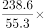
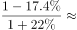
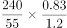
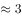

# 基期倍数

考点：[[20-考点/资料分析/倍数/基期倍数|倍数 / 基期倍数]]
材料：[[15-材料/资料分析/246393 我国乘用车（总量及轿车、MPV、SU|246393 我国乘用车（总量及轿车、MPV、SU]]

**问法模型**：题干问'2016年第一季度…是…多少倍'，所求时点早于表内现期（2017年一季度）→ 用基期倍数公式（现期倍数×(1+b)/(1+a)）

## 推理链
1. 第1步：题干时间'2016年第一季度'早于表格现期2017年一季度，且表中只给2017年一季度数量与同比增速，判定为基期倍数问题
2. 第2步：定位表格销量行（非产量行）：2017年一季度SUV销量A=238.6万辆、同比a=+22.0%；MPV销量B=55.3万辆、同比b=-17.4%
3. 第3步：基期倍数公式=A/B×(1+b)/(1+a)=(238.6/55.3)×(1-17.4%)/(1+22.0%)
4. 第4步：截位计算：238.6/55.3≈4.31；(1-17.4%)/(1+22.0%)=0.826/1.220≈0.677
5. 第5步：相乘得4.31×0.677≈2.92，与选项B(2.9)最接近

**最快解法**：⚡ 基期倍数公式法+截位直除：先算现期倍数238.6/55.3≈4.3，再看修正系数(1+b)/(1+a)=0.826/1.22≈0.68<1，2.9=4.3×0.68，一步锁定B；修正系数明显小于1可直接排除C(4.2)、D(6.5)

## 易错点
- ⚠ 现期/基期混淆：直接用238.6÷55.3≈4.3误选C(4.2)，漏做基期修正
- ⚠ MPV增速为负(-17.4%)，(1+b)=0.826<1使倍数变小；若把负号方向搞反（误用1.174）会算出约4.1，掉入C选项陷阱
- ⚠ 读数陷阱：MPV产量55.5与销量55.3、SUV产量249.5与销量238.6数值接近，须先确认题干要的是'销量'行

## 母题抽象
> 🧩 当题干出现'A年（早于材料现期）…是…多少倍'且两主体均有同比增速时，用基期倍数公式：倍数=(A/B)×(1+b)/(1+a)，先粗算现期倍数，再乘修正系数验证选项

**同类特征**：2016年第一季度（早于表内现期）、…是…多少倍、SUV销量与MPV销量两主体、基期倍数、同比增速+22.0%与-17.4%正负混合、销量行读数

## 相关题
- [[10-真题/资料分析/倍数/19591644 基期倍数|19591644]]（选调 2024，相关度2）
- [[10-真题/资料分析/倍数/456661 基期倍数（现期量−增长量求基期后作商）|456661]]（天津 2014，相关度1）
- [[10-真题/资料分析/倍数/5430323 基期倍数（图外基期值倒推+现期与基期倍数）|5430323]]（浙江 2023，相关度1）
- [[10-真题/资料分析/倍数/1752646 基期倍数（亏损额基期还原+倍数计算）|1752646]]（北京 2016，相关度1）
- [[10-真题/资料分析/倍数/2578811 基期倍数（图形逐月加总＋文字段增速还原基期）|2578811]]（四川 2020，相关度1）

---

### 题干
2016年第一季度我国运动型多用途乘用车(SUV)销量是多功能乘用车(MPV)销量的多少倍?

### 选项
- A. 1.8
- B. 2.9　✅
- C. 4.2
- D. 6.5

### 官方解析

由题干“2016年第一季度，···是···多少倍”，结合材料所给时间为2017年一季度，可判定本题为基期倍数问题。定位表格材料，2017年一季度运动型多用途乘用车(SUV)销量为238.6万辆（A），同比增长（a）；多功能乘用车(MPV)销量为55.3万辆（B），同比增长（b）。根据基期倍数公式：。则题目所求为倍，B项较为接近。

故正确答案为B。

### 给定材料

        2017年全年，我国乘用车产量为2483.1万辆，同比增长，销量为2474.4万辆，同比增长。

