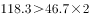
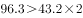
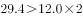

# 现期倍数比较（多类目逐项判定周末-上学日≥2并计数）

考点：[[20-考点/资料分析/倍数/现期倍数比较（多类目逐项判定周末-上学日≥2并计数）|倍数 / 现期倍数比较（多类目逐项判定周末/上学日≥2并计数）]]
材料：[[15-材料/资料分析/247415 全国10个市'我国儿童校外生活状况'|247415 全国10个市'我国儿童校外生活状况']]

**问法模型**：题干问'周末日平均用时是上学日2倍以上的活动类型有几类'→将8类活动逐一用'周末用时>上学日用时×2'判定后计数

## 推理链
1. 第1步：从柱状图读取8类活动的上学日/周末日平均用时（黑柱=上学日/白柱=周末）：做作业87.6/115.9、外出游玩46.7/118.3、使用电子产品43.2/96.3、做家务28.1/50.1、玩耍26.9/49.9、阅读25.6/37.1、锻炼23.5/34.7、社会学习12.0/29.4
2. 第2步：判定规则为周末用时>上学日用时×2，等价于周末/上学日>2
3. 第3步：用'上学日×2'作阈值口算比较：外出游玩46.7×2=93.4<118.3（≈2.53倍）✓；使用电子产品43.2×2=86.4<96.3（≈2.23倍）✓；社会学习12.0×2=24.0<29.4（=2.45倍）✓；做家务28.1×2=56.2>50.1（≈1.78倍）✗；玩耍26.9×2=53.8>49.9（≈1.85倍）✗；做作业87.6×2=175.2>115.9、阅读25.6×2=51.2>37.1、锻炼23.5×2=47.0>34.7均✗
4. 第4步：满足条件的有外出游玩、使用电子产品、社会学习共3类，对照选项选B

**最快解法**：⚡ 看半法（倍数阈值比较）：不需求商，直接口算'上学日×2'与周末值比大小，只有46.7×2=93.4<118.3、43.2×2=86.4<96.3、12.0×2=24.0<29.4三组通过，数出3类即选B；先扫周末值最小的几项（阅读37.1、锻炼34.7、社会学习29.4）可快速排除大部分

## 易错点
- ⚠ 图例读反：黑色=上学日、白色=周末，若读反会把周末值当上学日，8类全部不满足2倍（或判定方向全错）
- ⚠ 临界项误判：做家务50.1/28.1≈1.78、玩耍49.9/26.9≈1.85柱高视觉上接近2倍但未超过，凭目测倍数易多计为5类
- ⚠ 口径陷阱：全部数据为'日平均用时'，必须周末÷上学日同口径相除；'外出游玩'与'玩耍'是并列两类活动，勿把'玩耍'当总称导致漏项或并项

## 母题抽象
> 🧩 当题干出现'A口径是B口径的2倍（N倍）以上的种类有几个'特征时，逐项用'B值×2与A值比大小'的看半法判定，无需精算倍数，数出满足项数即可

**同类特征**：2倍以上、活动类型有(几)类、周末与上学日日平均用时对比、逐项倍数判定计数、柱状图双列（黑/白柱）数据、倍数比较型计数题

## 相关题
（暂无）

---

### 题干
儿童周末校外活动日平均用时是上学日日均用时2倍以上的活动类型有

### 选项
- A. 2类
- B. 3类　✅
- C. 4类
- D. 5类

### 官方解析

根据题干“······是······2倍以上的活动类型有”，可判定本题为倍数比较问题，所求活动类型应满足：周末日平均用时&gt;上学日日平均用时×2。定位图形资料，满足上述条件的活动类型有：外出游玩，；使用电子产品，；社会学习，。共3类。

故正确答案为B。

### 给定材料

        某研究机构从全国随机抽取10个市的儿童家长，对其进行“我国儿童校外生活状况”的问卷调查，回收有效问卷15000份。调查结果显示：对儿童校外生活表示“很重视”的家长占以上，表示“很满意”或“比较满意”的占；上学日，儿童日平均使用电子产品用时43.2分钟，其中利用电子产品学习用时13.9分钟，看动画等娱乐用时16.6分钟；周末，乡镇儿童日平均使用电子产品用时108.2分钟，市区儿童88.4分钟。

