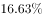
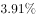
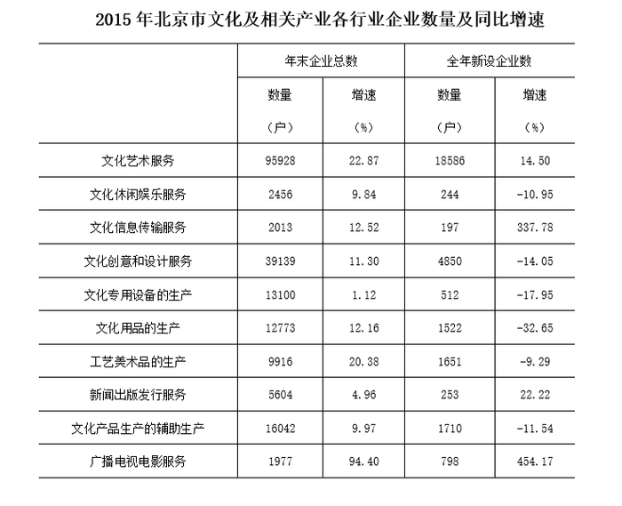

# 现期倍数计算（多几倍=（最大-最小）÷最小）+ 统计表极值查找

考点：[[20-考点/资料分析/倍数/现期倍数计算（多几倍=（最大-最小）÷最小）+ 统计表极值查找|倍数 / 现期倍数计算（多几倍=（最大-最小）÷最小）+ 统计表极值查找]]
材料：[[15-材料/资料分析/247456 截至2015年12月底北京市文化及相|247456 截至2015年12月底北京市文化及相]]

**问法模型**：题干问'企业数量最多的行业比最少的行业多多少倍' → 在'年末企业总数'列锁定最大值与最小值，套用'多几倍'公式（A-B）÷B计算

## 推理链
1. 第1步：题干时间'截至2015年12月底'对应现期，锁定表格'年末企业总数·数量（户）'列，扫描10个行业数据
2. 第2步：该列最大值为文化艺术服务95928户；最小值为广播电视电影服务1977户（次小为文化信息传输服务2013户、文化休闲娱乐服务2456户，1977最小）
3. 第3步：'多多少倍'对应公式：多几倍=（最大-最小）÷最小，即'是几倍'再减1，而非直接最大÷最小
4. 第4步：代入计算：（95928-1977）÷1977=93951÷1977≈47.5
5. 第5步：与选项对照：47.5对应C项，故正确答案为C

**最快解法**：⚡ 截位直除+倍数口径转换：先算'是几倍'95928÷1977≈48.5（1977×48.5≈95885），再减1得47.5；或直接93951÷1977，商首两位94÷20≈4.7、量级十位→约47.5，秒选C

## 易错点
- ⚠ '多多少倍'≠'是几倍'：95928÷1977≈48.5是'是几倍'口径，须再减1得47.5，不减1会误判至48.5附近而错选
- ⚠ 极值甄别陷阱：年末最小值是广播电视电影服务1977户而非文化信息传输服务2013户（两值仅差36户、行位置相邻，粗心即错）；且必须在'年末企业总数'列找极值，不能误用'全年新设企业数'列（新设最少为文化信息传输197户）
- ⚠ 时间口径：题干限定现期'截至2015年12月底'，直接用年末存量数据，与同比增速列无关，勿卷入增速或基期换算

## 母题抽象
> 🧩 当题干出现'A比B多（多少）倍'特征时，先在指定数据列准确锁定最大值A与最小值B，用（A-B）÷B即A÷B-1计算，并区分'是几倍'与'多几倍'口径、甄别相近的极值

**同类特征**：企业数量最多的行业、企业数量最少的行业、多多少倍、截至2015年12月底、各行业、现期倍数

## 相关题
- [[10-真题/资料分析/倍数/10204451 现期倍数计算（部分与部分之和的倍数）|10204451]]（广东 2024，相关度1）
- [[10-真题/资料分析/倍数/10297461 现期倍数计算（含'二季度=上半年-一季度'时段拆分推算）|10297461]]（四川 2025，相关度1）
- [[10-真题/资料分析/倍数/1797608 现期倍数计算+加总排序定位|1797608]]（山东 2016，相关度1）
- [[10-真题/资料分析/倍数/2024182 现期倍数（两分项净增量之比）|2024182]]（重庆 2016，相关度1）
- [[10-真题/资料分析/倍数/2042820 现期倍数计算（同一子总体内占比相除）|2042820]]（江苏 2017，相关度1）

---

### 题干
截至2015年12月底北京市文化及相关产业各行业中，企业数量最多的行业的企业户数比企业数量最少的行业多多少倍？

### 选项
- A. 5.6
- B. 22.7
- C. 47.5　✅
- D. 93.3

### 官方解析
根据题干“截至2015年12月底······多多少倍”，结合材料时间为2015年，可判定本题为现期倍数计算问题。定位材料表格可得：企业数量最多的行业是文化艺术服务业，其企业数量为95928户；企业数量最少的行业是广播电视电影服务业，其企业数量为1977户，代入公式：多几倍。
故正确答案为C。

### 给定材料

        截至2015年12月底，北京市文化及相关产业企业共有198948户，同比增长，占全市企业总数的；2015年新设文化及相关产业企业30323户，同比增长。

