# 现期倍数计算（每户人口相同条件下，总量倍数=人口比×每百户拥有量比，需经城镇化率换算农牧民人口）

考点：[[20-考点/资料分析/倍数/现期倍数计算（每户人口相同条件下，总量倍数=人口比×每百户拥有量比，需经城镇化率换算农牧民人口）|倍数 / 现期倍数计算（每户人口相同条件下，总量倍数=人口比×每百户拥有量比，需经城镇化率换算农牧民人口）]]
材料：[[15-材料/资料分析/247457 A自治区2012~2016年末城镇与|247457 A自治区2012~2016年末城镇与]]

**问法模型**：题干出现'假设平均每户城镇居民家庭人口数与农牧民家庭相同，则城镇家用电脑总量约是农村牧区的多少倍' → 采用'总量=户数×户均拥有量'模型：户数比=人口比，故倍数=(城镇人口/农牧民人口)×(62/23)，其中农牧民人口=城镇人口÷城镇化率−城镇人口。

## 推理链
1. 第1步：从题干提取关键条件'平均每户城镇居民家庭人口数与农牧民家庭相同'→户数比=人口比；从文字段取数：城镇居民每百户家用电脑62台、农牧民家庭每百户23台，城镇人口1542.1万人，城镇化率（本版材料该数值留空，需以原卷完整数据代入）。
2. 第2步：公式——电脑总量=户数×户均拥有量，总量倍数=(城镇户数/农牧民户数)×(62/23)；'每百户'换算户均需÷100，但分子分母同÷100可约去，故倍数简化为人口比×62/23。
3. 第3步：人口比换算——农牧民人口=总人口−城镇人口=1542.1/城镇化率−1542.1，故城镇/农牧民人口比=城镇化率/(1−城镇化率)。
4. 第4步：代入计算——62/23≈2.70（23×2.7≈62）；人口比=城镇化率/(1−城镇化率)，代入原卷城镇化率数值（按官方答案反推约0.61）≈1.58。
5. 第5步：倍数≈1.58×2.70≈4.3。
6. 第6步：与选项对照——D(4.3)吻合；C(2.7)恰为62/23本身（漏乘人口比）、A(1.6)≈人口比（漏乘拥有量比）均为干扰项，故选D。

**最快解法**：⚡ 公式法+截位直除：倍数=[城镇化率/(1−城镇化率)]×(62/23)；先算62/23≈2.7，再取人口比≈1.6，1.6×2.7≈4.3，直接锁定D；验证时警惕C选项2.7恰是62/23本身，必须再乘人口比才完整。

## 易错点
- ⚠ '每百户62台/23台'与户均差100倍：分子分母同时÷100可约去；若只对一边换算会差100倍量级。
- ⚠ 选项陷阱设计：C=2.7即62/23（只乘拥有量比、漏乘人口比），A=1.6≈人口比（只乘人口比、漏乘拥有量比），正确答案是两者乘积4.3。
- ⚠ 农牧民人口=城镇人口÷城镇化率−城镇人口，勿把1542.1万误当总人口，或把城镇化率数值直接当人口比使用；本版材料城镇化率数值留空，须以原卷完整数据为准。

## 母题抽象
> 🧩 当题干出现'假设每户人口相同，A群体拥有的X总量是B群体的多少倍'特征时，用'总量比=人口比×每百户拥有量比'模型（'每百户'两侧同时÷100自动约去），人口比经城镇化率换算为城镇化率/(1−城镇化率)，验证乘积最接近的选项。

**同类特征**：假设每户人口数相同、总量……是……的多少倍（现期倍数）、家用电脑每百户62台/23台（仅文字段给出的指标）、需用城镇化率换算农牧民人口、文字段跨段拼接：人口结构数据+每百户拥有量、选项含'只乘一个比'的干扰值（1.6与2.7）

## 相关题
（暂无）

---

### 题干
假设平均每户城镇居民家庭的人口数与农牧民家庭相同，则2016年末A自治区城镇居民拥有的家用电脑总量约是农村牧区居民的多少倍？

### 选项
- A. 1.6
- B. 2.1
- C. 2.7
- D. 4.3　✅

### 官方解析

由题干“2016年末······是······的多少倍”，且材料数据为2016年，可判定本题为现期倍数问题。定位文字材料第二段“2016年末A自治区城镇居民家庭每百户拥有家用电脑62台；农牧家庭每百户拥有家用电脑23台”。城镇居民家庭拥有电脑总量是农村牧区居民的倍数为：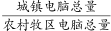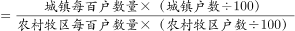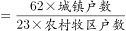。由题干“平均每户城镇居民家庭人口数与农牧家庭相同”，可知平均每户人口数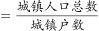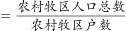，则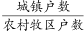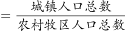，因此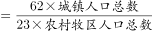。定位文字材料第一段“A自治区城镇人口为1542.1万人，城镇化率为”，可知A自治区农村牧区人口比例为（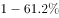），则人口总数为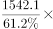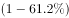，因此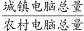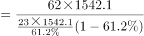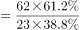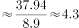倍。

故正确答案为D。

### 给定材料

        2016年末，A自治区城镇人口为1542.1万人，城镇化率(城镇人口占总人口比重)为。

        2016年末A自治区城镇人均居住面积达32.20平方米，比1978年末增长了5.5倍；农村牧区人均居住面积达27.40平方米，比1985年末增长。2016年末A自治区城镇居民家庭每百户拥有家用汽车38.48辆、家用电脑62台、移动电话222.21部；农牧民家庭每百户拥有家用汽车27.29辆、家用电脑23台、移动电话231.53部。

> [!warning] 疑点（官方解析可能有误，待人工复核）
> 给定材料中'城镇化率'具体数值留空缺失（官方解析亦未显式列出代入值与中间算式），无法从本版材料复核精确中间过程；按官方答案D反推，城镇化率约61%时倍数≈1.58×2.70≈4.3，与官方答案自洽，属材料截取不完整而非解析错误，不影响答案唯一性。

<!-- CODEX-ANSWER-REVIEW:BEGIN -->
### 本次独立复核

**复核状态：** `resolved`（答案与解析已核定）

**计分答案：** D（可计分）

**复核解析：**

城镇化率为61.2%，城镇人口1542.1万人，因此农村牧区人口=1542.1×(1−61.2%)/61.2%。题设平均每户人口数相同，户数比=人口比；每百户电脑量比为62/23。故城镇/农村电脑总量比=(61.2%/38.8%)×(62/23)≈4.252，约4.3倍，选D。

**相关信息：**

户均人口数相等时户数比等于人口比；每百户拥有量转换为总量时需乘户数比。

**题源依据：** [固定版本原题](https://github.com/Mentat-Uran/kaogongzhentizhengliu/blob/84ab93d4b64b61d897bece8a1c0a5bab06b4feb2/10-%E7%9C%9F%E9%A2%98/%E8%B5%84%E6%96%99%E5%88%86%E6%9E%90/%E5%80%8D%E6%95%B0/2453146%20%E7%8E%B0%E6%9C%9F%E5%80%8D%E6%95%B0%E8%AE%A1%E7%AE%97%EF%BC%88%E6%AF%8F%E6%88%B7%E4%BA%BA%E5%8F%A3%E7%9B%B8%E5%90%8C%E6%9D%A1%E4%BB%B6%E4%B8%8B%EF%BC%8C%E6%80%BB%E9%87%8F%E5%80%8D%E6%95%B0%3D%E4%BA%BA%E5%8F%A3%E6%AF%94%C3%97%E6%AF%8F%E7%99%BE%E6%88%B7%E6%8B%A5%E6%9C%89%E9%87%8F%E6%AF%94%EF%BC%8C%E9%9C%80%E7%BB%8F%E5%9F%8E%E9%95%87%E5%8C%96%E7%8E%87%E6%8D%A2%E7%AE%97%E5%86%9C%E7%89%A7%E6%B0%91%E4%BA%BA%E5%8F%A3%EF%BC%89.md)；固定内容 commit `84ab93d4b64b61d897bece8a1c0a5bab06b4feb2`，Markdown blob `c4f523c2b244d2c8a19389c479ae51c60bbb9a22`。
<!-- CODEX-ANSWER-REVIEW:END -->
