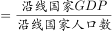
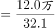
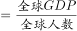
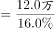
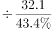
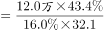
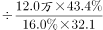
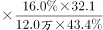
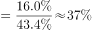

# 现期倍数——两个人均（平均数）作商，化为比重相除

考点：[[20-考点/资料分析/倍数/现期倍数——两个人均（平均数）作商，化为比重相除|倍数 / 现期倍数——两个人均（平均数）作商，化为比重相除]]
材料：[[15-材料/资料分析/247460 2016年“一带一路”沿线64国的G|247460 2016年“一带一路”沿线64国的G]]

**问法模型**：“沿线人均GDP约是全球水平的多少倍”→现期倍数模型：沿线人均GDP÷全球人均GDP，可化简为“沿线GDP占全球比重÷沿线人口占全球比重”，无需反求全球总量

## 推理链
1. 第1步：从文字材料提取：2016年沿线64国GDP=12.0万亿美元（=120000亿美元）、人口32.1亿人；而文字中“占全球GDP的a、占全球人口的b”两处数值空缺，代入时需按原题完整口径a=16.0%、b=43.4%补齐（见“疑点”）
2. 第2步：定模型：题干“约是……的多少倍”且无基期年份，为现期倍数；人均GDP是平均数，所求=（沿线GDP÷沿线人口）÷（全球GDP÷全球人口）
3. 第3步：公式化简：全球GDP=12.0万亿/a、全球人口=32.1亿/b，代回后沿线总量12.0万亿与32.1亿在分子分母中相消，倍数=a/b，即只需两个占比相除
4. 第4步：代入计算：16.0%÷43.4%≈0.37；分步验证：沿线人均=120000亿美元÷32.1亿人≈3738美元/人，全球人均=(12.0万亿÷16%)÷(32.1亿÷43.4%)≈75万亿美元÷73.9亿人≈10140美元/人，3738÷10140≈0.37
5. 第5步：对照选项：0.37与D项0.4最接近（A项2.7恰为倒算43.4%÷16.0%≈2.7的陷阱值），故正确答案为D

**最快解法**：⚡ 公式法（比重相除）+截位直除：倍数=GDP占比÷人口占比=16.0%÷43.4%，截位作16/43.4≈0.37≈0.4，一步锁定D；全程不必算出沿线或全球的任何人均值

## 易错点
- ⚠ 材料空缺陷阱：文字三处占比只有贸易份额21.7%可由折线图补得，切勿把21.7%冒充GDP或人口占比代入；本题实际依赖原文16.0%/43.4%两处被空缺数据
- ⚠ 单位量级陷阱：12.0万亿美元须×10^4换为120000亿美元再除以32.1亿人，直接“12.0÷32.1”得数0.37的单位是万美元/人，量级看错易在分步计算中翻车
- ⚠ 方向陷阱：倍数=分子（GDP）占比÷分母（人口）占比=16/43.4≈0.37<1，说明沿线人均低于全球水平；若倒算为43.4/16≈2.7即误选A，C(0.9)、B(1.6)为口算偏差干扰项

## 母题抽象
> 🧩 当题干出现“A区域的人均量（GDP/收入等）是B（全球/全国）水平的多少倍”特征时，用“比重相除”模型：倍数=A的分子占B比重÷A的分母占B比重，总量相消不必反求B总量，截位直除验证选项

**同类特征**：人均GDP约是全球水平的多少倍、现期倍数（无基期年份）、两层平均数作商、需由占比反推全球总量、万亿美元/亿人跨量级单位、倍数小于1（低于全球水平）

## 相关题
（暂无）

---

### 题干
2016年“一带一路”沿线国家人均GDP约是全球水平的多少倍：

### 选项
- A. 2.7
- B. 1.6
- C. 0.9
- D. 0.4　✅

### 官方解析

由题干“2016年······约是······的多少倍”，可判定本题为现期倍数问题。定位文字材料可得，2016年“一带一路”沿线64个国家GDP之和约为12.0万亿美元，占全球GDP的；人口总数约为32.1亿人，占全球人口的。则2016年“一带一路”沿线国家人均GDP美元/人，全球人均GDP美元/人，所求倍数，与D项最接近。

故正确答案为D。

### 给定材料

        2016年“一带一路”沿线64个国家GDP之和约为12.0万亿美元，占全球GDP的；人口总数约为32.1亿人，占全球人口的；对外贸易总额约为71885.5亿美元，占全球贸易总额的。

> [!warning] 疑点（官方解析可能有误，待人工复核）
> 材料文字与官方解析中“占全球GDP的__”“占全球人口的__”两处占比数值均被空缺（仅贸易份额21.7%可由折线图补得），按当前转录材料本题的全球人均GDP无法独立求解；由官方答案D=0.4反推，需原题完整口径“占全球GDP的16.0%、占全球人口的43.4%”，0.16÷0.434≈0.37≈0.4，与D一致。此系材料转录缺字（口径不全）问题，非官方解析计算错误，答案D予以认定

<!-- CODEX-ANSWER-REVIEW:BEGIN -->
### 本次独立复核

**复核状态：** `resolved`（答案与解析已核定）

**计分答案：** D（可计分）

**复核解析：**

材料插图给出“一带一路”GDP占全球16.0%、人口占全球43.4%。人均水平相对全球为16.0%÷43.4%≈0.369，最接近0.4倍，选D。

**相关信息：**

同一人口与GDP比值下，人均GDP相对值=GDP份额/人口份额；16.0%/43.4%=0.369，约0.4倍。

**题源依据：** [固定版本原题](https://github.com/Mentat-Uran/kaogongzhentizhengliu/blob/84ab93d4b64b61d897bece8a1c0a5bab06b4feb2/10-%E7%9C%9F%E9%A2%98/%E8%B5%84%E6%96%99%E5%88%86%E6%9E%90/%E5%80%8D%E6%95%B0/2453183%20%E7%8E%B0%E6%9C%9F%E5%80%8D%E6%95%B0%E2%80%94%E2%80%94%E4%B8%A4%E4%B8%AA%E4%BA%BA%E5%9D%87%EF%BC%88%E5%B9%B3%E5%9D%87%E6%95%B0%EF%BC%89%E4%BD%9C%E5%95%86%EF%BC%8C%E5%8C%96%E4%B8%BA%E6%AF%94%E9%87%8D%E7%9B%B8%E9%99%A4.md)；固定内容 commit `84ab93d4b64b61d897bece8a1c0a5bab06b4feb2`，Markdown blob `09fbcb80bf7867458171e224560f3aa1100f5235`。
<!-- CODEX-ANSWER-REVIEW:END -->
