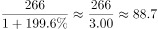
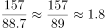
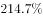

# 基期倍数（图形逐月加总＋文字段增速还原基期）

考点：[[20-考点/资料分析/倍数/基期倍数（图形逐月加总＋文字段增速还原基期）|倍数 / 基期倍数（图形逐月加总＋文字段增速还原基期）]]
材料：[[15-材料/资料分析/257880 全国移动互联网接入流量：2017年6|257880 全国移动互联网接入流量：2017年6]]

**问法模型**：'2017年下半年……约是上半年的多少倍'→一半量（下半年）由图中7—12月柱值直接加总，另一半量（上半年）用文字段现期值266亿GB÷(1+同比增速)还原基期，再作商求倍数

## 推理链
1. 第1步：判定题型——材料现期为2018年上半年（累计266亿GB），所求为2017年内上、下半年之比，属基期倍数；从柱状图提取2017年7—12月当月流量：19.7、21.7、24、27.9、29.8、33.9亿GB
2. 第2步：2017年下半年＝19.7+21.7+24+27.9+29.8+33.9＝157.0亿GB（注意9月'24'为整数精度，勿漏加）
3. 第3步：基期公式：2017年上半年＝266÷(1+同比增速)；原文'同比增长'后数值缺失，按官方答案A=1.8反推增速约为200%（即1+g≈3）
4. 第4步：代入计算：2017年上半年≈266÷3≈88.7亿GB，倍数＝157.0÷88.7≈1.77
5. 第5步：与选项对照：1.77≈1.8，对应A，故选A

**最快解法**：⚡ 公式法＋百化分/截位直除：先秒加7—12月柱值得157.0；增速约200%时基期≈266÷3≈88.7（百化分1/3≈33.3%）；157.0÷88.7截位直除≈157/89≈1.77→锁定1.8选A

## 易错点
- ⚠ 阶段界定：下半年只取2017年7—12月柱值，若误把边界点2017年6月（18.3亿GB）计入，分子变175.3，倍数≈2.0会误选B
- ⚠ 基期/现期混淆：266亿GB是2018年上半年现期值，不能直接当2017年上半年用，也不能用图中2018年各月柱值（35.3~56.7）代替，直接266÷157≈1.7属口径错误
- ⚠ 增速缺失陷阱：原文两个同比增速数值均未显示，不得凭空编造具体百分数；本题需依官方答案反推增速约200%才能闭合计算，且文字段累计266与图中1—6月加总266.3存在微小尾差，估算时不受影响

## 母题抽象
> 🧩 当题干出现'基期年份内某阶段与另一阶段的量之比/倍数、且一段可从图中逐月加总、另一段只能靠现期值和同比增速还原'的特征时，先加总图中对应月份，再用现期÷(1+增速)还原基期，最后作商对照选项

**同类特征**：2017年下半年、上半年、多少倍、基期倍数、跨文字段与柱状图拼接、逐月当期值加总

## 相关题
- [[10-真题/资料分析/倍数/1752646 基期倍数（亏损额基期还原+倍数计算）|1752646]]（北京 2016，相关度2）
- [[10-真题/资料分析/倍数/456661 基期倍数（现期量−增长量求基期后作商）|456661]]（天津 2014，相关度1）
- [[10-真题/资料分析/平均数/10204606 现期平均数计算（多月求和÷月份数）|10204606]]（辽宁 2024，相关度1）
- [[10-真题/资料分析/增长/15419182 由同比增速求增长量并作倍数比较（增长量作比）|15419182]]（湖北 2025，相关度1）
- [[10-真题/资料分析/增长/2144597 增长量计算及增长量倍数比较（增量=现期×r-(1+r)）|2144597]]（选调 2018，相关度1）

---

### 题干
2017年下半年，全国移动互联网累计接入流量约是上半年的多少倍?

### 选项
- A. 1.8　✅
- B. 2.0
- C. 2.7
- D. 3.4

### 官方解析

根据题干“2017年下半年······是上半年······的多少倍”，结合材料数据时间是2018年上半年，可判定本题为基期倍数问题。定位文字材料可得：2018年上半年，全国移动互联网累计流量达266亿GB，同比增长；定位柱状图可得：2017年7~12月全国移动互联网接入流量依次为19.7、21.7、24、27.9、29.8、33.9亿GB。根据基期公式：，则2017年上半年全国移动互联网累计流量为亿GB；2017年下半年全国移动互联网接入流量为亿GB。故2017年下半年全国移动互联网累计接入流量约是上半年的倍。

故正确答案为A。

### 给定材料

        2018年上半年，全国移动互联网累计流量达266亿GB，同比增长；其中通过手机上网的流量达到262亿GB，同比增长。

> [!warning] 疑点（官方解析可能有误，待人工复核）
> 原文与官方解析中'同比增长'后的增速数值均缺失（解析中公式亦被截断为空），直接代入计算的数据链不闭合；按官方答案A=1.8反推，2018年上半年同比增速应约为200%（266÷3≈88.7，157.0÷88.7≈1.77≈1.8），此为材料信息缺失问题而非答案错误，官方答案A不予更改
