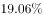
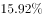
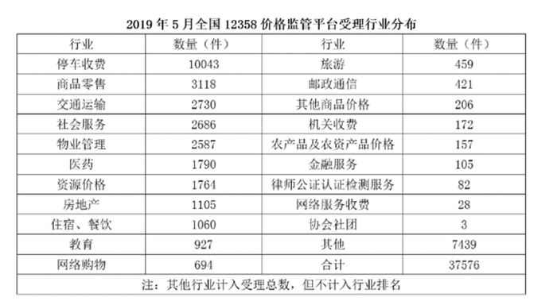

# 现期倍数计算

考点：[[20-考点/资料分析/倍数/现期倍数计算|倍数 / 现期倍数计算]]
材料：[[15-材料/资料分析/260069 2019年5月全国12358价格监管|260069 2019年5月全国12358价格监管]]

**问法模型**：题干出现'A约是B的多少倍'且材料时间（2019年5月）与题干时间一致 → 直接用现期值A÷现期值B，无需基期还原

## 推理链
1. 第1步：确认时间口径，题干问2019年5月，材料排名数据全部为2019年5月当期值，属现期倍数，不需除以(1+增长率)
2. 第2步：从文字段省（市）排名中定位目标对象：排名第二为江苏3528件，排名第九为福建1483件
3. 第3步：代入倍数公式，倍数=3528÷1483
4. 第4步：截位估算：3528≈3500，1483≈1500，3500÷1500≈2.33；精确计算3528/1483≈2.38
5. 第5步：与选项对照，2.38最接近2.4，排除1.4/3.7/4.4，故选B

**最快解法**：⚡ 截位直除：3528÷1483，首位商2（1483×2=2966，1483×2.4≈3559），商2.38附近，直选2.4；更粗可截为35÷15≈2.3~2.4区间锁定B

## 易错点
- ⚠ 排名数错位：第二名是江苏（第一名是北京5786），第九名是福建（第八名是天津1571），若错位取北京÷广西或天津等会得错误倍数
- ⚠ 取数段落错位：省（市）排名在文字段而非行业表格，若误从表中取'商品零售3118'等行业数据则完全错算
- ⚠ 模型误判：本题时间与材料一致是现期倍数，勿套用本材料其他小题的基期还原模型（第2、4小题）去补一个不存在的降幅

## 母题抽象
> 🧩 当题干出现'某期A约是B的多少倍'且时间与材料现期一致时，直接定位两个现期数相除，用截位直除首位定商，对照选项即可

**同类特征**：排名第二、排名第九、约是多少倍、省（市）受理量、时间与材料同为2019年5月、现期倍数

## 相关题
- [[10-真题/资料分析/倍数/2051002 现期倍数计算|2051002]]（江西 2017，相关度3）
- [[10-真题/资料分析/倍数/2187827 现期倍数计算|2187827]]（山东 2018，相关度3）
- [[10-真题/资料分析/倍数/2616148 现期倍数计算|2616148]]（海南 2020，相关度2）
- [[10-真题/资料分析/倍数/2047712 现期倍数计算|2047712]]（广东 2017，相关度2）
- [[10-真题/资料分析/倍数/4637200 现期倍数计算（部分不合格量与其余部分不合格量之比）|4637200]]（国考 2022，相关度2）

---

### 题干
2019年5月，平台受理量排名第二的省（市）约是排名第九的省（市）的多少倍？

### 选项
- A. 1.4
- B. 2.4　✅
- C. 3.7
- D. 4.4

### 官方解析
根据题干“2019年5月，······是······的多少倍”，结合材料时间为2019年5月，可判定本题为现期倍数问题。定位文字材料可得，2019年5月，平台受理量排名第二的省（市）为江苏（3528件），排名第九的省（市）为福建（1483件），则2019年5月，平台受理量排名第二的省（市）约是排名第九的省（市）的倍。
故正确答案为B。

### 给定材料

        2019年5月，全国12358价格监管平台受理价格举报、投诉、咨询共计37576件，同比下降，环比下降。其中，价格举报4192件，环比下降；价格投诉2059件，环比下降；价格咨询31325件，环比下降。平台受理量排名前十的省（市）依次是北京（5786件）、江苏（3528件）、上海（2499件）、重庆（2486件）、河南（2469件）、陕西（2440件）、浙江（2321件）、天津（1571件）、福建（1483件）、广西（1309件）。平台受理量行业分布如下表所示：

