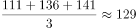
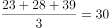
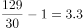

# 现期倍数（分组均值之差÷基组均值，'高出几倍'=倍数-1）

考点：[[20-考点/资料分析/倍数/现期倍数（分组均值之差÷基组均值，'高出几倍'=倍数-1）|倍数 / 现期倍数（分组均值之差÷基组均值，'高出几倍'=倍数-1）]]
材料：[[15-材料/资料分析/264405 2018年1月我国32个重点城市的空|264405 2018年1月我国32个重点城市的空]]

**问法模型**：'最后三名的均值比前三名的均值约高出多少倍' → 按综合指数排名锁定两组城市，分别求PM2.5均值，用（大均值-小均值）÷小均值计算

## 推理链
1. 第1步：由表格按'综合指数'列排序定位：前三名为海口(2.52)、厦门(3.42)、贵阳(3.83)，其PM2.5数值为23、28、39；最后三名为石家庄(9.14)、乌鲁木齐(9.39)、西安(10.34)，其PM2.5数值为111、136、141
2. 第2步：所用规则：'A比B高出多少倍' =（A均值-B均值）÷B均值，即倍数减1；分组均值=各组三城PM2.5数值之和÷3
3. 第3步：前三名均值=(23+28+39)/3=90/3=30；最后三名均值=(111+136+141)/3=388/3≈129.3
4. 第4步：高出倍数=(129.3-30)/30≈99.3/30≈3.31
5. 第5步：与选项对照：A为2.31、B为3.31、C为4.31、D为5.31，3.31与B项一致，故选B

**最快解法**：⚡ 分组均值+截位直除：先按综合指数列锁定两组城市，后三名PM2.5和111+136+141=388，388/3≈129.3；前三名和23+28+39=90，均值恰为30；再算(129.3-30)/30=99.3/30，直除首位商3、次位得3.31，直接锁定B

## 易错点
- ⚠ 表述陷阱：'高出多少倍'须先做差再除以基量（即倍数-1），若误当作'是多少倍'直接算129.3/30≈4.31，会错选C
- ⚠ 分组口径陷阱：'前三名/最后三名'以综合指数排名为准，而非PM2.5浓度排名；若按PM2.5排名选城市（前三会变成海口23、厦门28、昆明33）则样本取错
- ⚠ 双列串列陷阱：表中每项指标为'排名列+数值列'并排，读PM2.5数值时易把排名当数值（如石家庄行排名30、数值111，勿取30）

## 母题抽象
> 🧩 当题干出现'按某指标排名的前N名/后N名比…高出多少倍'时，先用指定排名列锁定两组城市，再取目标指标数值求两组均值，最后用（大均值-小均值）÷小均值（倍数-1）验证选项

**同类特征**：32个城市中、综合指数最后三名、比前三名、月均PM2.5均值、约高出多少倍、现期单一时点（2018年1月）

## 相关题
（暂无）

---

### 题干
在表中所列32个城市中空气质量综合指数最后三名的城市月均PM2.5均值比前三名的城市月均PM2.5均值约高出多少倍？

### 选项
- A. 2.31
- B. 3.31　✅
- C. 4.31
- D. 5.31

### 官方解析

根据题干“······比······约高出多少倍”，可判定本题为现期倍数问题。定位表格可得空气质量综合指数最后三名的城市月均PM2.5数值分别是111、136、141，均值为；前三名的城市月均PM2.5数值分别是23、28、39，均值为。则最后三名的城市月均PM2.5均值比前三名的城市月均PM2.5均值约高倍，与B项最接近。

故正确答案为B。 

### 给定材料

        我国自2013年1月开始按照《环境空气质量标准》（GB3095-2012）开展空气质量监测和评价，2018年1月部分城市的评价结果如下表：

        2018年1月部分城市空气质量综合指数与各项污染物指标月均浓度及排名情况

