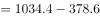
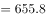
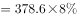
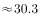
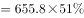
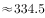
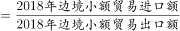
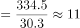

# 现期倍数计算（部分=总体×比重+总量拼算）

考点：[[20-考点/资料分析/倍数/现期倍数计算（部分=总体×比重+总量拼算）|倍数 / 现期倍数计算（部分=总体×比重+总量拼算）]]
材料：[[15-材料/资料分析/264432 2018年M省进出口总值1034.4|264432 2018年M省进出口总值1034.4]]

**问法模型**：题干'2018年A进口额约是出口额的多少倍'，时间与材料现期一致→现期倍数=进口边贸额÷出口边贸额，两笔金额均需'总值（或拼算值）×饼图比重'求出

## 推理链
1. 第1步：题干锁定现期2018年，问边境小额贸易'进口额是出口额的多少倍'，判定为现期倍数问题
2. 第2步：材料未直接给进口总值，先拼算：进口=进出口总值1034.4−出口378.6=655.8亿元
3. 第3步：读两张饼图取比重：出口结构（图1）中边境小额贸易占8%，基数378.6亿元；进口结构（图2）中占51%，基数655.8亿元；两图图例同名但主体不同，严禁互串
4. 第4步：套公式'部分=总体×比重'：出口边贸额=378.6×8%≈30.3亿元，进口边贸额=655.8×51%≈334.5亿元
5. 第5步：所求倍数=334.5÷30.3≈11.0倍
6. 第6步：与选项对照，11最接近选项C，故选C

**最快解法**：⚡ 拆分约分+截位直除：先减法拼出进口655.8，再写倍数=(655.8×51%)÷(378.6×8%)，拆成(655.8÷378.6)×(51÷8)≈1.73×6.375≈11，口算锁定C，无需精确计算两笔金额

## 易错点
- ⚠ 进口总值材料未直接给出，须用1034.4−378.6=655.8拼算，直接在文中找'进口'数据会落空
- ⚠ 两张饼图图例同名但主体不同：边境小额贸易出口仅占8%、进口占51%，反差极大，占比互串（如把51%用于出口）会算出约0.37倍而错选
- ⚠ 饼图给的是比重不是金额，必须各乘对应基数（出口378.6、进口655.8），基数张冠李戴即错；另同段'增长1.4倍'是140%增速表述，勿与'是多少倍'的倍数问题混淆

## 母题抽象
> 🧩 当题干出现'现期A是B的多少倍'且A、B金额未直接给出时，先用'总值−分项'或'总值×饼图比重'拼出两笔金额再相除，并逐一核验每张图对应的基数主体

**同类特征**：'是……的多少倍'、边境小额贸易、进口额与出口额对比、现期年份与材料一致、进口总值需拼算、饼图比重×基数

## 相关题
- [[10-真题/资料分析/倍数/2042820 现期倍数计算（同一子总体内占比相除）|2042820]]（江苏 2017，相关度1）

---

### 题干
2018年M省边境小额贸易中，进口额约是出口额的多少倍？

### 选项
- A. 6
- B. 8
- C. 11　✅
- D. 13

### 官方解析

根据题干“2018年······是······的多少倍”，结合材料所给时间为2018年，可判定本题为现期倍数问题。定位文字材料第一段可得：2018年，M省进出口总值达到1034.4亿元，其中，出口378.6亿元，则2018年进口额亿元；定位饼状图可得：2018年M省分类型出口贸易中，边境小额贸易占比为；M省分类型进口贸易中，边境小额贸易占比为。根据公式：部分总体比重，则2018年边境小额贸易出口额亿元，进口额亿元，故所求倍数倍。

故正确答案为C。

### 给定材料

        2018年，M省进出口总值达到1034.4亿元，比上年增长。其中，出口378.6亿元，增长；M省加工贸易进出口总值比上年增长。与“一带一路”沿线国家贸易保持快速增长，其中对蒙古国、越南、德国、荷兰进出口分别比上年增长、1.4倍、和。全省实际利用外资31.6亿美元，比上年增长。

        煤、锯材、铜矿砂为进口值前三的商品，三者合计占同期进口总值的；钢材、机电产品、农产品为出口值前三的商品，三者合计占同期出口总值的。2018年M省对“一带一路”沿线国家外贸进出口699.3亿元，增长，占同期外贸进出口总值的。其中对蒙古国外贸进出口327.7亿元，增长。

