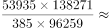
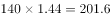

# 现期倍数计算（人均值×基数跨表拼合GDP总量后求两期倍数）

考点：[[20-考点/资料分析/倍数/现期倍数计算（人均值×基数跨表拼合GDP总量后求两期倍数）|倍数 / 现期倍数计算（人均值×基数跨表拼合GDP总量后求两期倍数）]]
材料：[[15-材料/资料分析/264841 以'改革开放之初五年（1978-19|264841 以'改革开放之初五年（1978-19]]

**问法模型**：题干问'2016年GDP约是1978年GDP的多少倍'，而GDP总量两表均未直接给出 → 采用现期倍数模型：GDP=人均GDP×总人口，倍数=(现期人均GDP×现期人口)÷(基期人均GDP×基期人口)，并拆为'人均倍数×人口倍数'两步直除相乘

## 推理链
1. 第1步：定位表1取人均GDP——2016年为53935元，1978年为385元
2. 第2步：定位表2取年末总人口——2016年为138271万人，1978年为96259万人
3. 第3步：按GDP总量=人均GDP×总人口拼出两期GDP：2016年≈53935×138271≈74.6万亿元，1978年≈385×96259≈0.37万亿元（元×万人=万元，再÷10000换亿元）
4. 第4步：列倍数公式=(53935×138271)÷(385×96259)，拆成(53935÷385)×(138271÷96259)避免大数相乘
5. 第5步：截位直除——53935÷385≈140.1，138271÷96259≈1.44
6. 第6步：相乘得140.1×1.44≈201.3，与选项D(201)最接近，故选D

**最快解法**：⚡ 因子拆分法+截位直除：所求倍数=(53935/385)×(138271/96259)，先算人均倍数53935÷385≈140，再算人口倍数138271÷96259≈1.44，两者相乘140×1.44≈202，对应D项201；切勿先做74.6万亿÷0.37万亿的大数运算

## 易错点
- ⚠ GDP总量在两张表中均未给出，须跨表用'人均GDP×年末总人口'拼接，只看表1会把人均GDP倍数≈140（即A项）误当GDP倍数——A项正是此陷阱
- ⚠ 单位口径：元×万人=万元，两期GDP量级分别为74.6万亿元与0.37万亿元，换算÷10000时量级跨度大极易出错；且表2人口为年末时点数，与按年平均人口计算的人均GDP口径并非严格对应，属命题默认近似，不必纠结
- ⚠ 表1、表2均为左右双栏结构（1978-1982在左、2012-2016在右），取数时勿看串栏：1978年取左栏首行(385元、96259万人)，2016年取右栏末行(53935元、138271万人)

## 母题抽象
> 🧩 当题干求某总量(A与B)的倍数/比值，而材料只给'平均值+基数'两要素时，用'总量=平均值×基数'分别拼出分子分母，再拆成'平均值之比×基数之比'分步截位直除后相乘，验证与哪个选项最接近

**同类特征**：'2016年GDP约是1978年GDP的多少倍'——两期均为材料当期值的现期倍数问法、所求指标GDP总量未在任一表中直接给出，须跨表拼接（人均GDP×总人口）、选项间距较宽且包含干扰项140（仅人均倍数）、数据源跨表1与表2，是全材料唯一的跨表综合题、倍数结果约201，数值大，适合拆分相乘而非直接大数运算

## 相关题
（暂无）

---

### 题干
2016年GDP约是1978年GDP的多少倍？

### 选项
- A. 140
- B. 186
- C. 200
- D. 201　✅

### 官方解析

根据题干“2016年GDP约是1978年GDP的多少倍”，可判定本题为现期倍数计算问题。定位表1可知，2016年人均GDP为53935元，1978年为385元；定位表2可知，2016年总人口为138271万人，1978年为96259万人。GDP人均GDP总人口，则所求倍数为倍，与D项最接近。

故正确答案为D。

### 给定材料

> [!warning] 疑点（官方解析可能有误，待人工复核）
> 官方解析中公式文字有缺漏（'GDP人均GDP总人口'），应为'GDP=人均GDP×总人口'，但代入计算结果≈201与答案D一致，属排版缺字而非结论错误

<!-- CODEX-ANSWER-REVIEW:BEGIN -->
### 本次独立复核

**复核状态：** `confirmed`（独立复算确认答案）

**计分答案：** D（可计分）

**复核解析：**

按题目所给GDP和人口数据计算两国人均GDP倍数：53935×138271÷(385×96259)≈201.233，按选项取整为201倍，选D。GDP单位与人口单位在比值中分别约去，关键是保持国家、年度和单位配对不交叉。

**相关信息：**

资料分析—人均量倍数；人均GDP之比=(GDP甲/人口甲)/(GDP乙/人口乙)，同单位因子可约去。

**题源依据：** [固定版本原题](https://github.com/Mentat-Uran/kaogongzhentizhengliu/blob/84ab93d4b64b61d897bece8a1c0a5bab06b4feb2/10-%E7%9C%9F%E9%A2%98/%E8%B5%84%E6%96%99%E5%88%86%E6%9E%90/%E5%80%8D%E6%95%B0/2669886%20%E7%8E%B0%E6%9C%9F%E5%80%8D%E6%95%B0%E8%AE%A1%E7%AE%97%EF%BC%88%E4%BA%BA%E5%9D%87%E5%80%BC%C3%97%E5%9F%BA%E6%95%B0%E8%B7%A8%E8%A1%A8%E6%8B%BC%E5%90%88GDP%E6%80%BB%E9%87%8F%E5%90%8E%E6%B1%82%E4%B8%A4%E6%9C%9F%E5%80%8D%E6%95%B0%EF%BC%89.md)；固定内容 commit `84ab93d4b64b61d897bece8a1c0a5bab06b4feb2`，Markdown blob `b9c2099699656336afecbca4d0d12b4d5ab406b5`。
<!-- CODEX-ANSWER-REVIEW:END -->
