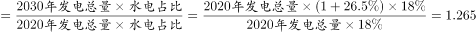
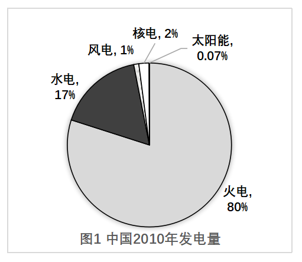
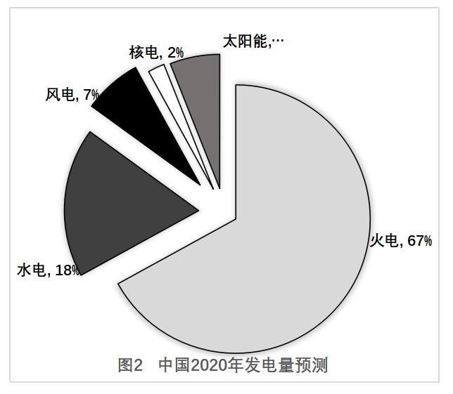

# 现期倍数计算（比重不变型：部分量倍数=1+总量增速）

考点：[[20-考点/资料分析/倍数/现期倍数计算（比重不变型：部分量倍数=1+总量增速）|倍数 / 现期倍数计算（比重不变型：部分量倍数=1+总量增速）]]
材料：[[15-材料/资料分析/264846 中国发电量的电源结构：图1为2010|264846 中国发电量的电源结构：图1为2010]]

**问法模型**：题干为'2030年总量比2020年提高（给定增速）、水电占比不变，求2030年水电约为2020年的几倍'→占比不变时部分量之比等于总量之比，倍数=1+增速，比重18%整体约去，无需任何比重或总量数值

## 推理链
1. 第1步：从题干提取两个条件——2030年发电量总量比2020年提高（增速数值在题干文本中脱漏，由官方答案1.3对应为提高30%），且水电发电量占比不变
2. 第2步：定位图2，2020年水电占比为18%；'占比不变'即2030年水电占比仍按18%计
3. 第3步：所求倍数=2030年水电÷2020年水电=(2030总量×18%)÷(2020总量×18%)，分子分母中的18%整体约去，倍数=2030总量÷2020总量
4. 第4步：由题干总量关系，2030总量÷2020总量=1+增速=1+30%=1.3
5. 第5步：与选项对照，1.3即B项，与官方解析'与B项最接近'一致，故选B

**最快解法**：⚡ 公式法（比重约分/等比缩放）：占比不变⇒部分量倍数=总量倍数=1+增速，增速30%⇒直接得1.3锁定B；全程不需要图1、图2中任何比重数值，更不需要用6867÷17%反推总量

## 易错点
- ⚠ 以为必须用比重18%分别算出两年水电量再相除，绕远路甚至误用2010年水电17%或反推总量（6867÷17%≈40394亿兆瓦时），实际比重可整体约去，18%只是干扰信息
- ⚠ 混淆'倍数'与'增长率'：答案是1+30%=1.3倍而非30%，漏加基数1即出错；也不能用比重变化（如风电+6个百分点、火电-13个百分点）参与倍数计算
- ⚠ 时间口径陷阱：材料只有2010年实际与2020年预测两个时点，2030年为题干纯假设，切勿到图中找2030年比重，也与兄弟题'核电两年均为2%'的数据巧合无关

## 母题抽象
> 🧩 当题干出现'某部分占比（比重）不变，总量提高/增长x%，求该部分约为原来的几倍'时，用比重约分法：部分量倍数=总量倍数=1+x%，一步锁定选项，无需代入任何比重或绝对量

**同类特征**：假设2030年（材料外年份的假设条件题）、总量比2020年提高（给定增速）、水电发电量占比不变、约为2020年的（ ）倍、现期倍数计算、比重可整体约去

## 相关题
- [[10-真题/资料分析/倍数/2616148 现期倍数计算|2616148]]（海南 2020，相关度1）
- [[10-真题/资料分析/倍数/2274541 现期倍数计算（分母为跨期五年年平均值）|2274541]]（北京 2019，相关度1）

---

### 题干

假设中国2030年发电量总量将比2020年提高，水电发电量占比不变，则2030年水电发电量将约为2020年的（    ）倍。

### 选项
- A. 1.1
- B. 1.3　✅
- C. 2.1
- D. 2.3

### 官方解析

根据题干“······2030年水电发电量将约为2020年的多少倍”，可判定本题为现期倍数计算问题。由题干可知，与2020年相比，2030年发电总量提高；水电发电量占比不变，定位图2可知占比为。则所求倍数倍，与B项最接近。

故正确答案为B。

### 给定材料

> [!warning] 疑点（官方解析可能有误，待人工复核）
> 题干'比2020年提高'后的增速数值与官方解析中'占比为__''所求倍数__倍'处的数值均脱漏（疑为原卷排版丢失）；按官方答案B=1.3反推，增速应为30%、图2水电占比18%，倍数=1+30%=1.3，与答案一致，不影响结论

<!-- CODEX-ANSWER-REVIEW:BEGIN -->
### 本次独立复核

**复核状态：** `resolved`（答案与解析已核定）

**计分答案：** B（可计分）

**复核解析：**

水电发电量=发电总量×水电占比。占比保持18%时，水电量倍数等于总发电量倍数。原公式图给总发电量提高26.5%，故倍数=1+26.5%=1.265，约1.3，选B。原疑点以答案选项反推增长率为30%不成立，图中给出的原始增幅是26.5%。

**相关信息：**

“提高26.5%”对应现期/基期=1.265；固定比重乘数约去。

**题源依据：** [固定版本原题](https://github.com/Mentat-Uran/kaogongzhentizhengliu/blob/84ab93d4b64b61d897bece8a1c0a5bab06b4feb2/10-%E7%9C%9F%E9%A2%98/%E8%B5%84%E6%96%99%E5%88%86%E6%9E%90/%E5%80%8D%E6%95%B0/2670137%20%E7%8E%B0%E6%9C%9F%E5%80%8D%E6%95%B0%E8%AE%A1%E7%AE%97%EF%BC%88%E6%AF%94%E9%87%8D%E4%B8%8D%E5%8F%98%E5%9E%8B%EF%BC%9A%E9%83%A8%E5%88%86%E9%87%8F%E5%80%8D%E6%95%B0%3D1%2B%E6%80%BB%E9%87%8F%E5%A2%9E%E9%80%9F%EF%BC%89.md)；固定内容 commit `84ab93d4b64b61d897bece8a1c0a5bab06b4feb2`，Markdown blob `d69975002249b76e7310142dc9545df5f887fad7`。
<!-- CODEX-ANSWER-REVIEW:END -->
