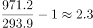

# 现期倍数（'比…多几倍'=(A−B)-B型）

考点：[[20-考点/资料分析/倍数/现期倍数（'比…多几倍'=(A−B)-B型）|倍数 / 现期倍数（'比…多几倍'=(A−B)/B型）]]
材料：[[15-材料/资料分析/265237 2017年我国文化产品和文化服务进出|265237 2017年我国文化产品和文化服务进出]]

**问法模型**：题干出现'A比B多约（几倍）'→ 用(A−B)/B即A/B−1计算，而非直接A/B；本题即(971.2−293.9)/293.9

## 推理链
1. 第1步：从材料第一段提取两个口径的现期量：2017年文化产品进出口总额971.2亿美元、文化服务进出口总额293.9亿美元（校验：971.2+293.9=1265.1，与进出口总额吻合，确认未读串口径）
2. 第2步：题干问'比…多约'几倍，所用公式为 多倍数=(A−B)/B=A/B−1，其中A=971.2、B=293.9（'比'字后的文化服务额作分母）
3. 第3步：代入计算：971.2−293.9=677.3，677.3÷293.9≈2.30；或先算971.2÷293.9≈3.30，再减1得2.30
4. 第4步：与选项对照：2.30最接近A项2.3倍；C项3.3恰为A/B（'是几倍'）的干扰值，验证'多'需减1，故选A

**最快解法**：⚡ 选项成对排除法+截位直除：题干'比…多'→结果应比A/B小1；截位算971.2/293.9≈3.3（即C项），减1得2.3→锁定A；或直接677.3/294≈2.3

## 易错点
- ⚠ '比…多几倍'与'是…几倍'混淆：误算971.2/293.9≈3.3倍而错选C（选项C/D即为此陷阱成对设计），'多'必须减1
- ⚠ 分母口径放错：应以防'比'字后对象293.9（文化服务进出口）为分母，勿误用总额1265.1或出口额881.9/61.7
- ⚠ 口径读串：971.2=出口881.9+进口89.3（文化产品），293.9=进口232.2+出口61.7（文化服务），须用'进出口总额'口径而非单项出口额

## 母题抽象
> 🧩 当题干出现'A比B多（约）几倍'特征时，用(A−B)/B即A/B−1计算，并利用选项中'是几倍'与'多几倍'成对出现（如3.3与2.3）的设计反向校验方向

**同类特征**：比…多约、现期倍数、两个分块总额对比、971.2与293.9同量级减法、选项成对设置2.3/3.3、2017年现期直接取数

## 相关题
- [[10-真题/资料分析/倍数/10204451 现期倍数计算（部分与部分之和的倍数）|10204451]]（广东 2024，相关度1）
- [[10-真题/资料分析/倍数/10297461 现期倍数计算（含'二季度=上半年-一季度'时段拆分推算）|10297461]]（四川 2025，相关度1）
- [[10-真题/资料分析/倍数/1797608 现期倍数计算+加总排序定位|1797608]]（山东 2016，相关度1）
- [[10-真题/资料分析/倍数/2024182 现期倍数（两分项净增量之比）|2024182]]（重庆 2016，相关度1）
- [[10-真题/资料分析/倍数/2042820 现期倍数计算（同一子总体内占比相除）|2042820]]（江苏 2017，相关度1）

---

### 题干
2017年我国文化产品进出口总额比文化服务进出口总额多约：

### 选项
- A. 2.3倍　✅
- B. 2.4倍
- C. 3.3倍
- D. 3.4倍

### 官方解析

根据题干“文化产品进出口总额比文化服务进出口总额多约”，结合选项，可判定本题为现期倍数问题。定位文字材料第一段，文化产品进出口总额971.2亿美元，同比增长。文化服务进出口总额293.9亿美元，同比增长。故所求倍数为倍。

故正确答案为A。

### 给定材料

        2017年，我国文化产品和服务进出口总额1265.1亿美元，同比增长。其中，文化产品进出口总额971.2亿美元，同比增长。文化服务进出口总额293.9亿美元，同比增长。

        文化产品方面，出口881.9亿美元，同比增长；进口89.3亿美元，同比下降。出口的技术含量有所提升，具有较高附加值的游艺器材和娱乐用品、广播电影电视设备出口同比增长，占比提升2个百分点至。美国、中国香港、荷兰、英国和日本为中国文化产品进出口前五大市场，进出口额合计占比为。这样比较上年下降1.8个百分点。我国与“一带一路”沿线国家进出口额达到176.2亿美元，同比增长，占比提高1.2个百分点至；与金砖国家进出口额43亿美元，同比增长。

        文化服务方面，进口232.2亿美元，同比增长。其中视听及相关产品许可费、著作权等研发成果使用费进口分别同比增长和。出口61.7亿美元，同比下降；其中处于核心层的文化和娱乐服务、研发成果、使用费、视听及相关产品许可费等三项服务出口15.4亿美元，同比增长，占比增提升5.7个百分点至。

> [!warning] 疑点（官方解析可能有误，待人工复核）
> 官方解析'故所求倍数为倍'处数值空缺（与材料原文增速空缺属同版断文问题），但按(971.2−293.9)/293.9≈2.3倍计算与官方答案A一致，不影响作答
