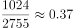
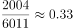
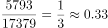
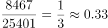

# 倍数比值比较（基数上限÷上年社平工资的逐年一致性比较）

考点：[[20-考点/资料分析/倍数/倍数比值比较（基数上限÷上年社平工资的逐年一致性比较）|倍数 / 倍数比值比较（基数上限÷上年社平工资的逐年一致性比较）]]
材料：[[15-材料/资料分析/267195 以B市为例介绍社会保险制度背景（缴费|267195 以B市为例介绍社会保险制度背景（缴费]]

**问法模型**：题干给出'基数上限与上年社平工资比值相对固定'的设定，问哪个年份与其他年份差别最大 → 逐年计算比值（上限÷上年社平工资），以约3.0为基准找偏离项

## 推理链
1. 第1步：从表格同一行提取'社保缴费基数上限'与'本市上年社会平均工资'两列数据：1999年为2755与1024，2004年为6011与2004，2014年为17397与5793，2019年为25401与8467
2. 第2步：确定模型：比值=缴费基数上限÷上年社平工资，题干明示该比值各年相对固定，故只需找偏离固定值最远的年份
3. 第3步：代入计算：1999年2755÷1024≈2.69；2004年6011÷2004≈3.00；2014年17397÷5793≈3.00（5793×3=17379，仅差18）；2019年25401÷8467=3.00（8467×3=25401恰好整除）
4. 第4步：对照结论：2004、2014、2019三年比值均约等于3.0，仅1999年约2.69，明显低于基准约0.31，偏离最大，故选A（1999年）

**最快解法**：⚡ 基准倍数验证法（整除判断）：先由多数年份锁定基准'上限≈上年社平×3'，再用分母×3对照分子——2019年8467×3=25401精确吻合、2004年2004×3=6012≈6011、2014年5793×3=17379≈17397（差18），而1999年1024×3=3072与2755相差317，仅1999年严重偏离3倍，秒选A

## 易错点
- ⚠ '本市上年社会平均工资'为滞后一年口径，必须与同一行的基数上限相除，不能错配相邻年份或误解为当年社平工资
- ⚠ 计算时须用'缴费基数上限'列，勿与养老/工伤/医疗生育的'基数下限'列混淆（下限比值明显不是3倍量级）
- ⚠ 比较口径争议：应按'下列选项中'仅在四个选项年份内比较偏离度（官方备注已确认此口径），若误将1994、2009年（比值均为3.0）纳入比较不改变结论，但会增加计算量

## 母题抽象
> 🧩 当题干出现'某比值相对固定/比值大体一致，问哪一年与其他年份差别最大'时，先用多数年份算出固定基准（本题为3倍），再用'分母×基准≈分子'的整除/接近度逐一验证，偏离最远者即答案

**同类特征**：比值相对固定、与其他年份差别最大、上一年社会平均工资、缴费基数上限、下列选项中、逐年比值比较

## 相关题
（暂无）

---

### 题干
一般来说，社保管理部门会根据当地上一年社会平均工资来确定当年的社保缴费基数上限，两者比值相对固定。下列选项中，B市这一比值与其他年份差别最大的是（    ）。

### 选项
- A. 1999年　✅
- B. 2004年
- C. 2014年
- D. 2019年

### 官方解析

根据题干“······B市这一比值与其他年份差别最大的是”，可判定本题为比值比较问题。定位表格可知，B市历年的社会平均工资和社保缴费基数上限，则各选项两者比值如下：1999年：，2004年：，2014年：，2019年：。因此B市这一比值与其他年份差别最大的是1999年。

故正确答案为A。

【备注】本题对于题干的理解存在争议点：比值比较的年份是仅选项涉及的四个年份进行比较，还是与表中所有年份进行比较。小粉笔根据题干中“下列选项中······”，倾向于按照选项四个年份进行比较。

### 给定材料

        社会保险包括了养老保险，工伤保险，医疗生育保险等，是社会保障体系的重要组成部分。其在整个社会保障体系中居于核心地位，社会保险是一种缴费型的社会保障，资金主要由用人单位和劳动者缴纳（一般而言，各类社会保险的缴纳费用缴费基数缴纳比例），政府财政给予补贴并承担最终责任。

        在经历了一段时间的摸索后，我国的社会保障制度在上世纪90年代进入了创新式的改革、发展时期。1995年3月1日，国务院发出《关于深化企业职工养老保险制度改革的通知》，确定了社会统筹与个人账户相结合的养老保险制度，职工基本养老保险制度在全国范围内正式实行统账结合模式。

        近年来，随着我国经济发展出现一系列新形式新情况，企业对进一步降低社保费率的呼声较强，党中央、国务院提出新的要求。2019年《政府工作报告》明确提出，各地可将养老保险单位缴费比例降至。2019年，B市率先降低养老保险单位缴费比例。预计今后每年可减轻该市企业社保费缴费负担超百亿元。

> [!warning] 疑点（官方解析可能有误，待人工复核）
> 官方解析中各年份比值的算式处为空白（仅列出'1999年：，2004年：…'未给出数值），需自行补算；另按官方备注，比较范围存在'仅四个选项年份'与'表中全部年份'两种理解，本题按选项内比较且两种口径结论一致（均为1999年）

<!-- CODEX-ANSWER-REVIEW:BEGIN -->
### 本次独立复核

**复核状态：** `resolved`（答案与解析已核定）

**计分答案：** A（可计分）

**复核解析：**

B市1999年上年社平工资为1024元/月，缴费基数上限2755元/月，比值2755÷1024≈2.69。其余所列年份：2004年6011÷2004≈3.00，2014年17379÷5793≈3.00，2019年25401÷8467≈3.00；表中其他年份也约为3.00。因此1999年偏离最大，选A。

**相关信息：**

比值按“当年缴费基数上限÷上年社会平均工资”计算；表中多年份校验显示基准约为3，1999年约2.69。

**题源依据：** [固定版本原题](https://github.com/Mentat-Uran/kaogongzhentizhengliu/blob/84ab93d4b64b61d897bece8a1c0a5bab06b4feb2/10-%E7%9C%9F%E9%A2%98/%E8%B5%84%E6%96%99%E5%88%86%E6%9E%90/%E5%80%8D%E6%95%B0/2696535%20%E5%80%8D%E6%95%B0%E6%AF%94%E5%80%BC%E6%AF%94%E8%BE%83%EF%BC%88%E5%9F%BA%E6%95%B0%E4%B8%8A%E9%99%90%C3%B7%E4%B8%8A%E5%B9%B4%E7%A4%BE%E5%B9%B3%E5%B7%A5%E8%B5%84%E7%9A%84%E9%80%90%E5%B9%B4%E4%B8%80%E8%87%B4%E6%80%A7%E6%AF%94%E8%BE%83%EF%BC%89.md)；固定内容 commit `84ab93d4b64b61d897bece8a1c0a5bab06b4feb2`，Markdown blob `cd75068174214abea88bc35766d5563bdfe37c99`。
<!-- CODEX-ANSWER-REVIEW:END -->
