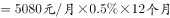
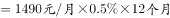
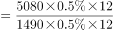
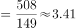

# 现期倍数计算（比例恒定时系数约去）

考点：[[20-考点/资料分析/倍数/现期倍数计算（比例恒定时系数约去）|倍数 / 现期倍数计算（比例恒定时系数约去）]]
材料：[[15-材料/资料分析/267195 以B市为例介绍社会保险制度背景（缴费|267195 以B市为例介绍社会保险制度背景（缴费]]

**问法模型**：题干出现'2019年…约为10年前的…倍'→ 现期倍数 = 2019年缴费额 ÷ 2009年缴费额 = (现期基数×比例)÷(基期基数×比例)，恒定比例直接约去，只比基数

## 推理链
1. 第1步：从题干提取时间锚点——现期2019年，'10年前'即2009年；缴费主体为工伤基数下限，比例恒定且职工个人不缴
2. 第2步：定位表格'工伤基数下限(元/月)'列：2009年为1490元/月，2019年为5080元/月（注意2019年工伤下限与医疗生育下限同为5080，与养老下限3387口径不同）
3. 第3步：套用文字材料核心公式'缴纳费用=缴费基数×缴纳比例'，倍数=(5080×r)÷(1490×r)，比例r分子分母约去
4. 第4步：代入计算：5080÷1490≈3.41（截位直除：1490×3=4470，1490×3.4=5066，1490×3.41≈5081）
5. 第5步：与选项对照：A.1.46(=5080/3476，误用2014年)、B.2.27(=3387/1490，误用养老下限)、C.3.41、D.4.23(=5080/1202，误用医疗生育下限)，故选C

**最快解法**：⚡ 系数约去+截位直除：缴费比例恒定则分子分母直接消去，倍数=5080÷1490，直除首位商3，次位验证3.41×1490≈5081，锁定C；全程无需知道比例具体数值，也不需×12换年

## 易错点
- ⚠ 跨险种张冠李戴：2019年养老下限3387、工伤下限5080、医疗生育下限5080三列并列，误用养老列得3387÷1490≈2.27（恰为B选项陷阱），误用医疗生育口径则可能错配其他选项
- ⚠ 时间锚定错误：'10年前'从2019年应推至2009年（1490），若误推至2014年（3476）得5080÷3476≈1.46（恰为A选项陷阱）
- ⚠ 题干比例数值空缺误判为条件不足而弃做——实际上比例恒定时倍数计算中完全约去，且是否×12折算全年也同样约去，均不影响结果

## 母题抽象
> 🧩 当题干出现'A年某缴费额/支出额是N年前…倍'且缴纳比例（或单价、单耗等系数）两期恒定时，系数直接约去，倍数=两期对应基数之比，用截位直除快速验证；同时先确认所问险种/指标列，防跨列误读

**同类特征**：约为…倍、10年前、缴费比例一直为、按基数下限缴纳、工伤保险、职工个人不缴纳

## 相关题
（暂无）

---

### 题干

根据行业的风险性质不同，工伤保险缴费的比例也不同。假如B市某企业所属行业类别的工伤保险缴费比例一直为（职工个人不缴纳工伤保险费用），在按照工伤基数下限为其员工缴纳工伤保险的情况下，2019年每名员工缴纳的工伤保险金额约为10年前的（    ）倍。

### 选项
- A. 1.46
- B. 2.27
- C. 3.41　✅
- D. 4.23

### 官方解析

根据题干“······2019年······约为10年前······倍”，可判定本题为现期倍数问题。定位表格可知，B市2009年工伤基数下限为1490元/月，2019年工伤基数下限为5080元/月；由题干可知，工伤保险缴费比例一直为。根据文字材料第一段：各类社会保险的缴纳费用缴费基数缴纳比例，可得2019年每名员工缴纳的工伤保险金额，2009年每名员工缴纳的工伤保险金额，因此题干所求倍。

故正确答案为C。

### 给定材料

        社会保险包括了养老保险，工伤保险，医疗生育保险等，是社会保障体系的重要组成部分。其在整个社会保障体系中居于核心地位，社会保险是一种缴费型的社会保障，资金主要由用人单位和劳动者缴纳（一般而言，各类社会保险的缴纳费用缴费基数缴纳比例），政府财政给予补贴并承担最终责任。

        在经历了一段时间的摸索后，我国的社会保障制度在上世纪90年代进入了创新式的改革、发展时期。1995年3月1日，国务院发出《关于深化企业职工养老保险制度改革的通知》，确定了社会统筹与个人账户相结合的养老保险制度，职工基本养老保险制度在全国范围内正式实行统账结合模式。

        近年来，随着我国经济发展出现一系列新形式新情况，企业对进一步降低社保费率的呼声较强，党中央、国务院提出新的要求。2019年《政府工作报告》明确提出，各地可将养老保险单位缴费比例降至。2019年，B市率先降低养老保险单位缴费比例。预计今后每年可减轻该市企业社保费缴费负担超百亿元。

> [!warning] 疑点（官方解析可能有误，待人工复核）
> 题干中工伤保险缴费比例数值在材料与题干中均空缺（'一直为'后无数值），官方解析亦未给出该数值；但因比例在分子分母中约去，不影响计算结果，正确答案C（3.41）无误

<!-- CODEX-ANSWER-REVIEW:BEGIN -->
### 本次独立复核

**复核状态：** `confirmed`（独立复算确认答案）

**计分答案：** C（可计分）

**复核解析：**

工伤保险缴费基数下限从2009年的1490元提高到2019年的5080元，倍数为5080÷1490≈3.409，按选项精度约3.4倍，选C。题目比较的是缴费基数下限，不是缴费比例；0.5%的费率保持不变。

**相关信息：**

资料分析—倍数比较；现期量÷基期量。先确认比较对象是缴费基数下限，勿把恒定费率0.5%当作基数。

**题源依据：** [固定版本原题](https://github.com/Mentat-Uran/kaogongzhentizhengliu/blob/84ab93d4b64b61d897bece8a1c0a5bab06b4feb2/10-%E7%9C%9F%E9%A2%98/%E8%B5%84%E6%96%99%E5%88%86%E6%9E%90/%E5%80%8D%E6%95%B0/2696550%20%E7%8E%B0%E6%9C%9F%E5%80%8D%E6%95%B0%E8%AE%A1%E7%AE%97%EF%BC%88%E6%AF%94%E4%BE%8B%E6%81%92%E5%AE%9A%E6%97%B6%E7%B3%BB%E6%95%B0%E7%BA%A6%E5%8E%BB%EF%BC%89.md)；固定内容 commit `84ab93d4b64b61d897bece8a1c0a5bab06b4feb2`，Markdown blob `4f6920d8c8bfdf2c8c065ae469505bde59121eb0`。
<!-- CODEX-ANSWER-REVIEW:END -->
